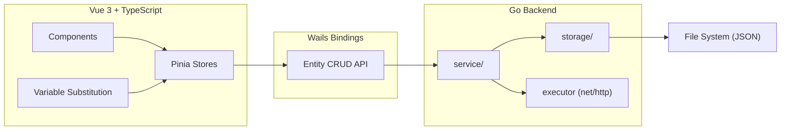
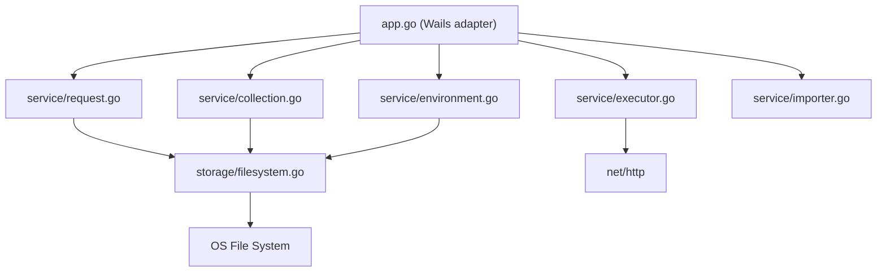

# Architecture Spine — hecto-api

## Design Paradigm

**Split-responsibility** trên ranh giới tự nhiên của Wails v2:

- **Go backend** sở hữu **data + execution**: CRUD file (collection, request, folder, environment), gửi HTTP request (`net/http`), parse import Postman, native dialogs. Không biết `{{variable}}` là gì — nhận request đã resolve, gửi, trả kết quả.
- **Vue 3 frontend** sở hữu **presentation + interaction**: render UI, form state, variable substitution (cả preview highlight lẫn resolve trước khi gửi), tab/modal/toast state. Gọi Go qua Wails bindings.
- **Wails bindings** = use-case-level API: entity-oriented CRUD, mỗi hàm một việc rõ ràng.



## Invariants & Rules

### AD-1 — Ranh giới trách nhiệm Go / Vue [ADOPTED]

- **Binds:** all
- **Prevents:** Logic trùng lặp giữa Go và Vue; không rõ ai xử lý business rule nào
- **Rule:** Go chỉ nhận dữ liệu đã resolve (URL, headers, body không còn `{{...}}`) và thực thi. Vue sở hữu toàn bộ variable substitution — cả preview (highlight xanh/đỏ) lẫn resolve trước khi gọi `SendRequest`. File trên disk luôn lưu raw template `{{...}}`.

### AD-2 — Wails binding contract: entity-oriented CRUD [ADOPTED]

- **Binds:** all bindings
- **Prevents:** Action-dispatch pattern mơ hồ; binding quá lớn, khó test
- **Rule:** Mỗi binding = một thao tác trên một entity. Tên hàm = Verb + Entity. Return type = `Result{Success, Data, Error}` thống nhất. Không có binding "catch-all" kiểu `ManageCollection(action, params)`.

### AD-3 — Structured error contract [ADOPTED]

- **Binds:** all bindings
- **Prevents:** Vue phải parse error message string để đoán loại lỗi
- **Rule:** Mọi Wails binding trả `Result` struct:
  ```
  Result { Success: bool, Data: T, Error: { Code: string, Message: string } }
  ```
  Error codes cố định: `NOT_FOUND`, `VALIDATION`, `IO_ERROR`, `PARSE_ERROR`, `CONNECTION_ERROR`, `TIMEOUT`, `ABORTED`. Vue switch theo `code` để quyết định UI treatment (toast, inline error, full-pane error state). DNS resolution failure, TLS handshake error, và redirect loop đều map vào `CONNECTION_ERROR` — Go executor phân biệt trong `Message` field, Vue không cần switch thêm.

### AD-4 — Entity identity: UUID [ADOPTED]

- **Binds:** FR-6, FR-7, FR-8
- **Prevents:** Rename/move phá vỡ reference; Vue mất active request khi user đổi tên
- **Rule:** Mọi entity (request, folder, environment) chứa UUID trong file JSON. UUID sinh bởi Go lúc create, không đổi suốt lifecycle. Filename trên disk = slug từ tên (readable, Git-friendly) nhưng không phải ID. Vue reference entity bằng UUID.

### AD-5 — Go package structure: layered [ADOPTED]

- **Binds:** Go codebase
- **Prevents:** Wails lifecycle coupling vào business logic; service untestable
- **Rule:** `app.go` = thin Wails adapter (chỉ delegate). `service/` = business logic. `storage/` = file I/O abstraction. `model/` = shared data structs. Service test được mà không cần Wails context. Storage mockable.



### AD-6 — Vue state: Pinia stores by domain [ADOPTED]

- **Binds:** Vue codebase
- **Prevents:** State phân tán trong components; prop drilling sâu
- **Rule:** 5 stores: `collectionStore` (tree + active request ref), `requestStore` (form state request đang edit), `environmentStore` (env list, active env, variables map), `responseStore` (response hiện tại), `uiStore` (tabs, modals, toasts). Store gọi Wails bindings. Components đọc store.

### AD-7 — Collection root: OS app data directory [ADOPTED]

- **Binds:** FR-6, FR-7, FR-8
- **Prevents:** Hardcode path; incompatible across OS
- **Rule:** Tách config và data theo XDG convention:
  - **App config** (window state, collection root path override): `{os.UserConfigDir()}/hecto-api/config.json` (Linux `~/.config/hecto-api/...`, macOS `~/Library/Application Support/hecto-api/...`, Windows `%APPDATA%/hecto-api/...`).
  - **Collection data**: `{dataDir}/hecto-api/collections/default/` — trong đó `dataDir` = `$XDG_DATA_HOME` nếu set (Linux), fallback `~/.local/share` (Linux), `~/Library/Application Support` (macOS), `%LOCALAPPDATA%` (Windows).
  - Go dùng `os.UserConfigDir()` cho config, custom helper hoặc thư viện cho data dir. Path stored in app config cho future multi-collection.

## Consistency Conventions

| Concern                | Convention                                                                                                                                                                              |
| ---------------------- | --------------------------------------------------------------------------------------------------------------------------------------------------------------------------------------- |
| Naming (Go)            | Package names lowercase single-word. Exported functions PascalCase. Struct fields PascalCase (serialized to `snake_case` JSON via tags).                                                |
| Naming (Vue)           | Components PascalCase. Stores camelCase (`useCollectionStore`). Files kebab-case.                                                                                                       |
| Naming (files on disk) | Request/folder files: slug from name, lowercase, hyphen-separated, `.json` extension. Vietnamese diacritics stripped in slug.                                                           |
| Data formats           | IDs: UUID v4 string. Dates: ISO 8601 (`created_at`, `updated_at`). Response time: integer milliseconds. Response size: integer bytes. No floats for metrics (product brief constraint). |
| Error shapes           | All Go→Vue: `Result{Success, Data, Error{Code, Message}}`. Error codes ALL_CAPS_SNAKE.                                                                                                  |
| State mutation         | Vue: chỉ mutate qua Pinia store actions. Không mutate state trực tiếp trong components.                                                                                                 |
| Cross-cutting: logging | Go: `log/slog` structured logging. Vue: `console.warn`/`console.error` cho dev, không ship production logs.                                                                             |
| Cross-cutting: config  | App config lưu `{os.UserConfigDir()}/hecto-api/config.json`. Collection data lưu `{dataDir}/hecto-api/collections/` (xem AD-7). Không env vars, không CLI flags cho v1.                 |
| File format            | JSON cho mọi persisted data (requests, environments, collection metadata, app config). Không YAML cho v1. UTF-8 always.                                                                 |

## Stack

| Name                 | Version                    |
| -------------------- | -------------------------- |
| Go                   | 1.27.1                     |
| Node.js              | 24.21.0                    |
| Wails                | latest                     |
| Vue                  | latest                     |
| TypeScript           | latest                     |
| Pinia                | latest                     |
| Tailwind CSS         | latest                     |
| net/http (Go stdlib) | (bundled)                  |
| Phosphor Icons       | (per DESIGN.md)            |
| Inter font           | (per DESIGN.md)            |
| JetBrains Mono font  | (per DESIGN.md)            |

## Structural Seed

```text
hecto-api/
  main.go                    # Wails bootstrap
  app.go                     # App struct, Wails bindings (thin adapter)
  model/
    types.go                 # Request, Folder, Environment, Collection, Result, AppError
  service/
    request.go               # CRUD request files
    collection.go            # CRUD collection tree, folders
    environment.go           # CRUD environments
    executor.go              # SendRequest — net/http wrapper
    importer.go              # Postman v2.1 import parser
  storage/
    filesystem.go            # File I/O: read/write/delete/list JSON files
  frontend/
    src/
      App.vue
      main.ts
      stores/
        collectionStore.ts   # Sidebar tree, active request ref
        requestStore.ts      # Form state of active request
        environmentStore.ts  # Env list, active env, variables map
        responseStore.ts     # Current response data
        uiStore.ts           # Tabs, modals, toasts
      components/
        layout/              # Header, Sidebar, MainContent
        request/             # UrlBar, KvpEditor, BodyEditor, WarningBanner
        response/            # MetaBar, JsonViewer, HeadersTable, PrettyRawToggle
        environment/         # EnvModal, EnvSelector
        common/              # Toast, EmptyState, ContextMenu
      utils/
        variables.ts         # {{...}} parse, highlight, resolve
        slug.ts              # Name → filename slug
      wailsjs/               # Auto-generated Wails TS bindings
```

### Collection on-disk structure (product brief)

```text
{collection-root}/
  collection.json              # { id, name, description, created_at, updated_at }
  environments/
    dev.json                   # { id, name, variables: [{ key: "base_url", value: "...", enabled: true }, ...] }
    staging.json
  auth/
    _folder.json               # { id, name, created_at } — folder metadata
    dang-nhap.json             # request file
    lay-thong-tin-user.json
  san-pham/
    _folder.json
    danh-sach-san-pham.json
    tao-san-pham-moi.json
```

### Request file shape (from product brief, enriched with UUID)

```json
{
  "id": "a1b2c3d4-e5f6-...",
  "name": "Đăng nhập",
  "method": "POST",
  "url": "{{base_url}}/api/v1/auth/login",
  "headers": [
    { "key": "Content-Type", "value": "application/json", "enabled": true }
  ],
  "params": [],
  "body": {
    "type": "json",
    "content": "{\"username\": \"admin\"}"
  },
  "created_at": "2026-09-22T14:00:00+07:00",
  "updated_at": "2026-09-22T14:30:00+07:00"
}
```

## Capability → Architecture Map

| Capability / FR             | Lives in                                                  | Governed by         |
| --------------------------- | --------------------------------------------------------- | ------------------- |
| FR-1 Send HTTP request      | `service/executor.go` → `net/http`                        | AD-1 (Go execution) |
| FR-2 Manage Headers         | `requestStore.ts` (form) + `service/request.go` (persist) | AD-1, AD-2          |
| FR-3 Manage Query Params    | `requestStore.ts` + `service/request.go`                  | AD-1, AD-2          |
| FR-4 Manage Body            | `requestStore.ts` + `service/request.go`                  | AD-1, AD-2          |
| FR-5 Display Response       | `responseStore.ts` + response components                  | AD-1, AD-3          |
| FR-6 Default Collection     | `service/collection.go` + `collectionStore.ts`            | AD-4, AD-7          |
| FR-7 Folders                | `service/collection.go` + `collectionStore.ts`            | AD-4, AD-5          |
| FR-8 Request CRUD           | `service/request.go` + `requestStore.ts`                  | AD-2, AD-4          |
| FR-9 Sidebar navigation     | `collectionStore.ts` + Sidebar component                  | AD-6                |
| FR-10 Environment CRUD      | `service/environment.go` + `environmentStore.ts`          | AD-2, AD-4          |
| FR-11 Switch Environment    | `environmentStore.ts`                                     | AD-1, AD-6          |
| FR-12 Variable substitution | `utils/variables.ts`                                      | AD-1                |
| FR-13 Import Postman        | `service/importer.go`                                     | AD-2, AD-3          |

## Deferred

| Decision                         | Why it can wait                                                                                                                       |
| -------------------------------- | ------------------------------------------------------------------------------------------------------------------------------------- |
| Multi-collection UI              | Storage design already supports it (each collection = separate root folder). v1 hardcodes default. Add collection picker when needed. |
| File watcher (external changes)  | v1 loads from disk on startup. Hot reload when files change externally is v2+ — no architectural impact, add fs.Notify later.         |
| Drag-and-drop reorder            | UX explicitly deferred to v2+. No architectural impact.                                                                               |
| Request tabs (multi-tab editing) | v1 = one request open at a time. Multi-tab changes `requestStore` to array but doesn't affect Go.                                     |
| Configurable timeout             | v1 = infinite (OS-level). Adding timeout = one field on executor config.                                                              |
| Form-data / multipart body       | v1 = raw JSON/Text only. Adding form-data = new body type + multipart encoding in executor.                                           |
| XML body type                    | v1 = JSON/Text only. XML deferred v2+. Thêm XML = new body type + Content-Type mapping.                                               |
| YAML request format              | v1 = JSON only. Adding YAML = storage layer codec swap, transparent to service/Vue.                                                   |
| Auto-complete in body editor     | v1 = plain textarea. Adding CodeMirror/Monaco = component swap, doesn't affect stores or Go.                                          |
| Keyboard shortcut system         | UX defines shortcuts. Implementation = Vue composable `useKeyboard`. No architectural impact.                                         |
| i18n                             | v1 = Vietnamese only. Adding i18n = Vue i18n plugin, string extraction. No Go impact.                                                 |
