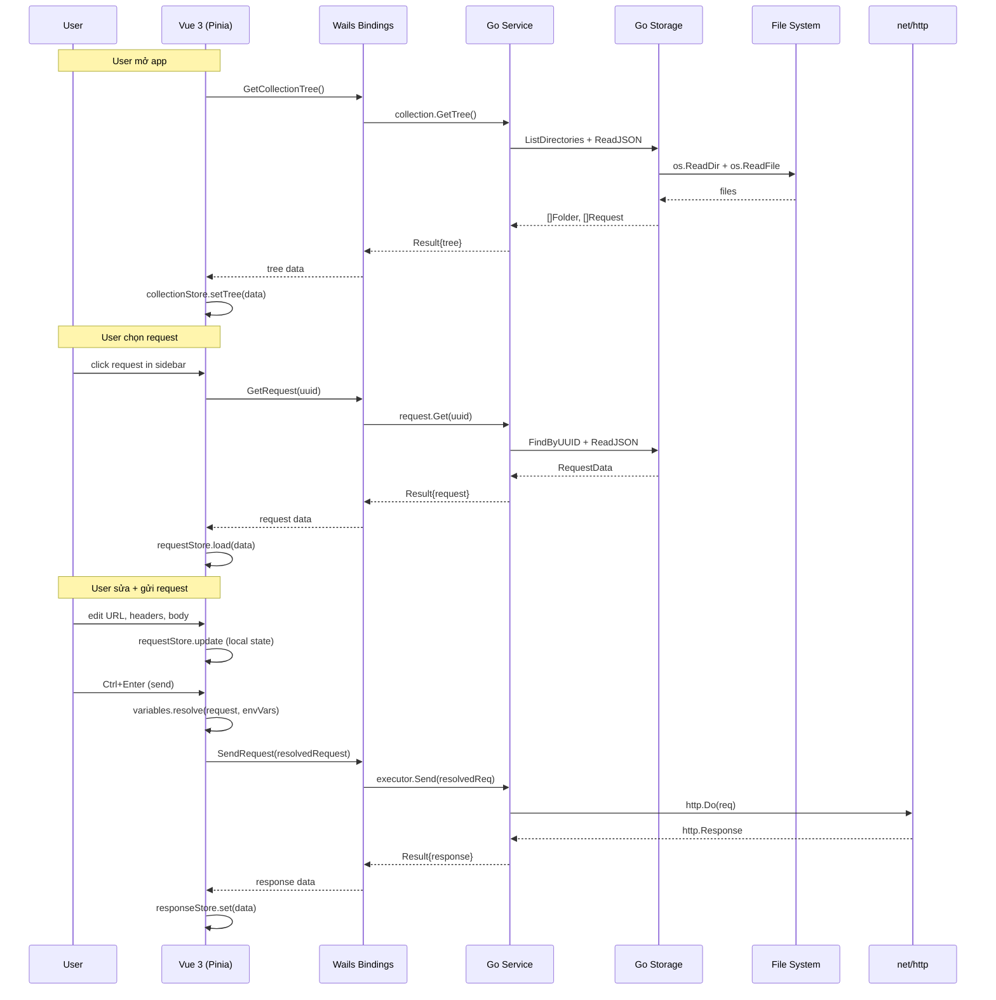
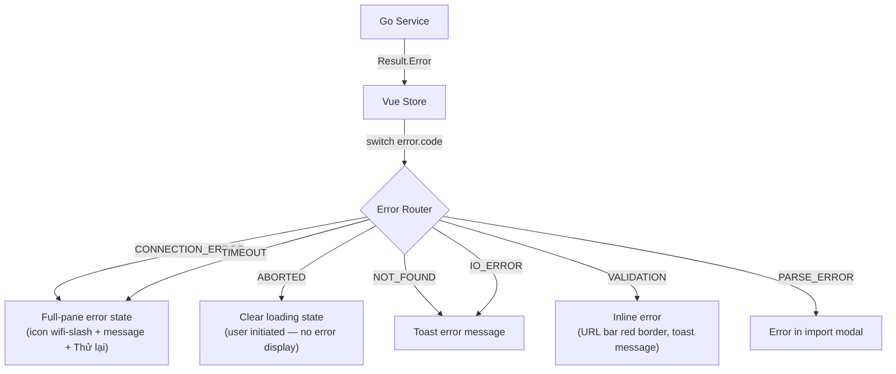
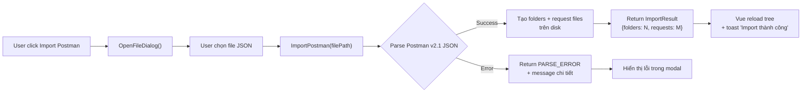

# Solution Design — hecto-api v1

> Tài liệu tham khảo chi tiết khi implementation. Paired with `ARCHITECTURE-SPINE.md` (terse build contract).
> Audience: tanmac (sole developer). Language: Vietnamese + English technical terms.

---

## 1. Tổng quan kiến trúc

Kiến trúc tổng quan và design paradigm: xem [ARCHITECTURE-SPINE.md](file:///home/dev/mdt/hecto-api/_bmad-output/planning-artifacts/architecture/architecture-hecto-api-2026-09-22/ARCHITECTURE-SPINE.md) §Design Paradigm. Dưới đây là luồng dữ liệu chính.

### Luồng dữ liệu chính



---

## 2. Go Backend — Chi tiết

### 2.1 App struct (app.go)

```go
type App struct {
    ctx              context.Context
    collectionSvc    *service.CollectionService
    requestSvc       *service.RequestService
    environmentSvc   *service.EnvironmentService
    executor         *service.Executor
    importer         *service.Importer
}
```

`App` là Wails entry point. Constructor inject các service. Mỗi method trên `App` = một Wails binding, chỉ delegate xuống service tương ứng.

### 2.2 Model types (model/types.go)

```go
// --- Result contract ---
// Wails v2 bindings không hỗ trợ Go generics — binding generator
// chỉ nhận concrete types. Dùng interface{} cho Data, Vue cast
// dựa trên binding nào đã gọi (mỗi binding biết return type).
type Result struct {
    Success bool        `json:"success"`
    Data    interface{} `json:"data,omitempty"`
    Error   *AppError   `json:"error,omitempty"`
}

type AppError struct {
    Code    string `json:"code"`
    Message string `json:"message"`
}

// Error codes
const (
    ErrNotFound       = "NOT_FOUND"
    ErrValidation     = "VALIDATION"
    ErrIOError        = "IO_ERROR"
    ErrParseError     = "PARSE_ERROR"
    ErrConnectionError = "CONNECTION_ERROR"  // bao gồm DNS, TLS, redirect loop
    ErrTimeout        = "TIMEOUT"
    ErrAborted        = "ABORTED"
)

// --- Domain entities ---
type Request struct {
    ID      string   `json:"id"`
    Name    string   `json:"name"`
    Method  string   `json:"method"`
    URL     string   `json:"url"`
    Headers []KVPair `json:"headers"`
    Params  []KVPair `json:"params"`
    Body    Body     `json:"body"`
    CreatedAt string   `json:"created_at"`
    UpdatedAt string   `json:"updated_at"`
}

type KVPair struct {
    Key     string `json:"key"`
    Value   string `json:"value"`
    Enabled bool   `json:"enabled"`
}

type Body struct {
    Type    string `json:"type"`    // "none", "json", "text" (XML deferred v2+)
    Content string `json:"content"`
}

type Folder struct {
    ID                   string                          `json:"id"`
    Name                 string                          `json:"name"`
    Path                 string                          `json:"path"`     // relative path from collection root
    Variables            []KVPair                        `json:"variables"` // Biến áp dụng chung cho mọi env
    EnvironmentOverrides map[string][]KVPair             `json:"environment_overrides"` // Biến override theo Env ID
    Requests             []Request                       `json:"requests"`
    Folders              []Folder                        `json:"folders"`  // nested
    CreatedAt            string                          `json:"created_at"`
}

type Environment struct {
    ID        string   `json:"id"`
    Name      string   `json:"name"`
    Variables []KVPair `json:"variables"`  // có thứ tự, enabled flag
    CreatedAt string   `json:"created_at"`
    UpdatedAt string   `json:"updated_at"`
}

type Collection struct {
    ID          string `json:"id"`
    Name        string `json:"name"`
    Description string `json:"description"`
    CreatedAt   string `json:"created_at"`
    UpdatedAt   string `json:"updated_at"`
}

// --- HTTP execution ---
// Vue đã resolve biến, filter enabled headers, và nối query params vào URL.
// Go nhận dữ liệu đã sẵn sàng, chỉ cần gửi. Go KHÔNG encode lại —
// Vue là single encoding point (encodeURIComponent cho params).
type ExecuteRequest struct {
    Method  string   `json:"method"`
    URL     string   `json:"url"`      // đã resolve + kèm query params
    Headers []KVPair `json:"headers"`  // tất cả đã enabled, Go không cần filter lại; duplicate keys OK (valid HTTP)
    Body    string   `json:"body"`     // đã resolve biến
}

type ExecuteResponse struct {
    StatusCode int                  `json:"status_code"`
    StatusText string               `json:"status_text"`
    Headers    map[string][]string  `json:"headers"`  // cho phép duplicate keys (ví dụ Set-Cookie)
    Body       string               `json:"body"`
    TimeMs     int                  `json:"time_ms"`
    SizeBytes  int                  `json:"size_bytes"`
    Timestamp  string               `json:"timestamp"`
}
```

### 2.3 Wails bindings — Danh sách đầy đủ

| Binding | Input | Output | Ghi chú |
|---------|-------|--------|---------|
| `GetCollectionTree()` | — | `Result{[]Folder}` | Load toàn bộ tree từ disk |
| `GetRequest(id)` | UUID string | `Result{Request}` | Load 1 request by UUID |
| `SaveRequest(data)` | Request | `Result{Request}` | Upsert by UUID. Rename chỉ cập nhật `name` trong JSON, filename giữ nguyên |
| `DeleteRequest(id)` | UUID string | `Result{}` | Xóa file trên disk |
| `DuplicateRequest(id)` | UUID string | `Result{Request}` | Clone với UUID mới + tên "(Copy)" + `created_at`/`updated_at` mới |
| `MoveRequest(id, targetFolderId)` | 2 UUID strings | `Result{}` | Di chuyển file giữa folders. No-op nếu source = target folder |
| `CreateFolder(parentId, name)` | UUID + string | `Result{Folder}` | Tạo folder trên disk, sinh UUID |
| `RenameFolder(id, name)` | UUID + string | `Result{Folder}` | Chỉ cập nhật `name` trong `_folder.json`, directory name giữ nguyên |
| `DeleteFolder(id)` | UUID string | `Result{}` | Xóa recursive (folder + tất cả nội dung). Vue clear active request nếu nằm trong |
| `ListEnvironments()` | — | `Result{[]Environment}` | Danh sách env files |
| `GetEnvironment(id)` | UUID string | `Result{Environment}` | Load 1 env |
| `SaveEnvironment(data)` | Environment | `Result{Environment}` | Upsert env |
| `DeleteEnvironment(id)` | UUID string | `Result{}` | Xóa env file |
| `SendRequest(data)` | ExecuteRequest | `Result{ExecuteResponse}` | Gửi HTTP, đo time, trả response |
| `AbortRequest()` | — | `Result{}` | Cancel request đang gửi (context cancel) |
| `ImportPostman(filePath)` | string | `Result{ImportResult}` | Parse + tạo files |
| `OpenFileDialog()` | — | `Result{string}` | Native file picker, trả path |
| `GetAppConfig()` | — | `Result{AppConfig}` | Collection root path, window state |

### 2.4 Service layer — Executor chi tiết

```go
// service/executor.go
type Executor struct {
    client    *http.Client
    mu        sync.Mutex           // bảo vệ cancelFn khỏi race condition
    cancelFn  context.CancelFunc   // để abort request
    inflight  bool                 // true khi đang có request in-flight
}

const MaxResponseBodySize = 10 * 1024 * 1024  // 10 MB — tránh OOM

func (e *Executor) Send(ctx context.Context, req model.ExecuteRequest) model.Result {
    e.mu.Lock()
    if e.inflight {
        e.mu.Unlock()
        return model.Result{Success: false, Error: &model.AppError{Code: ErrValidation, Message: "Request đang được gửi"}}
    }
    e.inflight = true
    ctx, e.cancelFn = context.WithCancel(ctx)
    e.mu.Unlock()
    defer func() { e.mu.Lock(); e.inflight = false; e.mu.Unlock() }()

    // 1. Build http.Request từ ExecuteRequest
    // 2. Gắn headers (Vue đã filter, Go không cần check enabled)
    // 3. Track start time
    // 4. http.Do với cancelable context
    // 5. Đo time = time.Since(start).Milliseconds() → int
    // 6. Read body với io.LimitReader(resp.Body, MaxResponseBodySize+1)
    //    Nếu đọc > MaxResponseBodySize: truncate, thêm warning trong response
    // 7. Đo size = len(bodyBytes)
    // 8. Return ExecuteResponse
    // Error mapping:
    //   connection refused, DNS failure, TLS error, redirect loop → `CONNECTION_ERROR`
    //   context canceled → `ABORTED`
    //   context deadline exceeded → `TIMEOUT`
}

func (e *Executor) Abort() {
    e.mu.Lock()
    defer e.mu.Unlock()
    if e.cancelFn != nil {
        e.cancelFn()
    }
}
```

**Invariant single-in-flight:** Chỉ cho phép 1 request in-flight tại một thời điểm. Go enforce bằng `mu` + `inflight` flag — nếu Vue race (2 click nhanh), Go reject call thứ hai bằng `VALIDATION` error. Vue cũng kiểm tra `responseStore.loading` trước khi gọi `SendRequest` (defense in depth).

**Response body limit:** `io.LimitReader` cap response body tại 10 MB để tránh OOM khi server trả binary lớn hoặc stream không kết thúc. Giá trị configurable trong v2+.

**Integer constraint (PRD + AGENTS.md):** Response time và size luôn dùng integer, không float. Vue hiển thị: `size_bytes < 1024` → `"N B"`, `>= 1024` → `"N KB"` (chia nguyên, bỏ thập phân).

### 2.5 Storage layer

```go
// storage/filesystem.go
type FileSystem struct {
    rootPath string  // collection root path
}

// Core operations — entity-agnostic
func (fs *FileSystem) ReadJSON(relativePath string, dest interface{}) error
func (fs *FileSystem) WriteJSON(relativePath string, data interface{}) error  // atomic: write temp → fsync → rename
func (fs *FileSystem) Delete(relativePath string) error
func (fs *FileSystem) MoveFile(from, to string) error  // kiểm tra target dir tồn tại trước khi rename
func (fs *FileSystem) ListDir(relativePath string) ([]DirEntry, error)
func (fs *FileSystem) MakeDir(relativePath string) error
func (fs *FileSystem) Exists(relativePath string) bool

// FindByUUID: dùng in-memory index, fallback walk nếu index miss
func (fs *FileSystem) FindByUUID(dirPath string, uuid string) (string, error)  // trả NOT_FOUND nếu không tìm thấy, không IO_ERROR
```

**UUID→path index:** Service layer giữ in-memory map `uuid → relativePath` được build lúc `GetCollectionTree()` (startup). CRUD operations (create, delete, move) cập nhật index. `FindByUUID` lookup index O(1), fallback walk nếu index miss (defensive). Index invalidate khi tree reload.

**WriteJSON atomic write:** Ghi vào temp file cùng directory → `fsync` temp file → `os.Rename` temp thành target. `fsync` đảm bảo data đã flush xuống disk trước khi rename — tránh corrupt nếu disk full hoặc app crash giữa chừng.

**MoveFile:** Kiểm tra target directory tồn tại trước khi gọi `os.Rename`. Nếu target không tồn tại → trả `NOT_FOUND` error (không phải `IO_ERROR`), Vue hiện toast "Folder đích không tồn tại".

**Concurrency model:** Wails dispatch bindings trên main goroutine từ webview, nên các thao tác file I/O chạy tuần tự. Không cần mutex cho file operations.

### 2.6 Slug generation

Tên request/folder tiếng Việt → filename slug:

```
"Đăng nhập"      → "dang-nhap.json"
"Lấy thông tin"  → "lay-thong-tin.json"
"Get All Users"  → "get-all-users.json"
```

Logic: lowercase → strip diacritics → replace spaces/special chars with `-` → dedup hyphens → trim. Nếu slug trùng trong cùng folder: append `-1`, `-2`... Collision check chạy synchronously trong `CreateFolder`/`SaveRequest` — Wails main goroutine đã serialize nên không có race condition.

**Lưu ý (Quyết định kiến trúc):** Mặc dù UUID là identity thực sự của các entity (request, folder), tên file (filename) trên ổ đĩa vẫn sẽ giữ định dạng slug. Lý do: Giữ cho người dùng có thể dễ dàng đọc/hiểu trên file explorer và khi thực hiện git diff. Slug filename sinh lúc create và **không đổi khi rename** (rename chỉ cập nhật field `name` trong JSON).

---

## 3. Vue Frontend — Chi tiết

### 3.1 Pinia Stores

> **Wails TypeScript bindings:** Wails tự generate `frontend/src/wailsjs/go/main/App.ts` khi build. Mọi store gọi Go qua file này: `import { GetRequest, SaveRequest } from '../wailsjs/go/main/App'`.

#### collectionStore

```typescript
// stores/collectionStore.ts
interface CollectionState {
  tree: Folder[]              // sidebar tree data
  activeRequestId: string | null  // UUID of selected request
  loading: boolean
}

// Actions:
// loadTree() → GetCollectionTree()
// selectRequest(id) → set activeRequestId, trigger requestStore.load(id)
// createFolder(parentId, name) → CreateFolder binding
// deleteFolder(id) → DeleteFolder binding → reload tree → clearActiveIfDeleted()
// renameFolder(id, name) → RenameFolder binding

// clearActiveIfDeleted(): sau khi deleteFolder reload tree,
// check activeRequestId còn tồn tại trong tree mới không.
// Nếu không → clear activeRequestId, requestStore.clear(), hiện empty state.
```

#### requestStore

```typescript
// stores/requestStore.ts
interface RequestState {
  original: Request | null    // data as loaded from Go (for dirty check)
  current: Request | null     // form state (user edits this)
  isDirty: boolean            // computed: original !== current
}

// Actions:
// load(id) → GetRequest(id) → set both original and current
// updateField(field, value) → mutate current only
// save() → SaveRequest(current) → set original = current
// duplicate() → DuplicateRequest(id) → reload tree
// delete() → DeleteRequest(id) → clear state, reload tree
```

**Unsaved detection:** `isDirty` = deep compare `original` vs `current` bằng `JSON.stringify` với sorted-key replacer: `JSON.stringify(obj, Object.keys(obj).sort())`. Đảm bảo key order không ảnh hưởng kết quả so sánh. Unsaved dot hiển thị khi `isDirty === true`.

#### environmentStore

```typescript
// stores/environmentStore.ts
interface EnvironmentState {
  environments: Environment[]
  activeEnvId: string | null       // null = không dùng env (không chọn environment nào)
  variablesMap: Record<string, string>  // flattened map for quick lookup
}

// Actions:
// loadAll() → ListEnvironments()
// setActive(id) → filter env.variables (enabled only) → flatten []KVPair to variablesMap
// save(env) → SaveEnvironment(env)
// delete(id) → DeleteEnvironment(id)
```

#### responseStore

```typescript
// stores/responseStore.ts
interface ResponseState {
  response: ExecuteResponse | null
  error: AppError | null          // connection error, timeout, etc.
  loading: boolean                // true khi đang gửi
}

// Actions:
// send(request) → resolve variables → SendRequest(resolved)
// abort() → AbortRequest()
// clear()
```

#### uiStore

```typescript
// stores/uiStore.ts
interface UIState {
  activeReqTab: 'params' | 'headers' | 'body'
  activeResTab: 'body' | 'headers'
  bodyType: 'none' | 'json' | 'text'
  envModalOpen: boolean
  toast: { message: string, visible: boolean } | null
  contextMenu: { x: number, y: number, items: MenuItem[] } | null
}
```

### 3.2 Variable Substitution (utils/variables.ts)

```typescript
// Regex pattern for {{...}}
const VAR_PATTERN = /\{\{([^}]+)\}\}/g;

// For preview highlighting — returns segments with type
interface VarSegment {
  text: string;
  type: 'text' | 'resolved' | 'missing';
}

function parseVariables(input: string, vars: Record<string, string>): VarSegment[] {
  // Split input by {{...}} pattern
  // For each match: check if key exists in vars map
  // Return segments array for rendering with colors
}

// For execution — returns fully resolved string
function resolveVariables(input: string, vars: Record<string, string>): string {
  return input.replace(VAR_PATTERN, (match, key) => {
    const trimmedKey = key.trim();
    return vars[trimmedKey] ?? match;  // missing → keep raw {{key}}
  });
}
```

**Lưu ý:** Resolution chạy single-pass: `{{...}}` match một lần, không re-expand. Không hỗ trợ biến lồng nhau hay tự tham chiếu.

```typescript
// Used by requestStore before calling SendRequest:
function buildResolvedRequest(request: Request, vars: Record<string, string>): ExecuteRequest {
  // 1. Resolve query params (cả key lẫn value) → nối vào URL
  const resolvedParams = request.params
    .filter(p => p.enabled)
    .map(p => `${encodeURIComponent(resolveVariables(p.key, vars))}=${encodeURIComponent(resolveVariables(p.value, vars))}`)
    .join('&');

  const resolvedUrl = resolveVariables(request.url, vars);
  // Parse URL để xử lý đúng query string — tránh double '?' nếu base_url đã chứa '?'
  const urlObj = new URL(resolvedUrl, 'http://placeholder');  // placeholder cho relative URLs
  if (resolvedParams) {
    const separator = urlObj.search ? '&' : '?';
    var fullUrl = `${resolvedUrl}${separator}${resolvedParams}`;
  } else {
    var fullUrl = resolvedUrl;
  }

  return {
    method: request.method,
    url: fullUrl,  // URL đã resolve + kèm query params
    headers: request.headers
      .filter(h => h.enabled)
      .map(h => ({
        key: resolveVariables(h.key, vars),    // resolve cả key (FR-12)
        value: resolveVariables(h.value, vars),
        enabled: true
      })),
    body: resolveVariables(request.body.content, vars)
  };
}
```

### 3.3 Auto Content-Type logic

Khi user chọn body type = JSON:

1. Check `requestStore.current.headers` có entry `Content-Type` không
2. Nếu **chưa có** → tự thêm `{ key: "Content-Type", value: "application/json", enabled: true }`, đánh dấu là auto-added
3. Nếu **đã có** (user tự set) → không đụng vào (header thủ công thắng)

Khi user chuyển body type từ JSON sang none/text:

4. Nếu Content-Type là **auto-added** (không phải user tạo) → tự gỡ ra
5. Nếu Content-Type là **user tạo** → giữ nguyên

**Persistence strategy:** Không persist flag auto-added vào file JSON. Thay vào đó, khi load request từ disk, **re-derive** auto-added state: nếu `body.type === 'json'` và có Content-Type header = `application/json` → coi là auto-added. Nếu user đã sửa Content-Type value (ví dụ `application/json; charset=utf-8`) → coi là user-created. Logic này nằm trong `requestStore.load()` action.

### 3.4 Component structure

```
components/
  layout/
    AppHeader.vue          # Logo, quick actions, env selector
    AppSidebar.vue         # Collection tree
    MainLayout.vue         # 3-pane shell
  request/
    RequestBuilder.vue     # Container: URL bar + tabs + content
    UrlBar.vue             # Method dropdown + URL input + Send button
    RequestTabs.vue        # Params | Headers | Body tab bar
    KvpEditor.vue          # Shared key-value-pair editor (params & headers)
    BodyEditor.vue         # Body type selector + textarea with line numbers
    WarningBanner.vue      # GET + body warning
  response/
    ResponseViewer.vue     # Container: meta bar + tabs + content
    ResponseMetaBar.vue    # Status badge + time + size + timestamp
    JsonViewer.vue         # Pretty-printed JSON with syntax highlighting
    HeadersTable.vue       # Response headers table
    PrettyRawToggle.vue    # Segmented control
  environment/
    EnvSelector.vue        # Header dropdown + gear button
    EnvModal.vue           # Full environment management modal
  common/
    ToastNotification.vue  # Auto-dismiss toast
    EmptyState.vue         # Icon + message + shortcut hint
    ContextMenu.vue        # Right-click menu
    ConfirmDialog.vue      # Delete confirmation
```

---

## 4. Error Handling Strategy

### 4.1 Go → Vue error flow



### 4.2 Quy ước xử lý lỗi

| Loại lỗi | UI treatment | Ví dụ |
|-----------|-------------|-------|
| Connection / Network | Full-pane error state trong Response viewer | "Lỗi kết nối: Connection refused — `http://...`" + nút "Thử lại" |
| File I/O | Toast | "Không thể lưu request: permission denied" |
| Validation | Inline + Toast | URL rỗng → border đỏ + "Vui lòng nhập URL trước khi gửi" |
| Parse (import) | In-modal error | "Không thể import: file không đúng định dạng Postman v2.1" |
| Aborted | Silent clear | User bấm Hủy — reset loading state, giữ response cũ nếu có |

---

## 5. Postman Import Flow



**ImportPostman logic (Go):**
1. Read file → parse JSON
2. Validate format = Postman Collection v2.1 (`info.schema` field)
3. Walk `item` array recursively (folders + requests)
4. For each request: map Postman fields → hecto-api format, generate UUID, generate slug filename. Giữ nguyên `name` từ Postman — coi như bulk create qua luồng CRUD bình thường.
5. For each folder: create directory (theo slug) + `_folder.json`. Parse mảng `variable` của Postman (nếu có) và map vào field `variables` của Folder.
6. Item lai (có cả `item[]` và `request`): tạo folder + request bên trong, mỗi entity nhận UUID riêng
7. Item không có cả `item[]` lẫn `request` (malformed): skip, ghi vào `ImportResult.Warnings[]`
8. Preserve `{{variable}}` syntax (same between Postman and hecto-api)
9. **Collision handling:** Trước khi write, check file/folder đã tồn tại chưa. Nếu slug trùng: append `-imported`, `-imported-1`, `-imported-2`... Không bao giờ overwrite file có sẵn.
10. Write all files to collection root
11. Return count summary + warnings

---

## 6. App Lifecycle

### 6.1 Startup sequence

```
1. main.go: wails.Run() với App struct
2. App.startup(ctx):
   a. Load/create app config (collection root path)
   b. Ensure collection root directory exists (MkdirAll)
      - Nếu MkdirAll fail (permissions, disk full, mounted drive unavailable):
        log error + Wails Events emit "startup-error" với message chi tiết
        Vue hiện full-screen error state: "Không thể khởi tạo thư mục dữ liệu: {error}" + hướng dẫn fix
   c. Ensure default collection.json exists
      - Nếu collection.json corrupt (parse lỗi): backup thành collection.json.bak, tạo file default mới
   d. Initialize services (inject storage with root path)
   e. Build UUID→path index từ tree scan
3. Vue app mount:
   a. collectionStore.loadTree() → hiển thị sidebar
   b. environmentStore.loadAll() → populate env selector
   c. Hiển thị empty state "Chọn một Request để bắt đầu"
```

### 6.2 Request send sequence

```
1. User Ctrl+Enter
2. uiStore: validate URL không rỗng → nếu rỗng: inline error, stop
3. requestStore: build ExecuteRequest
   a. Lấy variablesMap từ environmentStore
   b. resolveVariables trên URL, headers, body
   c. Filter headers chỉ giữ enabled=true
4. responseStore.send(resolvedRequest)
   a. Set loading = true
   b. Call SendRequest binding
   c. On success: set response data, loading = false
   d. On error: set error, loading = false
5. UI updates reactively from store state
```

### 6.3 Request save sequence

```
1. User Ctrl+S
2. requestStore.save()
   a. Call SaveRequest(current) binding
   b. On success: set original = current (isDirty → false)
   c. uiStore.showToast("Đã lưu")
3. Unsaved dot disappears (isDirty = false)
```

---

## 7. Những lưu ý khi implementation

### 7.1 Context cancellation cho AbortRequest

Xem §2.4 Executor — `mu` + `cancelFn` + `Abort()`.

### 7.2 Folder metadata file

Xem ARCHITECTURE-SPINE.md §Collection on-disk structure. Prefix `_` phân biệt với request files khi scan directory.

### 7.3 Tailwind CSS v4 config

Xem DESIGN.md — design tokens map vào Tailwind v4 `@theme` directive (CSS-first, không cần `tailwind.config.js`).
