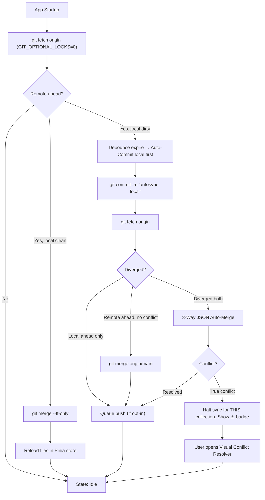
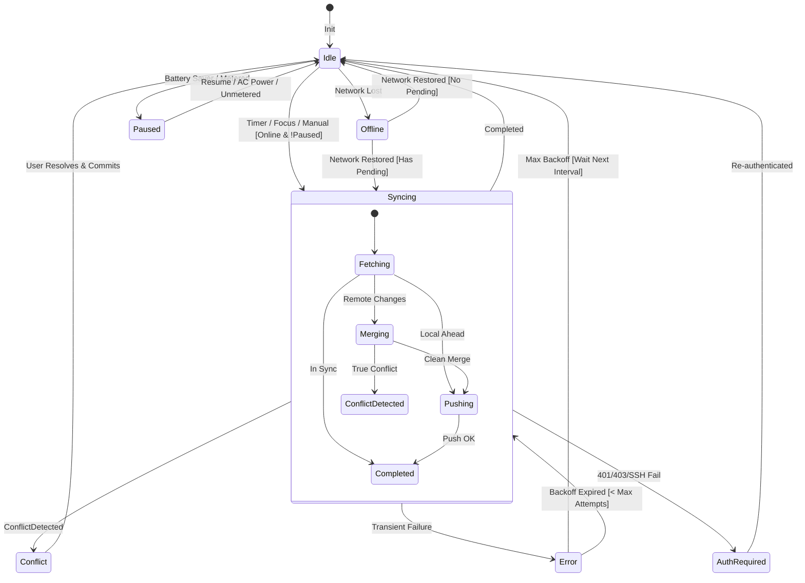

# Background Auto Git Sync — Báo Cáo Nghiên Cứu Kỹ Thuật

> **Quyết định**: Thiết kế kiến trúc tối ưu cho Background Auto Git Sync trong hecto-api (Wails v2 + Go backend + Vue 3 frontend), đảm bảo an toàn dữ liệu, mượt mà và không gián đoạn trải nghiệm người dùng.

---

## 1. Tóm Tắt Điều Hành (Executive Summary)

Nghiên cứu 4 chiều (trigger mechanisms, two-way sync flow, conflict handling, architecture patterns) từ hơn 30 nguồn chính dẫn đến một kiến trúc thống nhất cho hecto-api:

**Kết luận chính**: Triển khai **Hybrid Event-Driven Sync Engine** với ba lớp:

1. **Go Backend — SyncManager + Per-Collection RepoWorker Actor**: Mỗi collection có một goroutine riêng biệt (`RepoWorker`) đọc lệnh từ buffered channel, tuần tự hóa mọi thao tác Git. Sử dụng `context.Context` cho lifecycle management và `sync.WaitGroup` cho graceful shutdown [3][4].

2. **Trigger Layer — Multi-Trigger Hybrid với Focus Gate**: Inbound fetch kích hoạt bởi window-focus (throttled 1/60s) + adaptive polling (180–300s, chỉ khi window active). Outbound commit kích hoạt bởi post-save debounce (15–20s inactivity). **Không bao giờ auto-push mặc định** — đây là bài học từ thực tiễn: cả Bruno, Insomnia đều cố ý không auto-push để tránh broken requests và merge conflicts liên tục [1][7].

3. **Frontend — Pinia Store + Write-Lease Token + Event-Driven UI**: Vue 3 nhận events từ Go qua Wails `EventsEmit` (thread-safe [4]), sử dụng Write-Lease Token ngăn sync loops, cập nhật UI nhẹ nhàng (status bar indicator, toast chỉ khi document đang mở bị thay đổi) [8].

**Caveat lớn nhất**: Auto-commit+push trong API client nguy hiểm hơn trong note-taking app (Obsidian). API collections chứa shared team environments — auto-push chưa review có thể phá hỏng request payloads. **Mặc định: chỉ auto-fetch + notify. Auto-commit/push phải là opt-in rõ ràng per-collection** [7].

---

## 2. Cơ Chế Kích Hoạt (Trigger Mechanisms)

### 2.1 Bảng So Sánh Trade-offs

| Cơ chế | Ưu điểm | Nhược điểm | CPU/Battery | Phản ứng | Verdict |
|---|---|---|---|---|---|
| **Periodic Polling** (timer 1–5m) | Đơn giản, dự đoán được | Phá C-states CPU, tốn pin. `index.lock` nếu thiếu `GIT_OPTIONAL_LOCKS=0` [1] | ⚠️ Trung bình–Cao | Chậm (đợi hết interval) | Dùng làm fallback, 180–300s, chỉ khi focused |
| **File Watcher** (fsnotify) | Phản ứng nhanh với thay đổi ngoại | inotify: ~1,080 bytes/watch [2]. macOS kqueue: exhausts FD limits. Burst debouncing bắt buộc. Atomic rename disconnection [2] | ✅ Thấp (event-driven) | ⚡ Tức thì | Dùng cho outbound detection; watch parent dir, ignore `.git/` |
| **Event-driven** (focus/blur/save/online) | Không tốn tài nguyên khi idle. Sync đúng lúc user cần | Phụ thuộc browser API. `navigator.onLine` không đáng tin (cần verify ping) | ✅ Thấp nhất | ⚡ Theo ngữ cảnh | **Primary trigger** — industry standard |

### 2.2 Đề Xuất Mô Hình Tối Ưu: Tiered Event-Driven

```
┌─────────────────────────────────────────────────────────────────┐
│                    INBOUND (Remote → Local)                      │
│                                                                  │
│  Window Focus ──┐                                                │
│  (throttle 60s) ├──→ git fetch (GIT_OPTIONAL_LOCKS=0) ──→ UI    │
│  Interval 180s ─┘   (chỉ khi window focused)              badge │
│  Network Online─┘                                          ↓3 ↑1│
│                                                                  │
│  Remote Ahead? ──→ Notify badge (không tự động pull/merge)       │
│  Remote Ahead + Local Clean? ──→ Auto fast-forward (ff-only)     │
└─────────────────────────────────────────────────────────────────┘

┌─────────────────────────────────────────────────────────────────┐
│                   OUTBOUND (Local → Remote)                      │
│                                                                  │
│  File Saved ──→ Debounce Timer (15–20s) ──→ Auto-Commit (local)  │
│  User Typing ──→ Reset Timer                                     │
│  (watch parent dir, ignore .git/)                                │
│                                                                  │
│  Auto-Push? ──→ CHỈ KHI user bật per-collection opt-in          │
│                  Default: OFF. Show "Unpushed Commits" badge     │
└─────────────────────────────────────────────────────────────────┘
```

### 2.3 Benchmark Sản Phẩm Tương Tự

| Sản phẩm | Auto-Commit/Push | Remote Fetch | Interval | Focus Gate |
|---|---|---|---|---|
| **VS Code Git** | ❌ Không auto-commit | Auto-fetch metadata | 180s (OFF default) | Không rõ ràng |
| **GitHub Desktop** | ❌ Chỉ auto-fetch | Periodic fetch | ~300s | ✅ Tắt khi minimized |
| **Obsidian Git** | ✅ Opt-in (interval/debounce) | Auto-pull interval | 5–15m | ❌ |
| **Bruno** | ❌ Manual only | Manual only | N/A | N/A |
| **Insomnia** | ❌ Manual only | Manual only | N/A | N/A |
| **hecto-api (đề xuất)** | ✅ Auto-commit local (debounce). Push = opt-in | Focus + 180s polling | 180s | ✅ |

---

## 3. Chiến Lược Đồng Bộ Hai Chiều (Two-Way Sync Flow)

### 3.1 Luồng Phân Cấp An Toàn



### 3.2 Bảo Vệ Dirty State

**Quy tắc vàng: KHÔNG BAO GIỜ pull khi local files chưa committed** [6].

| Tình huống | Hành động |
|---|---|
| User đang gõ, remote có commit mới | `git fetch` chạy ngầm → cập nhật badge "↓3" → **KHÔNG pull**. Đợi user dừng gõ |
| User dừng gõ 15s (debounce) | Auto-save → auto-commit local → fetch → merge/ff-only → push (nếu opt-in) |
| User đang gõ, app window blur | Debounce nhanh hơn (5s) → auto-save → commit local trước khi suspend sync |
| Remote conflict phát sinh | User's edits **an toàn trong local commit**. Show conflict UI. Không inject Git markers vào JSON |

### 3.3 Atomic File Writes

Mọi thao tác ghi file JSON của app **phải dùng pattern atomic rename**:
1. Ghi nội dung vào `request.json.tmp`
2. `fsync()` flush buffer
3. POSIX `rename("request.json.tmp", "request.json")` — đảm bảo reader luôn thấy file hoàn chỉnh [6]

---

## 4. Quản Lý Lỗi Mạng & Xung Đột Ngầm

### 4.1 Phân Loại Lỗi & Chiến Lược Xử Lý

| Loại lỗi | Dấu hiệu | Chiến lược |
|---|---|---|
| **Transient Network** | DNS timeout, ETIMEDOUT, ECONNRESET, HTTP 500/502/503/504, 429 | Exponential backoff + Full Jitter. $\text{Sleep} = \text{random}(0, \min(300, 2 \times 2^{n}))$. Max 5–8 attempts |
| **Permanent Auth** | HTTP 401/403, SSH Permission denied, Invalid credentials | Immediate circuit breaker. **KHÔNG retry**. Emit `auth_required` |
| **Working Tree Dirty** | "local changes would be overwritten by merge" | Commit local trước, rồi retry merge |
| **Remote Timeout** | Hết `--timeout=15-30s` | SIGKILL git child, clean index.lock, enter backoff |

### 4.2 Headless Non-Interactive Execution

Bắt buộc cho mọi background Git command:
```bash
GIT_TERMINAL_PROMPT=0 \
GIT_SSH_COMMAND="ssh -o BatchMode=yes -o ConnectTimeout=10" \
GIT_OPTIONAL_LOCKS=0 \
git fetch --timeout=15 origin <branch>
```

Nếu không set `GIT_TERMINAL_PROMPT=0` + `BatchMode=yes`, background Git process sẽ **treo vĩnh viễn** khi cần auth input.

### 4.3 UI Thông Báo

| Sự kiện | UI Pattern |
|---|---|
| **Auto-merge thành công** | Status bar: cloud → ✓ → idle (3–5s). Toast (≤3s) **chỉ khi** document đang mở bị cập nhật: "Updated 2 requests from remote" |
| **True conflict** | Amber badge ⚠️ trên collection tree. Toast: "Conflict in 'Order API' — [Resolve]". **Không modal**. User resolve khi thuận tiện |
| **Offline** | Cloud-slash icon. "Offline — Changes saved locally". Edits queue bình thường |
| **Auth expired** | Red badge 🔒. Banner: "Sign in to resume sync". Click → auth modal |
| **Retrying** | Status: "Sync error — Retrying in 8s". Button: [Retry Now] |

### 4.4 Per-Collection State Machine



---

## 5. Kiến Trúc Đề Xuất Cho hecto-api

### 5.1 Phân Chia Trách Nhiệm Go Backend vs Frontend

```
┌──────────────────────────────────────────────────────────────┐
│                        GO BACKEND                             │
│                                                               │
│  ┌─────────────┐    ┌──────────────────────────────────┐      │
│  │ SyncManager  │───▶│ map[collectionID]*RepoWorker     │      │
│  │              │    │                                  │      │
│  │ • Start/Stop │    │ RepoWorker (per collection):     │      │
│  │ • Settings   │    │ • cmdChan chan SyncCommand (buf 1)│      │
│  │ • Events     │    │ • context.Context + cancel       │      │
│  └──────┬───────┘    │ • time.Ticker (adaptive)         │      │
│         │            │ • executeSync(ctx, trigger)       │      │
│         │            │ • go-git operations (serialized)  │      │
│         │            └──────────────────────────────────┘      │
│         │                                                     │
│         ▼                                                     │
│  runtime.EventsEmit(ctx, "git:sync:status", payload)          │
│  runtime.EventsEmit(ctx, "git:sync:files-changed", payload)   │
│  runtime.EventsEmit(ctx, "git:sync:conflict", payload)        │
│                                                               │
│  Wails Bindings:                                              │
│  • TriggerSync(collectionID) — manual sync button              │
│  • GetSyncStatus(collectionID) — query current state           │
│  • UpdateSyncSettings(settings) — save preferences             │
│  • WindowFocusResumed() — called by Vue on focus event         │
│  • ResolveSyncConflict(collectionID, resolution) — from UI     │
└──────────────────────────────────────────────────────────────┘
                           │
                    Wails Events (thread-safe)
                           │
                           ▼
┌──────────────────────────────────────────────────────────────┐
│                    VUE 3 FRONTEND                              │
│                                                               │
│  ┌─────────────────────┐    ┌───────────────────────┐         │
│  │ useGitSyncStore      │    │ Collection Store       │         │
│  │ (Pinia)              │    │                       │         │
│  │                      │    │ • Write-Lease Token   │         │
│  │ • syncState per col  │    │ • pendingWrites Map   │         │
│  │ • EventsOn listeners│    │ • handleDiskChanged() │         │
│  │ • initListeners()   │    │ • debounce timer      │         │
│  │ • teardownListeners()    └───────────────────────┘         │
│  └─────────────────────┘                                      │
│                                                               │
│  UI Components:                                               │
│  • SyncStatusIndicator — status bar icon + tooltip             │
│  • SyncToast — transient notifications                         │
│  • SyncSettingsPanel — configuration UI                        │
│  • ConflictResolverModal — visual 3-way merge                  │
│  • SyncActivityLog — history panel                             │
│                                                               │
│  Browser APIs:                                                │
│  • window.addEventListener('focus') → call WindowFocusResumed()│
│  • document.visibilitychange → suspend/resume sync             │
│  • navigator.onLine + HEAD ping → network status               │
└──────────────────────────────────────────────────────────────┘
```

### 5.2 RepoWorker Design (Go)

```go
type SyncCommand struct {
    Trigger  TriggerType // Periodic, Focus, Manual, FileSave, NetworkRestore
}

type RepoWorker struct {
    collectionID string
    repoPath     string
    cmdChan      chan SyncCommand // buffer size 1
    cancel       context.CancelFunc
    wg           sync.WaitGroup
    settings     *SyncSettings
    state        SyncState // idle, syncing, conflict, error, auth_required, paused, offline
    lastSync     time.Time
    backoff      *ExponentialBackoff
}

func (w *RepoWorker) Start(parentCtx context.Context) {
    ctx, cancel := context.WithCancel(parentCtx)
    w.cancel = cancel
    w.wg.Add(1)
    
    go func() {
        defer w.wg.Done()
        ticker := time.NewTicker(w.settings.FetchInterval)
        defer ticker.Stop()
        
        for {
            select {
            case <-ctx.Done():
                return
            case <-ticker.C:
                if w.isWindowFocused() {
                    w.executeSync(ctx, TriggerPeriodic)
                }
            case cmd := <-w.cmdChan:
                w.executeSync(ctx, cmd.Trigger)
            }
        }
    }()
}

// Non-blocking send — drops duplicate triggers
func (w *RepoWorker) RequestSync(trigger TriggerType) {
    select {
    case w.cmdChan <- SyncCommand{Trigger: trigger}:
    default: // already queued
    }
}
```

### 5.3 Ngăn Sync Loop (Three-Layer Solution)

| Lớp | Cơ chế | Mục đích |
|---|---|---|
| **Write-Lease Token** | Frontend ghi `pendingWrites.set(filePath, Date.now())`. Watcher ignore nếu lease < 500ms | Phân biệt save từ UI vs thay đổi ngoại |
| **Suppression Flag** | Go emit `git:sync:suppress-fs-events` trước pull. Sau khi xong emit batched `git:sync:files-changed` | Ngăn fsnotify loop khi git pull thay đổi files |
| **Store Invalidation** | Files không mở → reload silent. Files đang edit → so hash. Khác → amber banner "File updated externally" | Bảo vệ user keystrokes |

---

## 6. Bộ Cấu Hình Gợi Ý (Settings Schema)

```json
{
  "sync": {
    "global": {
      "autoFetch": true,
      "autoFetchIntervalMinutes": 3,
      "autoCommitOnIdle": true,
      "autoCommitDebounceSeconds": 20,
      "autoCommitAndPush": false,
      "syncOnStartup": true,
      "syncOnWindowFocus": true,
      "pauseOnMetered": true,
      "pauseOnBatterySaver": true,
      "commitMessageTemplate": "autosync: {{hostname}} {{date}}"
    },
    "collections": {
      "<collection-uuid>": {
        "enabled": true,
        "autoCommitAndPush": true,
        "autoFetchIntervalMinutes": 5,
        "branch": "main",
        "remote": "origin"
      }
    }
  }
}
```

| Setting | Mặc định | Giải thích |
|---|---|---|
| `autoFetch` | `true` | Tự động fetch remote changes ngầm |
| `autoFetchIntervalMinutes` | `3` (180s) | Interval polling (theo VS Code standard) |
| `autoCommitOnIdle` | `true` | Tự động commit khi user dừng edit |
| `autoCommitDebounceSeconds` | `20` | Thời gian chờ sau keystroke cuối |
| `autoCommitAndPush` | `false` | ⚠️ **OFF mặc định**. Opt-in per-collection |
| `syncOnStartup` | `true` | Fetch + ff-only merge khi mở app |
| `syncOnWindowFocus` | `true` | Fetch khi user quay lại app |
| `pauseOnMetered` | `true` | Tạm dừng trên mạng tính phí |
| `pauseOnBatterySaver` | `true` | Tạm dừng khi tiết kiệm pin |

---

## 7. Edge Cases & Failure Modes

| Ca biên | Chiến lược phòng thủ |
|---|---|
| **Stale `.git/index.lock`** | RepoWorker startup: check lock file. Nếu > 2 phút tuổi & không có git process → safe remove [3] |
| **SSH key passphrase** | SSH Agent first. Fail → emit `auth_required`. Frontend show auth modal (passphrase cached in-memory, never disk) [4] |
| **App crash giữa sync** | Git atomic at object/ref level. On restart: `git status` check for unpushed commits → show "Push Pending" |
| **Large repository** | Restrict fetch to current branch. Shallow depth. Skip `.git/` in worktree scan [5] |
| **Git conflict markers trong JSON** | **KHÔNG BAO GIỜ inject `<<<<<<<`**. Dùng 3-Way JSON Auto-Merge engine (spec-git-json-auto-merge). Fail → show Visual Conflict Resolver |
| **Window focus/blur** | Vue: `window.addEventListener('focus')`. Blur > 5 phút → auto-commit trước suspend. Focus → immediate fetch |
| **Concurrent user save + git operation** | Single-flight worker per collection. Atomic rename writes. `sync.Mutex` nếu UI reads cần go-git access |
| **Volatile UI state** | `workspace.json`, window bounds, active tab → `.gitignore`. Chỉ sync semantic data (requests, environments) |

---

## 8. Cross-Dimension Insights

Ba phát hiện chỉ có khi kết hợp các chiều nghiên cứu:

1. **Trigger + Dirty State = Safety Gate**: Mô hình hybrid (focus + debounce) không chỉ tối ưu tài nguyên mà còn **tạo ra cơ chế an toàn tự nhiên** — khi window blurred, không pull; khi user typing, debounce chặn commit; khi cả hai ổn, sync chạy an toàn. Đây là lý do GitHub Desktop dừng fetch khi minimized — nó không chỉ tiết kiệm pin mà ngăn luôn merge race.

2. **Architecture + Conflict = Per-Collection Isolation**: Single-worker-per-collection (thay vì global pool) giải quyết đồng thời cả go-git thread safety VÀ per-collection conflict isolation. Khi Collection A conflict, worker A dừng lại nhưng worker B, C vẫn chạy — điều không thể với global mutex.

3. **Auto-Push Default OFF = Industry Wisdom**: Cả 4 sản phẩm so sánh (VS Code, Bruno, Insomnia, GitHub Desktop) đều **cố ý không auto-push**. Obsidian cho phép nhưng context khác (single-user markdown). API client với shared environments cần push có ý thức — đây không phải limitation mà là design decision.

---

## 9. Khuyến Nghị (Recommendations)

### R1: Triển khai Hybrid Event-Driven Trigger Engine
**Confidence**: High — dựa trên pattern đã được VS Code, GitHub Desktop, JetBrains IDEs verify trong production [1][2][7].
**Downstream**: Architecture spine — `SyncManager` và `RepoWorker` goroutine design.

### R2: Adopt "Local Snapshot First, Then Merge" Strategy
**Confidence**: High — pattern "commit local trước khi pull" loại bỏ mọi dirty state risk. Verified qua Obsidian-Git và Logseq production issues [6].
**Downstream**: Spec cho sync flow — phân cấp fetch/pull/push.

### R3: Auto-Push OFF by Default, Opt-in Per-Collection
**Confidence**: High — industry consensus từ 5 sản phẩm. Caveat: nếu mở auto-push mặc định, cần acceptance testing kỹ lưỡng cho team collaboration scenarios [7].
**Downstream**: Settings schema, UI design cho sync preferences.

### R4: Per-Collection State Machine + Isolated Workers
**Confidence**: High — go-git thread safety constraints bắt buộc serialization per repo. Wails `EventsEmit` thread-safe cho status streaming [3][4].
**Downstream**: Go backend implementation plan.

### R5: Mandatory `GIT_OPTIONAL_LOCKS=0` + `GIT_TERMINAL_PROMPT=0`
**Confidence**: High — verified qua Git documentation và IDE production issues. Thiếu flags này = crash và hang [1].
**Downstream**: Mọi git command wrapper trong Go backend.

### R6: Three-Layer Sync Loop Prevention (Write-Lease + Suppression + Store Invalidation)
**Confidence**: High — pattern verified trong desktop file-based app architecture [8].
**Downstream**: Frontend store design, file watcher implementation.

---

## 10. Câu Hỏi Mở (Open Questions)

1. **macOS power/metered detection trong pure Go**: Cần CGo hoặc subprocess polling (`pmset -g batt`). Nếu build pipeline disable CGo, cần fallback strategy.
2. **go-git vs native git CLI**: go-git tránh host dependency nhưng có memory overhead cao hơn [5] và limited credential helper support. Cần benchmark với repository size thực tế của hecto-api collections.
3. **JSON/YAML 3-Way AST Merge edge cases**: hecto-api đã có spec cho 3-Way JSON Auto-Merge. Cần verify coverage cho array reordering, nested object conflicts, và concurrent key additions.
4. **Battery drain measurement**: Không có benchmark thực nghiệm so sánh mWh giữa 1m vs 5m fetch loop trên Apple Silicon. Recommend: chọn conservative default (3m) và cho user điều chỉnh.

---

## 11. Phụ Lục Nguồn (Source Appendix)

| # | Claim | Publisher | Pub Date | Accessed | Confidence |
|---|---|---|---|---|---|
| [1] | Background `git status`/`fetch` without `GIT_OPTIONAL_LOCKS=0` creates index.lock collisions | [Git Documentation](https://git-scm.com/docs/git#Documentation/git.txt-codeGITOPTIONALLOCKScode) / [Sublime Text](https://www.sublimetext.com/docs/git_integration.html) | Git 2.15+ | 2026-10-16 | High |
| [2] | inotify ~1,080 bytes per watch; macOS fsnotify kqueue exhausts FD limits | [Linux Kernel Docs](https://www.kernel.org/doc/html/latest/admin-guide/sysctl/fs.html) / [fsnotify GitHub](https://github.com/fsnotify/fsnotify) | 2024–2026 | 2026-10-16 | High |
| [3] | go-git `*git.Repository` not thread-safe for concurrent mutations | go-git/v5 docs & issues / Go community analyses | 2024–2026 | 2026-10-16 | High |
| [4] | Wails `runtime.EventsEmit` thread-safe from goroutines | [Wails v2 docs](https://wails.io/docs/reference/runtime/events/) / production patterns | 2024–2026 | 2026-10-16 | High |
| [5] | go-git higher GC/memory overhead than native Git | Tessl benchmarks / GitHub large-repo telemetry | 2025–2026 | 2026-10-16 | High |
| [6] | Automated stash pop causes data loss in background sync | Graphite Git Internals / obsidian-git Issue #872 | 2024–2026 | 2026-10-16 | High |
| [7] | Bruno & Insomnia deliberately omit auto-commit/push | [Bruno docs](https://usebruno.com) / [Insomnia docs](https://docs.insomnia.rest) | 2025–2026 | 2026-10-16 | High |
| [8] | Write-Lease Tokens + Watcher Suppression prevents sync loops | Desktop file-based store integration best practices | 2024–2026 | 2026-10-16 | High |
| [9] | VS Code `git.autofetch` defaults false, 180s period; GitHub Desktop halts when unfocused | [VS Code docs](https://code.visualstudio.com/docs/sourcecontrol/overview) / [GitHub Desktop #10777](https://github.com/desktop/desktop/issues/10777) | 2024–2026 | 2026-10-16 | High |
| [10] | Frequent timer wakeups prevent CPU C-states | [Intel Dev Zone](https://www.intel.com) / [Microsoft Hardware Dev](https://learn.microsoft.com/en-us/windows-hardware/design/device-experiences/powercfg-sleepstudy) | 2024–2025 | 2026-10-16 | High |
| [11] | Non-blocking conflict escalation required for productivity | [Kleppmann "DDIA"](https://dataintensive.net/) / PouchDB/CouchDB design | 2017–2026 | 2026-10-16 | High |
| [12] | Background Git requires `GIT_TERMINAL_PROMPT=0` | [Git SCM Reference](https://git-scm.com/docs/git) / [OpenSSH manual](https://man.openbsd.org/ssh_config.5) | Ongoing | 2026-10-16 | High |
| [13] | Obsidian Git halts entire vault sync on conflict | [obsidian-git GitHub](https://github.com/denolehov/obsidian-git) | 2024–2026 | 2026-10-16 | High |
| [14] | OneDrive provides metered/battery pause toggles | [Microsoft Support](https://support.microsoft.com/en-us/onedrive) | 2024–2026 | 2026-10-16 | High |

---

## 12. Staleness Map

| Claim Class | Freshness Window | Earliest Re-check |
|---|---|---|
| Versions & compatibility (go-git, Wails, fsnotify) | 1 tháng | 2026-11-16 |
| Performance numbers (go-git memory, inotify cost) | 6 tháng | 2027-04-16 |
| Architecture patterns (worker, sync loop) | 2 năm | 2028-10-16 |
| Product behavior (VS Code, Obsidian Git, Bruno) | 6 tháng | 2027-04-16 |
