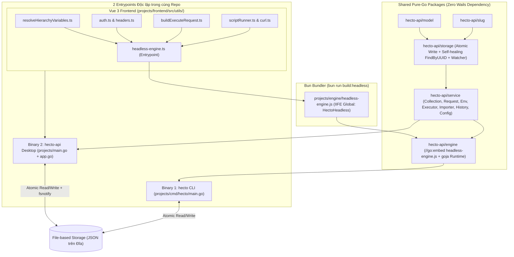

# Kiến trúc Kỹ thuật: Công cụ CLI (`hecto`), Shared TS Execution Engine (`goja`) & Đồng bộ Dữ liệu 3 Lớp

Tài liệu companion này đặc tả chi tiết kiến trúc kỹ thuật, cấu trúc gói (packages), giao diện hàm (signatures), ma trận lệnh CLI, cơ chế đóng gói `headless-engine.js` chạy trên `goja`, và luồng đồng bộ dữ liệu 3 lớp giữa `hecto` CLI và `hecto-api` Wails Desktop.

---

## 1. Tổng quan Kiến trúc Hệ thống



---

## 2. Tách Phụ thuộc Wails khỏi `service` & Cấu hình Đường dẫn Dữ liệu (`CAP-1`)

### 2.1. Tách `wailsRuntime` khỏi `projects/service/config.go`
Hiện tại `projects/service/config.go` là file duy nhất trong `projects/service/` import `github.com/wailsapp/wails/v2/pkg/runtime` (chỉ để gọi `wailsRuntime.EventsEmit(ctx, "startup-error", message)`).
Để `projects/cmd/hecto` hoàn toàn không phụ thuộc Wails/GTK/WebKit:
- Trong `ConfigService` (`projects/service/config.go`):
  - Xóa import `wailsRuntime "github.com/wailsapp/wails/v2/pkg/runtime"`.
  - Bổ sung trường `onStartupError func(ctx context.Context, message string)` và phương thức:
    ```go
    func (s *ConfigService) SetStartupErrorHandler(fn func(ctx context.Context, message string)) {
        s.onStartupError = fn
    }
    ```
  - Trong `emitStartupError(ctx context.Context, message string)`: nếu `s.onStartupError != nil` thì gọi `s.onStartupError(ctx, message)`.
- Trong `projects/app.go` (`NewApp` hoặc `startup`):
  - Đăng ký `a.cfgSvc.SetStartupErrorHandler(func(ctx context.Context, msg string) { runtime.EventsEmit(ctx, "startup-error", msg) })`.

### 2.2. Hỗ trợ Ghi đè Thư mục Cấu hình cho CLI & Kiểm thử An toàn
- Bổ sung hỗ trợ biến môi trường `HECTO_CONFIG_DIR` (hoặc phương thức `SetCustomConfigDir(dir string)` trên `ConfigService`) trong `resolveConfigPath()` và `resolveDefaultCollectionsRoot()`:
  - Nếu `customConfigDir != ""` hoặc `os.Getenv("HECTO_CONFIG_DIR") != ""`:
    - `configPath = filepath.Join(customDir, "config.json")`
    - `defaultCollectionsRoot = filepath.Join(customDir, "collections")`
  - Mặc định khi không thiết lập: giữ nguyên `{os.UserConfigDir()}/hecto-api/config.json` và `{os.UserCacheDir()}/hecto-api/collections` để CLI và Wails Desktop tự động nhìn thấy cùng một tập dữ liệu của người dùng.

---

## 3. Nâng cấp Tầng Lưu trữ & Phân giải Định danh (`CAP-4`, `CAP-5`)

### 3.1. Self-Healing Index trong `FileSystem.FindByUUID` (`projects/storage/filesystem.go`)
Khi ứng dụng Wails Desktop đang mở (giữ `f.index` trong RAM) và CLI thực hiện `hecto req delete`, `hecto req move`, hoặc `hecto folder move` ở tiến trình ngoài, đường dẫn lưu trong `f.index[uuid]` của Wails trở nên lỗi thời (stale). Tương tự, nếu một thư mục đã bị xóa tệp `_folder.json` nhưng vỏ thư mục còn sót lại trên đĩa, cache cũng cần tự chữa lành.
Cập nhật `FindByUUID(uuid string)`:
```go
func (f *FileSystem) FindByUUID(uuid string) (string, error) {
	if uuid == "" {
		return "", fmt.Errorf("%s: uuid empty", model.ErrNotFound)
	}

	f.mu.RLock()
	path, ok := f.index[uuid]
	collRoot := f.collectionRoot
	f.mu.RUnlock()

	if ok {
		if f.Exists(path) && (strings.HasSuffix(path, ".json") || f.Exists(filepath.Join(path, "_folder.json"))) {
			return path, nil
		}
		// Self-healing: cached path no longer exists on disk (or folder lost _folder.json)
		f.IndexDelete(uuid)
	}

	if collRoot == "" {
		return "", fmt.Errorf("%s: uuid %s", model.ErrNotFound, uuid)
	}

	found, err := f.walkFindUUID(collRoot, uuid)
	if err != nil {
		return "", err
	}

	f.IndexSet(uuid, found)
	slog.Debug("FindByUUID fallback walk hit", "uuid", uuid, "path", found)
	return found, nil
}
```
- **Lưu ý kiểm thử:** Cập nhật bài kiểm thử hiện có `TestFindByUUID_IndexHit` trong `projects/storage/filesystem_test.go` để tạo tệp thực trong `t.TempDir()` trước khi gọi `fs.IndexSet("uuid-123", existingPath)` (thay vì dùng đường dẫn giả `"/some/path.json"` không tồn tại trên đĩa), và bổ sung bài kiểm thử cho luồng tự chữa lành (self-healing) khi file/folder bị di chuyển hoặc xóa từ bên ngoài.

### 3.2. Single-Walk `CollectionService.GetTree` (`projects/service/collection.go`)
Hiện tại `GetTree(rootPath)` gọi `s.fs.IndexRebuild(rootPath)` (quét toàn bộ đĩa lần 1) rồi ngay lập tức gọi `s.buildTree(rootPath)` (quét toàn bộ đĩa lần 2).
Cập nhật:
1. Trong `buildRequestNode(fullPath string)` (`projects/service/collection.go`), bổ sung `s.fs.IndexSet(req.ID, fullPath)` ngay sau khi đọc `req.ID != ""` (tương tự `buildFolderNode` đã có `s.fs.IndexSet(folder.ID, fullPath)`).
2. Trong `GetTree(rootPath string)`:
   - Thay `s.fs.IndexRebuild(rootPath)` bằng:
     ```go
     s.fs.SetCollectionRoot(rootPath)
     s.fs.IndexClear()
     ```
   - Khi `s.buildTree(rootPath)` chạy, toàn bộ Folder UUID và Request UUID được nạp vào `s.fs` index chỉ trong **1 lượt đọc đĩa duy nhất**.

### 3.3. Bộ Phân giải Định danh Linh hoạt bằng UUID hoặc Đường dẫn Tên (`projects/service/selector.go`)
Để AI Agent và người dùng không bắt buộc phải nhớ UUID dài, tạo `projects/service/selector.go` cung cấp các hàm phân giải:
1. **`ResolveCollectionSelector(collectionsRoot, activeCollection, selector string) (model.Collection, string, error)`**:
   - Nếu `selector == ""` $\rightarrow$ dùng `activeCollection`.
   - Khớp chính xác theo `coll.ID == selector` trước; nếu không khớp, tìm không phân biệt hoa thường (`strings.EqualFold`) theo `coll.Name`. Nếu có $\ge 2$ collection trùng tên $\rightarrow$ trả về lỗi `VALIDATION` liệt kê các ID trùng để người dùng chọn.
   - **Thiết lập `collectionRoot` ngay lập tức:** Ngay sau khi xác định được `collRoot` của collection đích, bắt buộc gọi `fs.SetCollectionRoot(collRoot)` để mọi lệnh gọi `FindByUUID` tiếp theo trong tiến trình CLI stateless hoạt động chính xác mà không cần gọi `GetTree` trước.
2. **`ResolveEnvironmentSelector(collRoot, selector string) (*model.Environment, error)`**:
   - Gọi `fs.SetCollectionRoot(collRoot)`.
   - Khớp theo `env.ID == selector` trước; sau đó khớp `strings.EqualFold(strings.TrimSpace(env.Name), strings.TrimSpace(selector))`. Nếu trùng tên $\rightarrow$ báo lỗi `VALIDATION` kèm danh sách UUID.
3. **`ResolveFolderSelector(collRoot, selector string) (model.TreeNode, []model.TreeNode, error)`**:
   - Gọi `GetTree(collRoot)` (tự động thiết lập `SetCollectionRoot` và nạp index 1 lượt).
   - Hỗ trợ tìm theo `UUID` bất kỳ trong cây HOẶC theo đường dẫn phân cấp tên ngăn cách bởi dấu `/` (ví dụ: `"Users/Auth"` hoặc `"/Users/Auth/"`).
   - **Xử lý dấu `/` thừa và tên chứa `/`:** Trước khi tách theo `/`, kiểm tra xem toàn bộ chuỗi `strings.TrimSpace(selector)` có khớp trực tiếp với `ID` hoặc `Name` của một thư mục con cấp 1 (khi không mơ hồ) hay không; khi tách theo `/`, loại bỏ các phần tử rỗng do dấu `/` ở đầu/cuối hoặc lặp (`//`).
   - Ở mỗi bậc của đường dẫn `part1/part2/...`, tìm các node con có `Type == "folder"` và `strings.EqualFold(strings.TrimSpace(node.Name), strings.TrimSpace(part))` (hoặc `node.ID == part`).
   - Nếu tại một bậc có $\ge 2$ thư mục cùng tên $\rightarrow$ trả về lỗi `VALIDATION` chỉ rõ các UUID bị trùng.
   - Trả về `targetFolderNode` kèm mảng tổ tiên `ancestorFolders` (từ gốc xuống thư mục đích).
4. **`ResolveRequestSelector(collRoot, selector string) (model.Request, []model.TreeNode, []model.TreeNode, error)`**:
   - Gọi `GetTree(collRoot)` để lấy cây thư mục và danh sách phẳng tất cả các node folder `allFolders` (`[]model.TreeNode`).
   - Nếu `selector` là UUID (hoặc khớp trực tiếp `req.ID` trong cây) hoặc khớp trực tiếp tên một request duy nhất có chứa dấu `/` (ví dụ `"GET /users/profile"` ở gốc): xác định node request và chuỗi thư mục cha `pathFolders` (Root $\rightarrow$ Nearest Parent).
   - Nếu `selector` là đường dẫn phân cấp tên (ví dụ `"Users/Auth/Login"` hoặc `"Login"` ở gốc): chuẩn hóa bỏ phần tử rỗng khi tách `/`, duyệt các phần tử đầu là thư mục cha (`Users` $\rightarrow$ `Auth`), phần tử cuối là Request (`Type == "request"` có tên khớp `Login` hoặc ID khớp). Nếu có $\ge 2$ request cùng tên trong cùng thư mục $\rightarrow$ trả về lỗi `VALIDATION` kèm danh sách UUID và Method của từng request.
   - **Đọc đầy đủ `model.Request` từ đĩa:** Sau khi tìm được `TreeNode` của request, bắt buộc gọi `fs.ReadJSON(node.Path, &req)` (hoặc `RequestService.Get(node.ID)`) để lấy đầy đủ `Headers`, `Params`, `PathParams`, `Body`, `Auth`, `AuthEnvs`, `Scripts` (tuyệt đối không dựng `model.Request` từ `TreeNode`), rồi trả về `(req, pathFolders, allFolders, nil)`.

---

## 4. Shared TS Execution Engine (`headless-engine.js`) & `goja` Runtime (`CAP-2`)

### 4.1. Entrypoint TypeScript (`projects/frontend/src/utils/headless-engine.ts`)
Tạo file `projects/frontend/src/utils/headless-engine.ts` tái sử dụng trực tiếp các module hiện có mà không chạm tới DOM hay Pinia/Wails runtime:
- Import từ `./resolveHierarchyVariables`: `resolveHierarchyVariables`, `type ResolveHierarchyOptions`, `type FolderNodeLike`, `type VariableKVPair`.
- Import từ `./auth`: `resolveEffectiveAuth`, `getAuthArtifacts`.
- Import từ `./headers`: `getInheritedHeaders`, `mergeHeaders`.
- Import từ `./buildExecuteRequest`: `buildExecuteRequest`, `type ExecuteRequest`.
- Import từ `./scriptRunner`: `executeScript`, `type ScriptExecutionContext`, `type ScriptExecutionResult`, `type ScopedEnvUpdates`, `type ScopedAuthUpdates`.
- Import từ `./curl`: `isCurlCommand`, `parseCurlCommand`, `generateCurlCommand`.
- Import từ `./urlParams`: `reconcileParamsFromUrl`, `reconcilePathParamsFromUrl`, `updateUrlWithParams`.

Cung cấp thêm 2 hàm điều phối cấp cao thân thiện với JSON serializable để Go (`goja`) gọi trực tiếp:
1. **`prepareHeadlessExecution(input: HeadlessPreRequestInput): HeadlessPreRequestOutput`**:
   - Nhận vào: `request`, `collection`, `environments`, `activeEnvId`, `pathFolders`, `allFolders`, `cliVarOverrides` (`Record<string, string>`).
   - Thực hiện đúng 100% trình tự của `requestStore.normalizeLoadedRequest` + `responseStore.ts`:
     1. **Chuẩn hóa URL & Params trên bản sao `effectiveReq`:** Đồng bộ hai chiều `effectiveReq.params = reconcileParamsFromUrl(effectiveReq.url, effectiveReq.params || [])`, `effectiveReq.url = updateUrlWithParams(effectiveReq.url, effectiveReq.params)` và `effectiveReq.path_params = reconcilePathParamsFromUrl(effectiveReq.url, effectiveReq.path_params || [])` để `ha.request.params` và `ha.request.pathParams` luôn nhìn thấy đầy đủ tham số khai báo trong URL.
     2. Gọi `resolveHierarchyVariables` để lấy `vars: Map<string, string>`, sau đó ghi đè các biến truyền từ cờ CLI `--var K=V` (`cliVarOverrides`) lên `vars`.
     3. Nếu `effectiveReq.scripts?.pre_request?.trim()` khác rỗng:
        - Chạy `executeScript(effectiveReq.scripts.pre_request, ...)`.
        - Áp dụng `requestMutations` (`url`, `method`, `params`, `path_params`, `headers`, `body`, `auth`) lên `effectiveReq`.
        - **Áp dụng in-memory các cập nhật biến và Auth từ Pre-request Script** (phân giải khóa sentinel `'__nearest__'` $\rightarrow$ `pathFolders[pathFolders.length - 1]?.id`, `'__active__'` $\rightarrow$ `activeEnvId`, và tên Folder/Env sang UUID giống hệt `environmentStore.ts`) lên các bản sao `collection` (`variables`, `auth`, `auth_envs`), `environments`, `pathFolders` (`variables`, `folder_envs`, `auth`, `auth_envs`), `allFolders` và tính lại `vars` (+ `cliVarOverrides`) để bước `buildExecuteRequest` và bước `runHeadlessPostResponse` nhìn thấy ngay mọi thay đổi biến/Auth từ Pre-request Script.
     4. Tính `inheritedHeaders = getInheritedHeaders(mutatedPathFolders)`.
     5. Gọi `buildExecuteRequest(effectiveReq, vars, inheritedHeaders, mutatedPathFolders, { activeEnvId, requestAuthEnvs: effectiveReq.auth_envs, collection: mutatedCollection })`.
     6. Trả về `{ executeRequest, effectiveRequest: effectiveReq, resolvedVariables: Object.fromEntries(vars), preScriptResult, mutatedCollection, mutatedEnvironments, mutatedPathFolders, mutatedAllFolders }`.
2. **`runHeadlessPostResponse(input: HeadlessPostResponseInput): ScriptExecutionResult | null`**:
   - Nhận vào: `effectiveRequest`, `response`, `resolvedVariables`, `collection` (`mutatedCollection`), `environments` (`mutatedEnvironments`), `activeEnvId`, `pathFolders` (`mutatedPathFolders`), `allFolders` (`mutatedAllFolders`).
   - Nếu `effectiveRequest.scripts?.post_response?.trim()` khác rỗng, chạy `executeScript` và trả về `ScriptExecutionResult`.

### 4.2. Bundling Script (`projects/frontend/package.json`) & Quản lý Git cho Bundle
Trong `projects/frontend/package.json`:
- Thêm script:
  ```json
  "build:headless": "bun build src/utils/headless-engine.ts --outfile ../engine/headless-engine.js --target browser --format iife --global-name HectoHeadless && mkdir -p dist && cp ../engine/headless-engine.js dist/headless-engine.js"
  ```
- Cập nhật script `"build"` (chạy `bun run build:headless` **trước** `vite build` để mọi lệnh `wails build` và script đóng gói đều luôn làm mới `headless-engine.js`):
  ```json
  "build": "vue-tsc --noEmit && bun run build:headless && vite build"
  ```
- File `projects/engine/headless-engine.js` được sinh ra tại `projects/engine/` để `go test ./...` và `go build ./cmd/hecto` nhúng trực tiếp bằng `//go:embed headless-engine.js` (không vi phạm quy tắc cấm `..` của `//go:embed`).
- **Track trong Git:** File `projects/engine/headless-engine.js` **bắt buộc được commit và track trong Git** (không thêm vào `.gitignore`) để các job CI thuần Go (`lint:backend`, `test:backend` trong `.gitlab-ci.yml`) biên dịch và chạy test trực tiếp mà không cần cài Bun trong container Go.

### 4.3. Gói Go `projects/engine` (`hecto-api/engine`)
Tạo `projects/engine/headless.go` sử dụng `github.com/dop251/goja`:
- Nhúng `//go:embed headless-engine.js`.
- Khởi tạo `goja.Runtime` và đăng ký các polyfills chuẩn cho môi trường headless:
  - **`btoa(str)` và `atob(b64)` chuẩn Latin-1 (Byte-per-Rune):** Trong `auth.ts`, hàm `toBase64(str)` gọi `new TextEncoder().encode(str)` rồi ghép từng byte UTF-8 thành chuỗi Latin-1 (`0x00–0xFF`) qua `String.fromCharCode` trước khi gọi `btoa(binString)`. Khi `goja` chuyển chuỗi JS sang `string` của Go, các code unit `0x80–0xFF` trở thành các `rune` có giá trị `128..255` (được mã hóa UTF-8 2 byte trong `string` Go). Do đó:
    - Polyfill `btoa(s)` trong Go **bắt buộc** duyệt qua `[]rune(s)`: nếu có `r > 0xFF` thì throw `InvalidCharacterError`, ngược lại gán `buf[i] = byte(r)` rồi mới gọi `base64.StdEncoding.EncodeToString(buf)` (tuyệt đối không dùng `[]byte(s)` trực tiếp vì sẽ làm hỏng chuỗi tiếng Việt/Unicode).
    - Polyfill `atob(b64)` giải mã Base64 ra `decoded []byte`, sau đó chuyển từng byte `b` thành `rune(b)` rồi ghép thành `string(runes)`.
  - **`TextEncoder` (`encode(str)` trả về `Uint8Array` chứa mảng byte UTF-8) và `TextDecoder` (`decode(bytes)`):** đảm bảo `toBase64()` trong `auth.ts` chạy chính xác 100% với cả ký tự ASCII lẫn ký tự tiếng Việt/Unicode.
- Định nghĩa cấu trúc dữ liệu trả về chuẩn cho `hecto run` (`RunOutput`):
  ```go
  type RunOutput struct {
      StatusCode  int                    `json:"status_code"`
      Request     model.ExecuteRequest   `json:"request"`
      Response    *model.ExecuteResponse `json:"response,omitempty"`
      ScriptLogs  []string               `json:"script_logs"`
      ScriptError string                 `json:"script_error,omitempty"`
      EnvUpdates  map[string]string      `json:"env_updates,omitempty"`
  }
  ```
- Cung cấp các hàm Go:
  - `ExecuteRequestFlow(opts RunOptions) (*RunOutput, error)`: điều phối toàn bộ quy trình:
    1. Gọi `HectoHeadless.prepareHeadlessExecution` trong `goja`.
    2. Nếu không bật `--no-save-env`, lưu `preScriptResult` (`envUpdates`, `scopedEnvUpdates`, `scopedAuthUpdates`) xuống đĩa thông qua `ApplyScriptUpdatesToDisk`.
    3. Nếu `opts.TimeoutSec > 0`, gọi `execSvc.SetTimeout(time.Duration(opts.TimeoutSec) * time.Second)` (nếu `TimeoutSec <= 0` thì giữ nguyên timeout mặc định 30s của `ExecutorService`). Gọi `execSvc.Send(executeRequest)` để thực thi HTTP request:
       - Nếu `execSvc.Send` trả về lỗi kết nối/timeout (`res.Success == false`), trả về lỗi tương ứng để CLI xuất `model.Result{Success: false, Error: res.Error}` với exit code `1`.
       - Nếu nhận được phản hồi HTTP (kể cả `2xx`, `4xx`, `5xx`), gán `StatusCode = resp.StatusCode` và `Response = &resp`.
    4. Nếu có Post-response script và HTTP request trả về `ExecuteResponse`, gọi `HectoHeadless.runHeadlessPostResponse` trong `goja` (truyền các bản sao `mutatedCollection`, `mutatedEnvironments`, `mutatedPathFolders`, `mutatedAllFolders` từ bước 1) và lưu `postScriptResult` xuống đĩa (nếu không bật `--no-save-env`).
    5. Ghi lịch sử thực thi vào `historySvc.RecordExecution`.
  - `ParseCurl(curlStr string) (*ParsedCurlPayload, error)`: gọi `HectoHeadless.parseCurlCommand` trong `goja` để chuyển chuỗi lệnh `curl` thành cấu trúc `model.Request`.
  - `ApplyScriptUpdatesToDisk(...)`: chuyển đổi chính xác 100% logic của `environmentStore.applyVariableUpdates`, `applyScopedVariableUpdates` và `applyScopedAuthUpdates` sang thao tác trên `CollectionService` và `EnvironmentService`:
    - Với `envUpdates`: nếu có `activeEnvId` thì cập nhật `environments/<activeEnvId>.json`; nếu `activeEnvId == ""` thì fallback cập nhật biến tầng 1 trong `collection.json`.
    - Với `scopedEnvUpdates` và `scopedAuthUpdates`:
      - Phân giải khóa environment `eKey`: nếu `eKey == "__active__"` thì dùng `activeEnvId`; nếu không, tìm theo ID hoặc tên không phân biệt hoa thường trong danh sách environments của collection.
      - Phân giải khóa folder `fKey`: nếu `fKey == "__nearest__"` thì dùng `pathFolders[len(pathFolders)-1].ID`; nếu `fKey` chứa `/` thì dùng `ResolveFolderSelector`; nếu không chứa `/`, tìm theo ID hoặc tên trong `pathFolders` trước (từ gần nhất lên gốc), nếu không thấy thì duyệt tìm trong toàn bộ `allFolders` của cây collection (giống hệt `environmentStore.ts`).

---

## 5. Ma trận Lệnh CLI `hecto` & Giao thức AI Agent (`CAP-3`, `CAP-4`)

### 5.1. Cờ Toàn cục (Global Flags), Luồng Đầu ra Chuẩn & Phân tích Đối số
Mọi lệnh trong `hecto` đều hỗ trợ các cờ toàn cục đặt ở **bất kỳ vị trí nào** (trước hoặc sau đối số vị trí `<id|path>`):
- **Chuẩn hóa vị trí cờ trước khi `FlagSet.Parse`:** Vì gói `flag` chuẩn của Go dừng phân tích cờ ngay khi gặp đối số không bắt đầu bằng `-`, bộ phân tích lệnh của `hecto` phải tự động tách/sắp xếp lại các cờ (`--json`, `-c`, `--collection`, `--data-dir`, `--to`, `--set-var`,...) lên trước đối số vị trí `<id|path>` trước khi gọi `FlagSet.Parse`, đảm bảo cú pháp tự nhiên như `hecto req get "AuthFlow/Login" --json` hay `hecto req move "Login" --to "AuthFlow" --json` luôn hoạt động.
- **Bảo vệ `stdout` tuyệt đối:** Trong `projects/cmd/hecto/main.go`, khởi tạo `slog.Logger` truyền vào tất cả các service với `io.Discard` (hoặc ghi ra `os.Stderr` ở mức `slog.LevelError`), đảm bảo các lời gọi `slog.Info` trong `ConfigService`/`CollectionService`/`FileSystem` không bao giờ in ra `stdout` làm hỏng dữ liệu JSON.
- `--collection, -c <id|name>`: Chỉ định Collection thao tác (nếu bỏ trống sẽ dùng `active_collection` trong `config.json`). Ngay sau khi phân giải collection, gọi `fs.SetCollectionRoot(collRoot)`.
- `--json`: Xuất kết quả ra `stdout` dưới định dạng JSON chuẩn `model.Result`:
  ```json
  {
    "success": true,
    "data": { ... }
  }
  ```
  hoặc khi có lỗi (kèm mã thoát `os.Exit(1)`):
  ```json
  {
    "success": false,
    "error": {
      "code": "NOT_FOUND | VALIDATION | IO_ERROR | PARSE_ERROR | CONNECTION_ERROR | TIMEOUT",
      "message": "Thông báo lỗi chi tiết"
    }
  }
  ```
- `--data-dir <path>`: Ghi đè thư mục chứa `config.json` và `collections/` (hoặc qua biến môi trường `HECTO_CONFIG_DIR`).

### 5.2. Lệnh Tự khám phá `hecto agent-guide` & Banner `hecto --help`
- Dòng đầu tiên khi chạy `hecto`, `hecto --help`, hoặc `hecto -h`:
  ```text
  🤖 AI AGENT / LLM GUIDE: Run `hecto agent-guide` to print the complete SKILL.md manual (command matrix, 4-tier variables, auth inheritance, scripting, and JSON schemas) to stdout.
  ```
- Lệnh `hecto agent-guide`:
  - In nguyên bản tệp `projects/cmd/hecto/SKILL.md` (được nhúng qua `//go:embed SKILL.md`) ra `stdout`.
  - Nội dung `SKILL.md` có đầy đủ YAML frontmatter (`name: hecto-cli`, `description: ...`), giải thích mô hình dữ liệu 4 thực thể (`collection`, `env`, `folder`, `req`), cơ chế phân giải biến 4 tầng, cú pháp Read-Merge-Write khi `update`, cấu trúc `RunOutput` và các recipe mẫu cho AI Agent.

### 5.3. Bảng Ma trận Lệnh Trực giao `hecto <entity> <verb>` & Quy tắc Ngữ nghĩa

| Thực thể / Lệnh | Động từ (Verb) | Cú pháp & Cờ chính (Flags) | Hành vi & Ngữ nghĩa |
|---|---|---|---|
| **`collection`** | `list` | `hecto collection list [--json]` | Liệt kê toàn bộ collections kèm trạng thái `is_active`, `is_default`. |
| | `get` | `hecto collection get [id\|name] [--json]` | Đọc chi tiết `collection.json` (variables tầng 1, auth, auth_envs, active_env_id). Nếu bỏ trống arg thì lấy collection đang active. |
| | `create` | `hecto collection create --name <name> [--description <desc>] [--var K=V]... [--auth-type <none\|bearer\|basic\|apiKey>] [--auth-token <t>] [--auth-user <u>] [--auth-pass <p>] [--auth-key <k>] [--auth-val <v>] [--auth-in <header\|query>] [--switch]` | Tạo collection mới trong 1 bước kèm cấu hình biến tầng 1 và Auth cấp Collection. |
| | `update` | `hecto collection update <id\|name> [--name <name>] [--description <desc>] [--set-var K=V]... [--unset-var K]... [--auth-type ...] [--env-auth <env>:<type>...] [--active-env <id\|name\|none>]` | **Read-Merge-Write (patch)** trên `collection.json`: chỉ sửa các trường/biến có cờ được truyền (qua `FlagSet.Visit`). Phân giải `<env>` trong `--env-auth` và `--active-env` sang UUID qua `ResolveEnvironmentSelector`. |
| | `delete` | `hecto collection delete <id\|name>` | Xóa collection (chặn xóa `default`). Nếu collection bị xóa đang là `active_collection` trong `config.json`, tự động gọi `ConfigService.SwitchActiveCollection(ctx, "default")`. |
| | `switch` | `hecto collection switch <id\|name>` | Chuyển `active_collection` mặc định trong `config.json`. |
| **`env`** | `list` | `hecto env list [-c <coll>] [--json]` | Liệt kê tất cả Environments (biến tầng 2) của collection. |
| | `get` | `hecto env get <id\|name> [-c <coll>] [--json]` | Xem chi tiết một Environment và danh sách biến `variables`. |
| | `create` | `hecto env create --name <name> [--var K=V]... [--activate] [-c <coll>]` | Tạo Environment mới cùng danh sách biến ban đầu; nếu có `--activate` thì đặt làm `active_env_id` của collection. |
| | `update` | `hecto env update <id\|name> [--name <new-name>] [--set-var K=V]... [--unset-var K]... [-c <coll>]` | **Read-Merge-Write (patch)**: thêm/sửa biến qua `--set-var`, xóa biến qua `--unset-var`, đổi tên nếu có `--name`, giữ nguyên các biến còn lại. |
| | `delete` | `hecto env delete <id\|name> [-c <coll>]` | Xóa Environment. Bắt buộc kiểm tra `collection.json`: nếu `coll.ActiveEnvID == deletedEnv.ID` thì xóa trắng `coll.ActiveEnvID = ""` và lưu lại `collection.json`. |
| | `activate` | `hecto env activate <id\|name\|none> [-c <coll>]` | Đặt Environment đang active cho Collection (lưu `env.ID` vào `collection.json`, hoặc xóa trắng với `none`). |
| **`folder`** | `list` / `tree` | `hecto folder list [-c <coll>] [--json]` / `hecto folder tree [-c <coll>] [--json]` | `tree` trả về cây phân cấp đầy đủ (`GetTree`); `list` trả về danh sách phẳng các thư mục kèm đường dẫn phân cấp (`path_display`, ví dụ `"Users/Auth"`). |
| | `get` | `hecto folder get <id\|path> [-c <coll>] [--json]` | Đọc `_folder.json` (Variables tầng 3, FolderEnvs tầng 4, Headers kế thừa, Auth & AuthEnvs). |
| | `create` | `hecto folder create --name <name> [--parent <id\|path>] [--var K=V]... [--env-var <env>:<K>=<V>]... [--header "K:V"]... [--auth-type <inherit\|none\|bearer\|basic\|apiKey>] [...]` | Tạo thư mục mới tại gốc hoặc trong `--parent`, gán luôn tên, biến tầng 3/4, headers và auth trong 1 bước. Phân giải `<env>` trong `--env-var` sang `env.ID` qua `ResolveEnvironmentSelector`. |
| | `update` | `hecto folder update <id\|path> [--name <new-name>] [--set-var K=V]... [--unset-var K]... [--set-env-var <env>:<K>=<V>]... [--unset-env-var <env>:<K>]... [--set-header "K:V"]... [--unset-header K]... [--auth-type ...]` | **Read-Merge-Write (patch)** trên `_folder.json`: cập nhật đúng các khóa biến/header/auth được truyền mà không mất cấu hình sẵn có. Phân giải `<env>` trong `--set-env-var` / `--unset-env-var` sang `env.ID`. |
| | `delete` | `hecto folder delete <id\|path> [-c <coll>]` | Xóa thư mục và toàn bộ phần tử con bên trong. |
| | `move` | `hecto folder move <id\|path> --to <target-id\|path\|root> [-c <coll>]` | Di chuyển thư mục sang thư mục đích hoặc về gốc (`--to root` hoặc `--to ""`), bảo toàn chống chu trình (cycle detection). |
| **`req`** | `list` | `hecto req list [--folder <id\|path>] [-c <coll>] [--json]` | Liệt kê danh sách các Request (tất cả hoặc lọc theo thư mục) kèm `id`, `name`, `method`, `url`, `folder_path`. |
| | `get` | `hecto req get <id\|path> [-c <coll>] [--json]` | Đọc toàn bộ chi tiết Request (`<uuid>.json`). |
| | `create` | `hecto req create --name <name> [--method <M>] --url <U> [--folder <id\|path>] [--header "K:V"]... [--param K=V]... [--path-param K=V]... [--body-type <none\|json\|text\|xml\|urlencoded\|formdata>] [--body <str\|@file>] [--form K=V]... [--urlencoded K=V]... [--auth-type ...] [--pre-script <js\|@file>] [--post-script <js\|@file>]` | Tạo Request hoàn chỉnh ngay trong 1 lệnh duy nhất (hỗ trợ đọc nội dung `--body`, `--pre-script`, `--post-script` trực tiếp từ chuỗi hoặc từ file nếu bắt đầu bằng `@path`). Tự động đồng bộ hai chiều `url`, `params` và `path_params` qua `reconcileParamsFromUrl`, `updateUrlWithParams`, `reconcilePathParamsFromUrl`. |
| | `update` | `hecto req update <id\|path> [--name ...] [--method ...] [--url ...] [--set-header "K:V"]... [--unset-header K]... [--set-param K=V]... [--unset-param K]... [--set-path-param K=V]... [--body-type ...] [--body <str\|@file>] [--set-form K=V]... [--unset-form K]... [--set-urlencoded K=V]... [--unset-urlencoded K]... [--auth-type ...] [--pre-script <js\|@file>] [--post-script <js\|@file>]` | **Read-Merge-Write (patch)**: đọc `<uuid>.json` hiện có, dùng `FlagSet.Visit` để chỉ áp dụng các cờ được truyền trên CLI (cho phép truyền `""` để xóa trắng `body`/`pre-script`/`post-script`) và đồng bộ hai chiều `url` $\leftrightarrow$ `params`/`path_params` khi `--url` hoặc `--set-param`/`--unset-param` thay đổi. |
| | `delete` | `hecto req delete <id\|path> [-c <coll>]` | Xóa Request khỏi đĩa. |
| | `move` | `hecto req move <id\|path> --to <target-id\|path\|root> [-c <coll>]` | Di chuyển Request sang thư mục đích hoặc về gốc (`--to root`). |
| **`run`** | *(top-level)* | `hecto run <id\|path> [-c <coll>] [--env <id\|name>] [--var K=V]... [--timeout <sec>] [--no-save-env] [--json]` | Thực thi Request qua `headless-engine.js` (`goja`) + `ExecutorService.Send`. Hỗ trợ ghi đè biến tạm thời qua `--var K=V`, chỉ đặt timeout khi `--timeout > 0`, và chặn ghi biến xuống đĩa qua `--no-save-env`. |
| **`import`** | *(top-level)* | `hecto import <file-or-curl> [-c <coll>] [--folder <id\|path>] [--name <req-name>] [--json]` | Quy tắc nhận diện chặt chẽ: (1) Nếu `<file-or-curl>` bắt đầu bằng `curl ` (`isCurlCommand`), gọi `Engine.ParseCurl` tạo Request mới (trong `--folder` và đặt tên `--name` nếu có); (2) Ngược lại, kiểm tra tệp tồn tại trên đĩa (nếu không tồn tại $\rightarrow$ trả về lỗi `NOT_FOUND`, tuyệt đối không truyền tên file thiếu vào `ParseCurl`); (3) Đọc nội dung tệp: nếu là JSON Postman Collection v2.1 thì import vào thư mục đích `--folder` (và dùng `--name` ghi đè tên thư mục gốc nếu có), nếu nội dung tệp bắt đầu bằng `curl ` thì gọi `Engine.ParseCurl`, ngược lại trả về `VALIDATION`/`PARSE_ERROR`. |
| **`agent-guide`** | *(top-level)* | `hecto agent-guide` | In toàn bộ tài liệu hướng dẫn chuẩn `SKILL.md` ra `stdout`. |

- **Quy tắc chuẩn hóa `--auth-type` và `--auth-in`:** Ở mọi lệnh `collection`, `folder`, `req` (`create` và `update`), bộ phân tích cờ phải chuẩn hóa không phân biệt hoa thường `'apikey'`, `'api-key'`, `'api_key'` thành giá trị chuẩn `'apiKey'` (camelCase) của `model.AuthConfig.Type` và `auth.ts:getAuthArtifacts`. Cờ `--auth-in` chỉ nhận `'header'` hoặc `'query'` (mặc định `'header'` nếu bỏ trống).

---

## 6. Đồng bộ Dữ liệu 3 Lớp: `fsnotify` Watcher & UI Smart Data Reload (`CAP-5`)

### 6.1. Bộ Theo dõi Tệp tin `CollectionWatcher` & Đồng bộ Cấu hình (`projects/storage/watcher.go` & `projects/app.go`)
1. **Lọc sự kiện tự ghi (Self-Write Suppression) trong `storage.FileSystem`:**
   - Trong `storage.FileSystem`, bổ sung trường `lastSelfWriteNano atomic.Int64`.
   - Trong `WriteJSON`, `Delete`, `MoveFile`, `MakeDir`: gọi `f.RecordSelfWrite()` cả ở đầu hàm và trong `defer f.RecordSelfWrite()` khi hàm kết thúc (đảm bảo bao phủ cả trường hợp `fsync` trên đĩa chậm hơn 400ms), nhưng **bỏ qua không ghi nhận self-write** nếu đường dẫn nằm trong `.history/` hoặc là tệp `config.json` để các thao tác ghi lịch sử thực thi của Wails không vô tình che khuất sự kiện thay đổi thực thể từ CLI.
   - Hàm `f.IsWithinSelfWriteWindow(window time.Duration) bool` trả về `true` nếu khoảng thời gian từ lần tự ghi gần nhất nhỏ hơn `window` (`400ms`).
2. **Theo dõi thư mục đệ quy với `fsnotify` (`projects/storage/watcher.go`):**
   - Tạo `CollectionWatcher` sử dụng `github.com/fsnotify/fsnotify` để theo dõi `collRoot` và toàn bộ các thư mục con của nó (ngoại trừ `.git`, `.history`).
   - Khi nhận sự kiện `fsnotify.Create` hoặc `fsnotify.Rename` của một thư mục mới bên trong `collRoot`, tự động duyệt đệ quy (`addRecursive`) và đăng ký toàn bộ cây thư mục con bên trong vào watcher (đảm bảo không bỏ sót các thư mục con cấp sâu được tạo đồng loạt khi chạy `hecto import`).
   - Bỏ qua các sự kiện trên tệp tạm `.tmp-*` (do quá trình ghi nguyên tử tạo ra), thư mục `.git/`, `.history/`.
   - Nếu `fs.IsWithinSelfWriteWindow(400 * time.Millisecond)` là `true` $\rightarrow$ bỏ qua sự kiện.
   - Nếu là thay đổi từ bên ngoài (do `hecto` CLI ghi/xóa/di chuyển file): kích hoạt bộ hẹn giờ debounce `300ms`; khi hết thời gian chờ, gọi callback `onExternalChange()` để `App` phát sự kiện Wails:
     ```go
     runtime.EventsEmit(a.ctx, "collection:external-change", map[string]interface{}{
         "collectionId": a.activeCollection,
         "timestamp":    time.Now().Format(time.RFC3339),
     })
     ```
   - Khi người dùng chuyển đổi Collection (`SwitchCollection`) hoặc đổi `UpdateCollectionRoot`, tự động chuyển `CollectionWatcher` sang theo dõi `a.collRoot` mới.
3. **Đồng bộ `active_collection` từ đĩa trong `App` (`projects/app.go`):**
   - Trong `App.ListCollections()` và `App.GetCollectionTree()`, đọc lại `cfg := a.cfgSvc.GetConfig()` (hoặc kiểm tra `config.json` trên đĩa): nếu `cfg.ActiveCollection != ""` và khác với `a.activeCollection` trong RAM (do người dùng vừa chạy `hecto collection switch` hoặc `hecto collection delete` trên CLI) và thư mục collection đó tồn tại, tự động cập nhật `a.activeCollection = cfg.ActiveCollection`, `a.collRoot = filepath.Join(cfg.CollectionsRoot, a.activeCollection)`, `a.fs.SetCollectionRoot(a.collRoot)` và chuyển `CollectionWatcher` sang `a.collRoot` mới.

### 6.2. Trạng thái `hasExternalChanges`, Hành động `smartReload()` (`projects/frontend/src/stores/collectionStore.ts`) & Đồng bộ `FolderEditor.vue`
1. **State mới trong `collectionStore`:**
   - `hasExternalChanges: boolean` (mặc định `false`).
   - Đăng ký lắng nghe sự kiện `EventsOn('collection:external-change', () => { this.hasExternalChanges = true })` (khởi tạo một lần).
2. **Hành động `smartReload()` trong `collectionStore`:**
   Khác hoàn toàn với `refresh()` (vốn xóa sạch `expandedFolders`, đóng toàn bộ `tabStore` và xóa `responseStore`), `smartReload()` thực hiện đồng bộ không phá hủy:
   - Đặt `this.hasExternalChanges = false`.
   - Gọi song song `await Promise.all([this.loadCollections(), this.loadTree(), envStore.loadAll()])`, và **ngay sau khi cả 3 hoàn tất**, gọi tường minh `await envStore.syncActiveEnvFromCollection()` để đảm bảo nếu CLI vừa chạy `hecto env activate` hoặc `hecto env create --activate`, `activeEnvId` trên UI luôn được cập nhật theo `active_env_id` mới nhất của `collection.json` mà không bị race condition hoặc bị chặn bởi lệnh return sớm trong `envStore.loadAll()`.
   - **Bảo toàn `expandedFolders`:** Tập hợp toàn bộ ID của các node `folder` còn tồn tại trong `this.tree` mới; giữ nguyên mọi ID trong `this.expandedFolders` vẫn còn tồn tại trong cây mới (chỉ loại bỏ ID của những thư mục đã bị xóa).
   - **Đồng bộ `tabStore` thông minh:**
     - Xây dựng bản đồ tra cứu nhanh từ `this.tree` mới: `existingFolders: Map<string, TreeNode>` và `existingRequests: Map<string, TreeNode>`.
     - Với các tab có thực thể không còn tồn tại trong `this.tree` mới: gọi `await tabStore.closeTabsByEntities(deletedEntities)` để đóng các tab mồ côi và chuyển sang tab liền kề an toàn.
     - Với các tab vẫn còn tồn tại trên đĩa: cập nhật lại `tab.name` và `tab.method` theo `TreeNode` mới (trong trường hợp CLI vừa đổi tên hoặc đổi HTTP method).
     - **Xử lý tab đang mở (`activeTab`):**
       - Nếu `activeTab.type === 'request'`:
         - Kiểm tra `requestStore.isDirty`:
           - Nếu `!requestStore.isDirty` (tab sạch): gọi `await requestStore.loadRequest(activeTab.entityId)` để nạp ngay nội dung mới nhất từ đĩa (URL, headers, params, body, auth, scripts).
           - Nếu `requestStore.isDirty === true` (người dùng đang gõ dở chưa lưu): **KHÔNG ghi đè `requestStore.current`**, giữ nguyên nội dung đang gõ và hiển thị thông báo `uiStore.showToast('Dữ liệu trên đĩa đã thay đổi, nhưng tab hiện tại đang có chỉnh sửa chưa lưu nên được giữ nguyên.')`.
       - Nếu `activeTab.type === 'folder'`:
         - Kiểm tra `activeTab.isDirty`:
           - Nếu `activeTab.isDirty === true` (người dùng đang sửa dở Folder chưa lưu): **KHÔNG tải đè dữ liệu Folder**, giữ nguyên trạng thái đang sửa và hiển thị thông báo `uiStore.showToast('Dữ liệu trên đĩa đã thay đổi, nhưng tab hiện tại đang có chỉnh sửa chưa lưu nên được giữ nguyên.')`.
           - Nếu `!activeTab.isDirty` (tab Folder sạch): phát sự kiện `window.dispatchEvent(new CustomEvent('hecto:folder-updated', { detail: { folderId: activeTab.entityId, reload: true } }))`. Trong `projects/frontend/src/components/FolderEditor.vue` (`handleExternalFolderUpdated`), bổ sung nhánh xử lý: nếu `ce.detail?.folderId === folder.value?.id && !isDirty.value` thì gọi `await loadFolderData()` để nạp lại đầy đủ `variables`, `folder_envs`, `headers`, `auth`, `auth_envs` mới nhất từ đĩa (vẫn giữ nguyên nhánh `syncExternalFolderVariables(ce.detail)` khi nhận trực tiếp đối tượng `Folder` từ `environmentStore`).

### 6.3. Nút Reload Dữ liệu trên `AppSidebar.vue` & Phím tắt `Ctrl+R` / `F5` trong `App.vue`
- Trong thanh công cụ phía trên của `projects/frontend/src/components/AppSidebar.vue` (cạnh nút `Thu gọn tất cả` và `Sắp xếp theo thứ tự A-Z`), bổ sung nút **Reload dữ liệu**:
  - `data-test="sidebar-reload-btn"`
  - `title="Tải lại dữ liệu từ đĩa (Đồng bộ CLI / bên ngoài)"`
  - `aria-label="Tải lại dữ liệu từ đĩa"`
  - Khi click: gọi `store.smartReload()`.
  - Biểu tượng mũi tên xoay tròn (`RefreshCw` SVG), xoay nhẹ (`animate-spin`) khi `store.loading === true`.
  - Khi `store.hasExternalChanges === true`: hiển thị chấm tròn thông báo nổi bật ở góc trên bên phải của nút (`data-test="external-change-badge"`, màu `bg-brand-primary` hoặc `bg-amber-400`) để báo hiệu cho người dùng biết có dữ liệu mới từ CLI/bên ngoài.
- Trong `projects/frontend/src/App.vue` (`handleKeyDown` tại dòng 61–66):
  - Thay thế lệnh gọi `window.location.reload()` khi người dùng nhấn `Ctrl+R`, `Cmd+R`, hoặc `F5` bằng `void collectionStore.smartReload()` để phím tắt làm mới luôn thực hiện Smart Data Reload an toàn mà không bao giờ reload toàn bộ WebView hay làm mất dữ liệu đang gõ dở.
