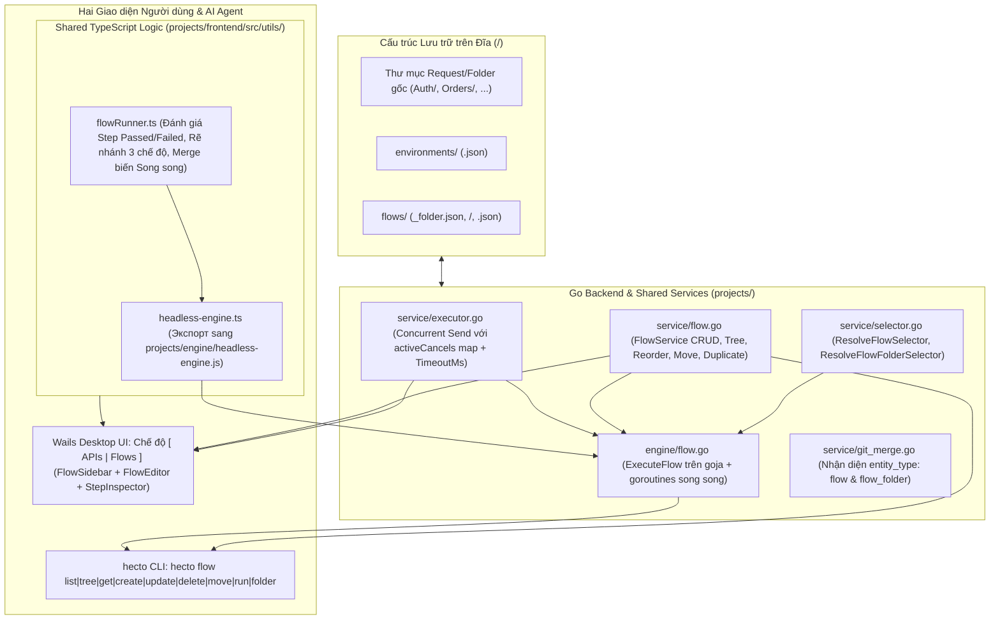
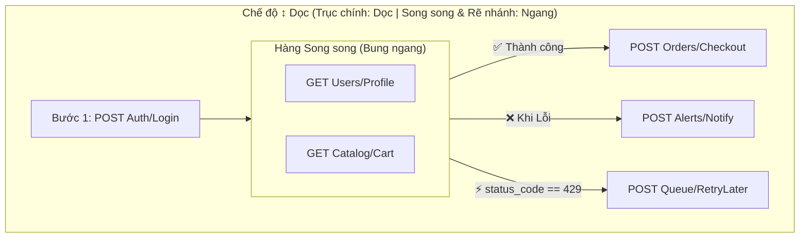

# Kiến trúc Kỹ thuật & Đặc tả Schema: API Flow (Structured Flowchart Runner), Không gian làm việc `[ APIs | Flows ]` & CLI `hecto flow`

Tài liệu companion này đặc tả chi tiết mô hình dữ liệu JSON trên đĩa, kiến trúc 2 trục vuông góc của Sơ đồ khối (`Structured Flowchart`), bộ máy thực thi dùng chung (`flowRunner.ts` + `headless-engine.js` + `projects/engine`), giao diện Wails Bindings, hệ thống Component/Store trên Vue 3 và ma trận lệnh CLI `hecto flow`.

---

## 1. Tổng quan Kiến trúc Hệ thống



---

## 2. Cấu trúc Lưu trữ trên Đĩa & Mô hình Dữ liệu (`CAP-1`, `CAP-2`)

### 2.1. Cấu trúc thư mục `<collection>/flows/`
Toàn bộ dữ liệu Flow của một Collection nằm tách biệt trong thư mục con `flows/` ngay dưới gốc Collection:
```text
<collection-root>/
├── collection.json
├── environments/
├── flows/
│   ├── _folder.json                  ← Lưu thứ tự gốc: { "id": "flows-root", "name": "Flows", "order": ["<uuid-1>", "<uuid-2>"] }
│   ├── <flow-uuid>.json              ← Thực thể Flow ở cấp gốc
│   └── e2e-checkout/                 ← Thư mục phân nhóm Flow (FlowFolder)
│       ├── _folder.json              ← Metadata nhóm: { "id": "<folder-uuid>", "name": "E2E Checkout", "order": ["<flow-uuid-2>"] }
│       └── <flow-uuid-2>.json        ← Thực thể Flow nằm trong nhóm
└── auth/                             ← Thư mục Request thông thường của màn APIs
    ├── _folder.json
    └── <req-uuid>.json
```

- **Cô lập với cây Request (`CollectionService.buildTree`):**
  Trong `projects/service/collection.go`, cập nhật điều kiện bỏ qua thư mục hệ thống:
  ```go
  if entry.IsDir() && (name == "environments" || name == "flows" || name == ".git" || name == ".history") {
      continue
  }
  ```
- **Tích hợp `FileSystem.FindByUUID` & `walkFindUUID` (`projects/storage/filesystem.go`):**
  - `walkFindUUID` chỉ bỏ qua `environments`, `.git`, `.history` (KHÔNG bỏ qua `flows`), nhờ đó `fs.FindByUUID(id)` tìm được cả `Flow` (`<uuid>.json`) lẫn `FlowFolder` (thư mục có `_folder.json`) bên trong `<collection>/flows/`.
  - Khi `FlowService.GetTree(collRoot)` duyệt `<collection>/flows/`, hàm gọi `s.fs.IndexSet(node.ID, fullPath)` cho mọi `FlowFolder` và `Flow` (không gọi `IndexClear()` để không xóa cache UUID của cây Request).

### 2.2. Go Structs trong `projects/model/types.go`

```go
// FlowBranchCondition định nghĩa điều kiện kích hoạt một nhánh rẽ sau khi FlowNode thực thi xong.
type FlowBranchCondition struct {
	Type     string `json:"type"`               // "success" | "error" | "custom"
	Source   string `json:"source,omitempty"`   // Khi type == "custom": "status_code" | "body_json" | "variable"
	Path     string `json:"path,omitempty"`     // JSON path (VD: "data.status", "items[0].id") khi source=="body_json", hoặc tên biến khi source=="variable"
	Operator string `json:"operator,omitempty"` // "==" | "!=" | ">" | "<" | "contains" | "exists"
	Value    string `json:"value,omitempty"`    // Giá trị so sánh (hỗ trợ {{var}})
}

// FlowBranch biểu diễn một nhánh rẽ (↙ ↘) bung ra từ một FlowNode.
type FlowBranch struct {
	ID        string              `json:"id"`
	Name      string              `json:"name,omitempty"`
	Condition FlowBranchCondition `json:"condition"`
	Nodes     []FlowNode          `json:"nodes"`
}

// FlowStep là con trỏ mỏng (Thin Pointer) tham chiếu tới một model.Request gốc qua RequestID.
type FlowStep struct {
	ID        string `json:"id"`
	RequestID string `json:"request_id"`
	Enabled   bool   `json:"enabled"`
	TimeoutMs int    `json:"timeout_ms,omitempty"` // Ghi đè timeout_ms cấp Flow nếu > 0
}

// FlowNode là một khối/hàng thực thi trên sơ đồ:
// - len(Steps) == 1: Bước đơn tuần tự.
// - len(Steps) >= 2: Hàng chạy Song song ([Req 1 || Req 2]) bung theo trục vuông góc.
// - len(Branches) > 0: Điểm rẽ nhánh (↙ ↘) bung các nhánh con theo trục vuông góc.
type FlowNode struct {
	ID       string       `json:"id"`
	Steps    []FlowStep   `json:"steps"`
	Branches []FlowBranch `json:"branches,omitempty"`
}

// Flow biểu diễn một kịch bản API Flow lưu dưới dạng <uuid>.json trong <collection>/flows/.
type Flow struct {
	ID          string     `json:"id"`
	Name        string     `json:"name"`
	Description string     `json:"description,omitempty"`
	Layout      string     `json:"layout"`               // "vertical" | "horizontal" (mặc định "vertical")
	TimeoutMs   int        `json:"timeout_ms,omitempty"` // Timeout mặc định cho mỗi bước trong Flow (ms), mặc định 30000
	MaxSteps    int        `json:"max_steps,omitempty"`  // Giới hạn tổng số bước thực thi tối đa (mặc định 100)
	Nodes       []FlowNode `json:"nodes"`
	CreatedAt   time.Time  `json:"created_at"`
	UpdatedAt   time.Time  `json:"updated_at"`
}

// FlowFolder biểu diễn thư mục phân nhóm hiển thị trong <collection>/flows/ (lưu tại _folder.json).
// Không chứa Variables, FolderEnvs, Headers, Auth hay AuthEnvs.
type FlowFolder struct {
	ID        string    `json:"id"`
	Name      string    `json:"name"`
	Order     []string  `json:"order,omitempty"`
	CreatedAt time.Time `json:"created_at"`
	UpdatedAt time.Time `json:"updated_at"`
}

// FlowTreeNode biểu diễn một node trên cây quản lý Flow ở Sidebar (type: "flow_folder" | "flow").
type FlowTreeNode struct {
	ID          string         `json:"id"`
	Name        string         `json:"name"`
	Type        string         `json:"type"` // "flow_folder" | "flow"
	Description string         `json:"description,omitempty"`
	Layout      string         `json:"layout,omitempty"`
	StepCount   int            `json:"step_count,omitempty"`
	Path        string         `json:"path"`
	Children    []FlowTreeNode `json:"children,omitempty"`
	CreatedAt   time.Time      `json:"created_at"`
}
```

### 2.3. Mở khóa Concurrency & `TimeoutMs` trong `ExecutorService` (`CAP-2`)
1. Cập nhật `model.ExecuteRequest` trong `projects/model/types.go`:
   ```go
   type ExecuteRequest struct {
       Method    string   `json:"method"`
       URL       string   `json:"url"`
       Headers   []KVPair `json:"headers"`
       Body      string   `json:"body"`
       BodyType  string   `json:"body_type,omitempty"`
       FormData  []KVPair `json:"form_data,omitempty"`
       TimeoutMs int      `json:"timeout_ms,omitempty"`
   }
   ```
2. Cập nhật `ExecutorService` trong `projects/service/executor.go`:
   - Thay `inflight bool` và `cancelFn context.CancelFunc` bằng:
     ```go
     mu            sync.Mutex
     nextReqID     uint64
     activeCancels map[uint64]context.CancelFunc
     ```
   - Trong `Send(req model.ExecuteRequest) model.Result`:
     - Xác định thời gian chờ:
       ```go
       timeout := s.timeout
       if req.TimeoutMs > 0 {
           timeout = time.Duration(req.TimeoutMs) * time.Millisecond
       }
       ctx, cancel := context.WithTimeout(context.Background(), timeout)
       ```
     - Đăng ký `cancel` vào `s.activeCancels[reqID]` (không chặn các request đang bay khác) và xóa `delete(s.activeCancels, reqID)` trong `defer`.
   - Trong `Abort() model.Result`:
     - Duyệt toàn bộ `s.activeCancels`, gọi `cancel()` cho mọi request đang bay và làm rỗng map.

---

## 3. Quy tắc Bố cục Sơ đồ Khối 2 Trục Vuông góc (`CAP-5`)

Sơ đồ khối tuân thủ nghiêm ngặt quy tắc **2 trục vuông góc tự động** dựa trên thuộc tính toàn cục `flow.layout` (`"vertical"` hoặc `"horizontal"`):

| Thành phần trên Sơ đồ | Khi `layout === "vertical"` (`↕ Dọc` - Mặc định) | Khi `layout === "horizontal"` (`↔ Ngang`) |
|---|---|---|
| **Trục chính (Chuỗi `FlowNode` nối tiếp)** | Xếp từ **Trên xuống Dưới** (`flex-col items-center`) | Xếp từ **Trái sang Phải** (`flex-row items-center`) |
| **Trục phụ vuông góc: Hàng Song song (`len(node.Steps) >= 2`)** | Các `FlowStep` trong cùng `FlowNode` bung **Ngang** (`flex-row items-stretch gap-4`) | Các `FlowStep` trong cùng `FlowNode` bung **Dọc** (`flex-col items-stretch gap-4`) |
| **Trục phụ vuông góc: Nhánh rẽ (`len(node.Branches) > 0`)** | Các `FlowBranch` bung **Ngang** (`flex-row items-start gap-6`), mỗi nhánh con bên trong lại chảy **Dọc** (`flex-col`) | Các `FlowBranch` bung **Dọc** (`flex-col items-start gap-6`), mỗi nhánh con bên trong lại chảy **Ngang** (`flex-row`) |



---

## 4. Ngữ nghĩa Thực thi Flow, Phán quyết Step & Rẽ nhánh (`CAP-3`)

### 4.1. Bộ hàm Dùng chung trong `projects/frontend/src/utils/flowRunner.ts`
Để đảm bảo **Single Source of Truth** giữa Wails Desktop UI và CLI `hecto flow run`, module `flowRunner.ts` cung cấp các hàm thuần (pure functions) được đóng gói vào `headless-engine.ts` $\rightarrow$ `projects/engine/headless-engine.js`:

1. **`evaluateStepVerdict(input: StepVerdictInput): { passed: boolean; failureReason?: string; failureCategory?: 'deleted_request' | 'network_or_timeout' | 'script_error' | 'test_failed' | 'http_status' }`**:
   - Nếu `input.requestMissing === true` $\rightarrow$ `{ passed: false, failureCategory: 'deleted_request', failureReason: 'Request gốc đã bị xóa khỏi Collection' }`.
   - Nếu `input.networkError` khác rỗng $\rightarrow$ `{ passed: false, failureCategory: 'network_or_timeout', failureReason: input.networkError }`.
   - Nếu `input.scriptError` khác rỗng $\rightarrow$ `{ passed: false, failureCategory: 'script_error', failureReason: input.scriptError }`.
   - Nếu `input.scriptTests` có phần tử nào `passed === false` $\rightarrow$ `{ passed: false, failureCategory: 'test_failed', failureReason: ... }`.
   - Nếu `input.scriptTests` rỗng (`length === 0`) và `input.statusCode >= 400` $\rightarrow$ `{ passed: false, failureCategory: 'http_status', failureReason: 'HTTP ' + input.statusCode }`.
   - Ngược lại (bao gồm trường hợp `statusCode >= 400` nhưng có ít nhất 1 `ha.test()` và toàn bộ `ha.test()` đều `passed === true`) $\rightarrow$ `{ passed: true }`.

2. **`evaluateCustomBranchCondition(condition: FlowBranchCondition, ctx: BranchEvalContext): boolean`**:
   - Giải biến `{{var}}` trong `condition.value` dựa trên `ctx.variables` hiện hành (nếu có).
   - Trích xuất giá trị nguồn `actualValue`:
     - `source === "status_code"`: `ctx.statusCode` (số nguyên; nếu bước lỗi mạng/deleted thì không tồn tại).
     - `source === "body_json"`: đọc giá trị theo đường dẫn `condition.path` (hỗ trợ cả chấm `a.b.c` và chỉ số mảng `items[0].id`) từ `JSON.parse(ctx.responseBody)`. Nếu body không phải JSON hợp lệ hoặc đường dẫn không tồn tại $\rightarrow$ `exists = false`.
     - `source === "variable"`: tra cứu `condition.path.trim()` trong `ctx.variables` (tập biến 4 tầng đã giải tại thời điểm sau khi bước chạy xong).
   - Áp dụng toán tử `condition.operator`:
     - `"exists"`: trả về `true` nếu đường dẫn JSON hoặc biến tồn tại và khác `undefined` / `null`.
     - `"=="` / `"!="`: so sánh bằng/khác (nếu cả hai vế ép kiểu số hợp lệ thì so sánh số, ngược lại so sánh chuỗi `String(actualValue) === String(expectedValue)`).
     - `">"` / `"<"`: ép kiểu `Number(actualValue)` và `Number(expectedValue)`; trả về `false` nếu một trong hai là `NaN`.
     - `"contains"`: nếu `actualValue` là mảng thì kiểm tra mảng chứa phần tử khớp `expectedValue`; nếu là chuỗi/số thì kiểm tra `String(actualValue).includes(String(expectedValue))`.

3. **`selectMatchingBranch(branches: FlowBranch[], nodePassed: boolean, ctx: BranchEvalContext): { matchedBranchId: string | null; skippedBranchIds: string[] }`**:
   - Bước 1: Duyệt theo thứ tự các nhánh có `condition.type === "custom"`. Nhánh đầu tiên có `evaluateCustomBranchCondition(...) === true` được chọn làm `matchedBranchId`.
   - Bước 2: Nếu không có nhánh `"custom"` nào khớp:
     - Nếu `nodePassed === true`: chọn nhánh đầu tiên có `condition.type === "success"`.
     - Nếu `nodePassed === false`: chọn nhánh đầu tiên có `condition.type === "error"`.
   - Mọi nhánh còn lại trong `branches` (kể cả toàn bộ các `FlowNode` và `FlowStep` con bên trong chúng) được đánh dấu là `skipped`.

4. **`mergeParallelScriptUpdates(baseState: HeadlessMutableState, stepOutputs: ParallelStepMutationItem[]): MergedParallelState`**:
   - Khi một `FlowNode` có nhiều `FlowStep` chạy song song (`[Req 1 || Req 2]`):
     - Mỗi step thực thi độc lập trên bản sao sâu (`structuredClone` / JSON deep copy) của `collection`, `environments`, `pathFolders`, `allFolders` tại thời điểm bắt đầu hàng.
     - Sau khi **tất cả** các step trong hàng hoàn tất, hàm `mergeParallelScriptUpdates` duyệt tuần tự qua mảng kết quả theo đúng thứ tự khai báo trong `node.Steps` (`index 0 -> 1 -> ...`) để gộp `envUpdates`, `scopedEnvUpdates` (`collection`, `globalEnvs`, `folderGlobals`, `folderEnvs`) và `scopedAuthUpdates` vào trạng thái chung, rồi mới ghi xuống đĩa **1 lần duy nhất** trước khi chuyển sang đánh giá nhánh hoặc bước kế tiếp.

### 4.2. Quy tắc Thực thi Cây `FlowNode[]` & Điều kiện Kết thúc Flow
- Bộ chạy duy trì bộ đếm `executedStepsCount` trên toàn Flow (khởi đầu `0`, giới hạn bởi `maxSteps = flow.max_steps > 0 ? flow.max_steps : 100`). Nếu `executedStepsCount >= maxSteps` khi chuẩn bị chạy bước mới $\rightarrow$ dừng ngay lập tức với lỗi `"Đã vượt quá giới hạn số bước thực thi tối đa (max_steps)"` và đánh dấu Flow `failed`.
- Tại mỗi `FlowNode` trong danh sách `nodes`:
  - Lọc các step có `step.enabled === true`.
  - Nếu không có step nào `enabled === true`: đánh dấu toàn bộ step trong `FlowNode` là `skipped`, đánh dấu các `Branches` (nếu có) là `skipped`, và tiếp tục sang `FlowNode` kế tiếp.
  - Nếu có 1 step `enabled`: thực thi step đó (truyền `effectiveTimeoutMs = step.timeout_ms > 0 ? step.timeout_ms : (flow.timeout_ms > 0 ? flow.timeout_ms : 30000)`).
  - Nếu có $\ge 2$ steps `enabled`: thực thi đồng thời tất cả các step `enabled` trong hàng; sau khi tất cả hoàn tất, gộp tuần tự các cập nhật biến/auth và lưu đĩa 1 lần. Hàng đạt `nodePassed = true` khi và chỉ khi **tất cả** các step `enabled` trong hàng đều có `passed === true`. Ngữ cảnh `BranchEvalContext` của hàng lấy từ step thực thi cuối cùng trong hàng (hoặc step đầu tiên bị lỗi nếu hàng `Failed`) kết hợp với bộ biến 4 tầng mới nhất sau khi merge.
  - **Xử lý sau khi `FlowNode` hoàn tất:**
    - **Trường hợp 1: Không khai báo nhánh (`len(node.Branches) == 0`)**:
      - Nếu `nodePassed === true`: đi tiếp sang `FlowNode` kế tiếp trong mảng `nodes` hiện tại.
      - Nếu `nodePassed === false`: **Dừng ngay lập tức (Halt on Error)**, đánh dấu các `FlowNode` còn lại phía sau là `skipped`, và kết thúc Flow với `status = "failed"`.
    - **Trường hợp 2: Có khai báo nhánh (`len(node.Branches) > 0`)**:
      - Gọi `selectMatchingBranch(node.Branches, nodePassed, branchCtx)`.
      - Nếu tìm thấy `matchedBranch`: đệ quy thực thi danh sách `matchedBranch.Nodes`. Nếu `matchedBranch` được kích hoạt (ví dụ nhánh `❌ Khi Lỗi` hoặc nhánh `⚡ Custom` đã bắt và xử lý lỗi của `FlowNode` hiện tại) và toàn bộ chuỗi `matchedBranch.Nodes` bên trong chạy hoàn tất mà không phát sinh lỗi dừng mới, luồng thực thi tiếp tục sang `FlowNode` kế tiếp sau khối rẽ nhánh (nếu có) và lỗi tại node chia nhánh được coi là **đã được bắt/xử lý (`handledByBranch = true`)**.
      - Nếu **không** có nhánh nào khớp (`matchedBranch == null`):
        - Nếu `nodePassed === false`: dừng ngay lập tức toàn bộ Flow với `status = "failed"`.
        - Nếu `nodePassed === true` (ví dụ chỉ cấu hình nhánh `On Error` mà không có nhánh `Success`): bỏ qua khối nhánh (`skipped`) và đi tiếp sang `FlowNode` kế tiếp trong mảng `nodes`.
- **Phán quyết `status` tổng thể của lần chạy Flow (`"passed" | "failed"`):**
  - `status = "passed"` nếu Flow không bị dừng giữa chừng do lỗi chưa xử lý (`halted_error == ""`), không bị `aborted`, và mọi step bị `Failed` đều đã được rẽ vào một nhánh xử lý (`On Error` hoặc `Custom`) chạy thành công. Ngược lại `status = "failed"`.

---

## 5. Wails Bindings & Giao diện Người dùng `[ APIs | Flows ]` (`CAP-4`, `CAP-5`)

### 5.1. Wails Bindings trong `projects/app.go`
Bổ sung `flowSvc *service.FlowService` vào `App` và xuất các phương thức Wails binding:
- `GetFlowTree() model.Result`
- `GetFlow(id string) model.Result`
- `CreateFlow(parentFolderId string) model.Result`
- `SaveFlow(flow model.Flow) model.Result`
- `RenameFlow(id, newName string) model.Result`
- `DeleteFlow(id string) model.Result`
- `DuplicateFlow(id string) model.Result`
- `CreateFlowFolder(parentFolderId string) model.Result`
- `RenameFlowFolder(id, newName string) model.Result`
- `DeleteFlowFolder(id string) model.Result`
- `ReorderFlowNodes(parentFolderId string, orderedIds []string) model.Result`
- `MoveFlowNode(nodeId, targetFolderId string, targetIndex int) model.Result`
- `SortFlowNodes(parentFolderId string) model.Result`

### 5.2. Pinia Store `flowStore.ts` (`projects/frontend/src/stores/flowStore.ts`)
- Quản lý trạng thái:
  - `workspaceMode`: `'apis' | 'flows'` (hoặc đặt trong `uiStore.workspaceMode`, mặc định `'apis'`).
  - `flowTree`: `FlowTreeNode[]`, `expandedFlowFolders`: `Set<string>`, `activeFlowId`: `string | null`, `currentFlow`: `Flow | null`, `savedSnapshot`: `string`, `isDirty`: `boolean`.
  - Trạng thái thực thi trực tiếp: `isRunning`: `boolean`, `abortRequested`: `boolean`, `nodeStates`: `Record<string, 'idle' | 'running' | 'passed' | 'failed' | 'skipped'>`, `branchStates`: `Record<string, 'idle' | 'active' | 'skipped'>`, `stepResults`: `Record<string, FlowStepExecutionDetail>`, `selectedStepId`: `string | null`.
- Thực thi Flow trên UI (`flowStore.runCurrentFlow()`):
  - Sử dụng chính các hàm điều phối của `headless-engine.ts` (`prepareHeadlessExecution`, `runHeadlessPostResponse`, `evaluateStepVerdict`, `selectMatchingBranch`, `mergeParallelScriptUpdates`) kết hợp gọi Wails binding `SendRequest` (hoặc `Promise.all` các lệnh `SendRequest` cho Hàng Song song) để cập nhật giao diện thời gian thực sau từng bước mà không cần chờ toàn bộ Flow kết thúc.
  - Sau khi mỗi bước đơn hoặc Hàng Song song hoàn tất, lưu cập nhật biến/auth xuống đĩa và đồng bộ lại `collectionStore` / `environmentStore` trên RAM để bước tiếp theo đọc đúng giá trị mới nhất.

### 5.3. Hệ thống Vue Components cho Màn hình `Flows`
1. **`AppSidebar.vue` & `FlowSidebarTree`**:
   - Bổ sung thanh chuyển đổi сегment **`[ APIs | Flows ]`** ngay đầu Sidebar (`data-test="workspace-mode-apis"`, `data-test="workspace-mode-flows"`).
   - Khi ở chế độ `Flows`, hiển thị ô tìm kiếm Flow, nút `+` (tạo `New Flow` hoặc `New Flow Folder`), nút `Thu gọn tất cả`, nút `Sắp xếp A-Z`, nút `Smart Reload` (`data-test="sidebar-reload-btn"`) và cây `FlowTreeNode` hỗ trợ kéo-thả sắp xếp, đổi tên tại chỗ (`F2`), nhân bản và xóa.
2. **`ContentArea.vue` & `FlowEditor.vue`**:
   - Khi `uiStore.workspaceMode === 'flows'`, `ContentArea.vue` hiển thị `FlowEditor.vue` (nếu có `flowStore.currentFlow`) hoặc `EmptyStateFlow.vue`.
   - `FlowEditor.vue` chia làm 2 phần có thanh kéo splitter (tương tự RequestPane / ResponsePane):
     - **Phần trên/chính (`FlowCanvas`)**:
       - Thanh công cụ `FlowToolbar`: Tên Flow, nút gạt **`Bố cục: [ ↕ Dọc | ↔ Ngang ]`** (`data-test="flow-layout-toggle"`), ô nhập `Timeout (ms)`, nút **`+ Thêm bước`**, nút **`Lưu`**, nút **`▶ Chạy Flow` / `⏹ Dừng`**, và badge tổng kết kết quả chạy.
       - Sơ đồ khối đệ quy (`FlowNodeList.vue` / `FlowNodeItem.vue`): Hiển thị các khối `FlowStepCard` nối nhau bằng đường kẻ trục chính; mỗi khối có nút `+` (chèn bước nối tiếp), nút `||` (thêm bước chạy song song cùng hàng), nút `↙ ↘` (thêm nhánh rẽ `✅ Thành công` / `❌ Khi Lỗi` / `⚡ Điều kiện tùy chỉnh` với 3 ô chọn trực quan: `Nguồn [Status Code | Body JSON path | Biến]` $\rightarrow$ `Toán tử [==, !=, >, <, contains, exists]` $\rightarrow$ `Giá trị`), và hỗ trợ kéo-thả hoán đổi vị trí bước.
     - **Phần dưới/cạnh (`StepInspectorPanel.vue`)**:
       - Mở ra khi người dùng click vào bất kỳ `FlowStepCard` nào trên sơ đồ.
       - Hiển thị thông tin bước, lý do lỗi (nếu có), nút **`Mở Request gốc ↗`** (`data-test="open-original-request-btn"` — khi nhấn sẽ chuyển `uiStore.workspaceMode = 'apis'` và gọi `collectionStore.selectRequest(step.request_id)`), và nhúng `ResponseViewer.vue` (cập nhật `ResponseViewer.vue` hỗ trợ prop tùy chọn `:override-data="stepInspectorData"` hoặc đọc từ `responseStore` mặc định để tái sử dụng 100% giao diện xem Body JSON/XML, Headers, Test Results, Execution Logs).
3. **`RequestPickerModal.vue` (Searchable Request Picker)**:
   - Hiển thị danh sách phẳng toàn bộ Request trong Collection kèm badge Method (`GET`, `POST`,...) và đường dẫn thư mục đầy đủ (`Auth / OAuth / Login`), lọc tức thì khi gõ phím và hỗ trợ chọn bằng phím mũi tên + `Enter`.

---

## 6. Ma trận Lệnh CLI `hecto flow` & Schema `FlowRunOutput` (`CAP-6`)

### 6.1. Ma trận Lệnh `hecto flow` (`projects/cmd/hecto/`)

| Lệnh CLI | Ý nghĩa & Cờ hỗ trợ |
|---|---|
| `hecto flow list [--folder <id\|path>] [-c <coll>] [--json]` | Liệt kê danh sách các Flow (phẳng hoặc trong một Flow Folder). |
| `hecto flow tree [-c <coll>] [--json]` | Hiển thị cây phân cấp `FlowFolder` và `Flow` trong `<collection>/flows/`. |
| `hecto flow get <id\|path> [-c <coll>] [--json]` | Lấy chi tiết toàn bộ cấu trúc JSON của một Flow (kèm thông tin tóm tắt các Request được tham chiếu). |
| `hecto flow create --name <name> [--folder <id\|path>] [--desc <text>] [--layout vertical\|horizontal] [--timeout-ms <ms>] [--max-steps <n>] [--steps "<req1>,<req2>\|\|<req3>,..."] [--nodes-json <json\|@file>] [-c <coll>] [--json]` | Tạo mới một Flow trong 1 bước. Cờ `--steps` hỗ trợ cú pháp rút gọn phân tách bước tuần tự bằng dấu `,` và bước song song cùng hàng bằng `\|\|` (mỗi phần tử là UUID hoặc đường dẫn tên Request như `"Auth/Login,Users/Profile\|\|Catalog/Cart"`). Cờ `--nodes-json` nhận mảng `FlowNode[]` đầy đủ (hỗ trợ cả nhánh rẽ `branches`). |
| `hecto flow update <id\|path> [--name <name>] [--desc <text>] [--layout vertical\|horizontal] [--timeout-ms <ms>] [--max-steps <n>] [--steps "..."] [--nodes-json <json\|@file>] [-c <coll>] [--json]` | Cập nhật Flow theo ngữ nghĩa **Read-Merge-Write (patch)** qua `FlagSet.Visit` (chỉ sửa trường có truyền cờ). |
| `hecto flow delete <id\|path> [-c <coll>] [--json]` | Xóa tệp Flow khỏi `<collection>/flows/`. |
| `hecto flow move <id\|path> --to <folder-id\|path\|root> [-c <coll>] [--json]` | Di chuyển Flow sang một `FlowFolder` khác hoặc ra gốc `flows/`. |
| `hecto flow folder create --name <name> [--parent <id\|path>] \| update <id\|path> --name <name> \| delete <id\|path> \| move <id\|path> --to <id\|path\|root> [-c <coll>] [--json]` | Quản lý cây thư mục phân nhóm `FlowFolder` trong `<collection>/flows/`. |
| `hecto flow run <id\|path> [-c <coll>] [--env <id\|name>] [--var K=V]... [--timeout-ms <ms>] [--no-save-env] [--json]` | Thực thi toàn bộ sơ đồ Flow trên `projects/engine` (`ExecuteFlow`) và trả về `FlowRunOutput`. |

### 6.2. Cấu trúc `FlowRunOutput` (`projects/engine/flow.go`)

```go
type FlowStepRunOutput struct {
	StepID          string     `json:"step_id"`
	NodeID          string     `json:"node_id"`
	RequestID       string     `json:"request_id"`
	RequestName     string     `json:"request_name,omitempty"`
	Method          string     `json:"method,omitempty"`
	Status          string     `json:"status"` // "passed" | "failed" | "skipped"
	FailureCategory string     `json:"failure_category,omitempty"`
	FailureReason   string     `json:"failure_reason,omitempty"`
	RunOutput       *RunOutput `json:"run_output,omitempty"`
}

type FlowNodeRunOutput struct {
	NodeID          string              `json:"node_id"`
	Status          string              `json:"status"` // "passed" | "failed" | "skipped"
	MatchedBranchID string              `json:"matched_branch_id,omitempty"`
	StepResults     []FlowStepRunOutput `json:"step_results"`
}

type FlowRunOutput struct {
	FlowID        string              `json:"flow_id"`
	FlowName      string              `json:"flow_name"`
	Status        string              `json:"status"` // "passed" | "failed"
	TotalTimeMs   int64               `json:"total_time_ms"`
	StepsExecuted int                 `json:"steps_executed"`
	StepsPassed   int                 `json:"steps_passed"`
	StepsFailed   int                 `json:"steps_failed"`
	StepsSkipped  int                 `json:"steps_skipped"`
	HaltedError   string              `json:"halted_error,omitempty"`
	NodeResults   []FlowNodeRunOutput `json:"node_results"`
	StepResults   []FlowStepRunOutput `json:"step_results"`
}
```
