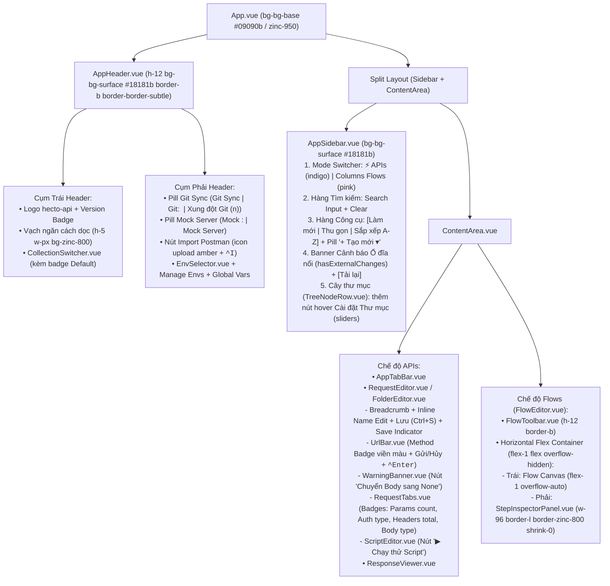

# Chi tiết Kỹ thuật & Ánh xạ Giao diện từ Mockup (`ui-mockup-alignment-details.md`)

Tài liệu đính kèm này cụ thể hóa ma trận Design Tokens, sơ đồ bố cục tổng thể, chi tiết thay đổi trên từng component Vue 3 (`projects/frontend/src/`), các thuộc tính `data-test`, và danh mục bảo toàn tính năng nâng cao khi đồng bộ giao diện với bản thiết kế mẫu `/home/dev/Downloads/hecto_api_desktop_ui.html`.

---

## 1. Sơ đồ Kiến trúc Bố cục Giao diện (Layout Hierarchy)

---

## 2. Hệ thống Design Tokens & Badge HTTP Method (`projects/frontend/src/style.css`)

### 2.1. Bảng ánh xạ CSS Custom Properties (`@theme`)

| Token trong `style.css` | Giá trị cũ (Slate + Blue) | Giá trị mới (Dark Zinc + Indigo) | Tương đương Tailwind trong Mockup |
| :--- | :--- | :--- | :--- |
| `--color-bg-base` | `#0F172A` | `#09090B` | `zinc-950` |
| `--color-bg-surface` | `#1E293B` | `#18181B` | `zinc-900` |
| `--color-bg-elevated` | `#334155` | `#27272A` | `zinc-800` |
| `--color-bg-hover` | `#26334D` | `#27272A` | `zinc-800/80` |
| `--color-border-subtle` | `#334155` | `#27272A` | `border-zinc-800` |
| `--color-border-focus` | `#3B82F6` | `#6366F1` | `indigo-500` |
| `--color-text-primary` | `#F8FAFC` | `#F4F4F5` | `zinc-100` |
| `--color-text-secondary` | `#94A3B8` | `#A1A1AA` | `zinc-400` |
| `--color-text-muted` | `#64748B` | `#71717A` | `zinc-500` |
| `--color-accent-primary` | `#3B82F6` | `#4F46E5` | `indigo-600` |
| `--color-accent-hover` | `#2563EB` | `#6366F1` | `indigo-500` |
| `--color-method-get` | `#10b981` | `#10b981` | `emerald-500` (`#10b981`) |
| `--color-method-post` | `#f59e0b` | `#f59e0b` | `amber-500` (`#f59e0b`) |
| `--color-method-put` | `#3b82f6` | `#3b82f6` | `blue-500` (`#3b82f6`) |
| `--color-method-patch` | `#f97316` | `#f97316` | `orange-500` (`#f97316`) |
| `--color-method-delete` | `#ef4444` | `#ef4444` | `red-500` (`#ef4444`) |
| `--color-method-head` | *(mới)* | `#22d3ee` | `cyan-400` (`#22d3ee`) |
| `--color-method-options` | *(mới)* | `#c084fc` | `purple-400` (`#c084fc`) |

### 2.2. Chuẩn hóa class Badge HTTP Method (Nền mờ + Viền màu)

Định nghĩa các utility class `.method-badge-<method>` trong `style.css` (hoặc helper dùng chung) kết hợp với `.text-method-<method>` để vừa hiển thị đúng thiết kế badge (nền mờ `12%`, viền màu `25%`), vừa bảo toàn 100% bảng màu HTTP Method gốc quen thuộc (`GET` xanh lá, `POST` vàng cam amber, `PUT` xanh dương, `PATCH` cam, `DELETE` đỏ, `HEAD` xanh lơ, `OPTIONS` tím) và các class `text-method-get`, `text-method-post`,... phục vụ bộ kiểm thử hiện tại:

- **`GET`**: `text-method-get method-badge-get` (`color: #10b981; background: rgba(16, 185, 129, 0.12); border-color: rgba(16, 185, 129, 0.25)`)
- **`POST`**: `text-method-post method-badge-post` (`color: #f59e0b; background: rgba(245, 158, 11, 0.12); border-color: rgba(245, 158, 11, 0.25)`)
- **`PUT`**: `text-method-put method-badge-put` (`color: #3b82f6; background: rgba(59, 130, 246, 0.12); border-color: rgba(59, 130, 246, 0.25)`)
- **`PATCH`**: `text-method-patch method-badge-patch` (`color: #f97316; background: rgba(249, 115, 22, 0.12); border-color: rgba(249, 115, 22, 0.25)`)
- **`DELETE`**: `text-method-delete method-badge-delete` (`color: #ef4444; background: rgba(239, 68, 68, 0.12); border-color: rgba(239, 68, 68, 0.25)`)
- **`HEAD`**: `text-method-head method-badge-head` (`color: #22d3ee; background: rgba(34, 211, 238, 0.12); border-color: rgba(34, 211, 238, 0.25)`)
- **`OPTIONS`**: `text-method-options method-badge-options` (`color: #c084fc; background: rgba(192, 132, 252, 0.12); border-color: rgba(192, 132, 252, 0.25)`)

---

## 3. Đặc tả Chi tiết Từng Khu vực & Component

### 3.1. Thanh Header (`AppHeader.vue` & `CollectionSwitcher.vue`)

1. **Cụm bên trái (`
`)**:
   - Hiển thị Logo biểu tượng tia sét nền `bg-indigo-600/20 border border-indigo-500/30` + tên `hecto-api` + badge `v{{ appVersion }}`.
   - Thêm vạch ngăn cách dọc `

`.
   - Đặt `<CollectionSwitcher />` ngay bên phải vạch ngăn cách (thay vì nằm ở cụm bên phải như trước).
   - Trên nút bấm mở dropdown của `CollectionSwitcher.vue` (`data-test="collection-switcher-btn"`): hiển thị thêm badge `Default` (`text-[10px] px-1.5 py-0.5 rounded bg-indigo-500/15 text-indigo-400 font-medium`) nếu collection đang chọn có `is_default === true`.

2. **Cụm bên phải (`
`)**:
   - **Nút Git Sync Pill (`data-test="git-config-btn"`)**:
     - Hiển thị icon nhánh Git + chấm trạng thái + nhãn văn bản rõ ràng:
       - Khi `gitStore.hasConflict === true`: khung viền/nền cảnh báo amber (`border-amber-500/40 bg-amber-500/10 text-amber-300`), chấm tròn nhấp nháy `data-test="git-status-badge-conflict"`, nhãn chữ `Xung đột Git ({{ gitStore.conflictFiles.length }})`.
       - Khi `gitStore.isConfigured === true` và không có xung đột: chấm xanh `data-test="git-status-badge-configured"`, nhãn chữ `Git: {{ gitStore.config?.branch || 'main' }}`.
       - Khi chưa cấu hình Git: chấm xám `bg-zinc-600`, nhãn chữ `Git Sync`.
   - **Nút Mock Server Pill (`data-test="open-mock-server-btn"`)**:
     - Khi `mockStore.status.running === true`: khung viền/nền xanh ngọc (`border-emerald-500/40 bg-emerald-500/10 text-emerald-300`), chấm tròn xanh nhấp nháy `data-test="mock-server-running-indicator"`, nhãn chữ `Mock :{{ mockStore.status.port }}`.
     - Khi tắt: chấm tròn xám `bg-zinc-600`, nhãn chữ `Mock Server`.
   - **Nút Import Postman (`data-test="import-collection-btn"`)**:
     - Gồm icon Upload màu `text-amber-400`, chữ `Import Postman`, và thẻ phím tắt `<kbd class="text-[10px] text-zinc-500 bg-zinc-800 px-1 rounded">^I</kbd>`.
   - Vạch ngăn cách dọc `

` rồi đến `<EnvSelector />`, nút Quản lý biến môi trường (`data-test="manage-env-btn"`) và nút Biến toàn cục (`data-test="open-global-vars-btn"`).

### 3.2. Thanh Sidebar (`AppSidebar.vue`, `TreeNodeRow.vue`, `TreeContextMenu.vue`)

1. **Bộ chuyển đổi chế độ `APIs` / `Flows` (`AppSidebar.vue`)**:
   - Nút `APIs` (`data-test="workspace-mode-apis"`): có icon tia sét `<svg>` (màu `text-indigo-400` khi active) + chữ `APIs`.
   - Nút `Flows` (`data-test="workspace-mode-flows"`): có icon luồng/cột `<svg>` (màu `text-pink-400` khi active) + chữ `Flows`.

2. **Tách hàng Tìm kiếm và hàng Công cụ (`AppSidebar.vue`)**:
   - **Hàng 1 (Ô tìm kiếm)**: `<input data-test="tree-filter-input" placeholder="Tìm nhanh request, thư mục..." />` chiếm trọn chiều ngang (`w-full`), kèm nút xóa nhanh `data-test="clear-filter-btn"` khi có từ khóa.
   - **Hàng 2 (Thanh công cụ)**: `flex items-center justify-between`:
     - Cụm nút icon bên trái (`flex items-center gap-0.5`):
       - Nút Làm mới (`data-test="sidebar-reload-btn"`, `title="Làm mới từ ổ đĩa (Ctrl+R)"`) kèm chấm cảnh báo `data-test="external-change-badge"` khi `store.hasExternalChanges === true`.
       - Nút Thu gọn tất cả (`data-test="tree-collapse-all-btn"`, `title="Thu gọn tất cả"`).
       - Nút Sắp xếp A-Z (`data-test="tree-sort-alphabet-btn"`, `title="Sắp xếp gốc A-Z"`).
     - Cụm bên phải: Nút pill `+ Tạo mới ▾` (`data-test="sidebar-add-btn"`, style `px-2.5 py-1 rounded-md text-xs font-medium bg-indigo-600/15 hover:bg-indigo-600/25 text-indigo-300 border border-indigo-500/30`). Menu xổ xuống giữ nguyên các item `data-test="add-request-item"`, `data-test="add-folder-item"`, `data-test="add-flow-item"`, `data-test="add-flow-folder-item"`.

3. **Banner cảnh báo ổ đĩa thay đổi (`AppSidebar.vue`)**:
   - Hiển thị ngay phía trên danh sách cây thư mục khi `store.hasExternalChanges === true` (`data-test="external-change-banner"`):
     - Nội dung: Icon cảnh báo + `"Phát hiện ổ đĩa thay đổi (Git/CLI)"`.
     - Nút hành động: `[Tải lại]` (`data-test="external-change-reload-btn"`) gọi `handleSmartReload()` (`store.smartReload()`).

4. **Nút mở nhanh `Cài đặt Thư mục` trên dòng Folder (`TreeNodeRow.vue` & `TreeContextMenu.vue`)**:
   - Trong `TreeNodeRow.vue` (chế độ `mode === 'apis'`, khi `node.type === 'folder'` và không ở chế độ đổi tên):
     - Cụm nút thao tác nhanh khi hover (`opacity-0 group-hover:opacity-100`) gồm 3 nút:
       1. Nút `Cài đặt Thư mục` (`data-test="folder-settings-btn"`, `title="Cài đặt Thư mục (Auth, Headers, Vars, Scripts)"`, icon sliders) — khi bấm (`@click.stop`) gọi `store.openFolderSettings(props.node.id)`.
       2. Nút `Sắp xếp thư mục A-Z` (`data-test="folder-sort-btn"`, icon A-Z).
       3. Nút `•••` mở menu ngữ cảnh (`data-test="tree-node-menu-btn"`).
   - Trong `TreeContextMenu.vue`: giữ và đồng bộ mục `Cài đặt thư mục` (`data-test="ctx-folder-settings"`, chỉ hiển thị ở chế độ `apis` cho node `folder`) kèm icon sliders màu `text-indigo-400`.

### 3.3. Khu vực Soạn thảo Request/Folder (`RequestEditor.vue`, `FolderEditor.vue`, `UrlBar.vue`, `WarningBanner.vue`, `RequestTabs.vue`, `ScriptEditor.vue`)

1. **Thanh Breadcrumb, Sửa tên nhanh Inline & Nút Lưu (`RequestEditor.vue` & `FolderEditor.vue`)**:
   - Trên `RequestEditor.vue`:
     - Cụm trái (Breadcrumb): Hiển thị đường dẫn thư mục (`data-test="breadcrumb-folder"`) + tên Request hiện tại (`data-test="breadcrumb-request"`).
     - Giữ nguyên hành vi click vào `data-test="breadcrumb-request"` để gọi `collectionStore.revealNodeInTree(req.id)`.
     - Hỗ trợ sửa nhanh tên Request inline ngay trên thanh Breadcrumb:
       - Thêm nút bút chì sửa tên cạnh tên request (`data-test="breadcrumb-rename-btn"`, `title="Đổi tên Request"`) hoặc cho phép double-click vào tên request để bật ô `<input data-test="breadcrumb-name-input" />` (hoặc chỉnh sửa trực tiếp, lưu qua `collectionStore.renameNode(req.id, newName, 'request')` và đồng bộ `requestStore.activeRequest.name`).
     - Cụm phải: Đặt chỉ báo trạng thái lưu (`data-test="save-state-indicator"`) cạnh nút `Lưu (Ctrl+S)` (`data-test="request-save-btn"`):
       - Nút `Lưu (Ctrl+S)` có icon đĩa mềm/save + nhãn `Lưu (Ctrl+S)` (`px-2.5 py-1 rounded bg-zinc-800 hover:bg-zinc-700 text-zinc-200 border border-zinc-700`), khi bấm gọi `autoSave.saveNow()`.
   - Trên `FolderEditor.vue`:
     - Bổ sung thanh Breadcrumb đồng bộ với `RequestEditor.vue`: hỗ trợ sửa nhanh tên thư mục inline (`data-test="folder-name-input"` / `collectionStore.renameNode(folder.id, newName, 'folder')`) và đặt chỉ báo trạng thái lưu cạnh nút `Lưu (Ctrl+S)` (`data-test="folder-save-btn"`, gọi `saveFolderSettingsNow()`).

2. **Thanh URL & Nút Gửi (`UrlBar.vue`)**:
   - Nút chọn HTTP Method (`#http-method-select`): áp dụng màu chữ + nền mờ + viền màu theo phương thức đang chọn (`GET` emerald, `POST` blue, `PUT` amber, `PATCH` purple, `DELETE` rose, `HEAD` cyan, `OPTIONS` zinc).
   - Nút Gửi (`data-test="send-request-btn"`, `aria-label="Gửi"`):
     - Style: `bg-indigo-600 hover:bg-indigo-500 text-white font-semibold px-4 h-9 rounded-md flex items-center gap-2 shadow-lg shadow-indigo-600/20`.
     - Nội dung: Icon gửi (`<svg>`) + chữ `Gửi` + badge `<kbd class="text-[10px] bg-indigo-700/80 text-indigo-200 px-1.5 py-0.5 rounded font-mono">^Enter</kbd>`.
   - Nút Hủy khi đang gửi (`data-test="abort-request-btn"`):
     - Style: `bg-rose-600 hover:bg-rose-500 text-white font-semibold px-4 h-9 rounded-md flex items-center gap-2`.
     - Nội dung: Icon spinner (`<svg class="animate-spin">`) + chữ `Hủy`.

3. **Banner Cảnh báo GET có Body (`WarningBanner.vue`)**:
   - Khi `requestStore.showGetBodyWarning === true` (`method === 'GET'` và `body.type !== 'none'`):
     - Hiển thị cảnh báo màu amber: `"Cảnh báo: Phương thức GET đang đi kèm dữ liệu Body ({{ body.type.toUpperCase() }}). Một số máy chủ hoặc proxy có thể bỏ qua hoặc từ chối request này."`
     - Bổ sung nút thao tác nhanh bên phải: `Chuyển Body sang None` (`data-test="switch-body-none-btn"`, gọi `requestStore.setBodyType('none')`), đặt cạnh nút đóng `Bỏ qua`.

4. **Thanh Tab Cấu hình Request (`RequestTabs.vue`)**:
   - Hiển thị các badge trạng thái động trên từng tab:
     - **Tab `Params` (`data-test="request-tab-params"`)**: badge số lượng query params đang `enabled` (`data-test="tab-params-badge"`).
     - **Tab `Auth` (`data-test="request-tab-auth"`)**: badge hiển thị kiểu Auth hiện tại (`inherit`, `bearer`, `basic`, `apiKey`, `none`) trên `data-test="tab-auth-badge"` (màu `bg-emerald-500/15 text-emerald-400` khi khác `none`, hoặc `bg-zinc-800 text-zinc-500` khi là `none`).
     - **Tab `Headers` (`data-test="request-tab-headers"`)**: badge tổng số Headers đang có hiệu lực (`data-test="tab-headers-badge"`) = số custom headers có `enabled !== false` và `key.trim() !== ''` + số default/inherited headers đang bật và không bị ghi đè.
     - **Tab `Body` (`data-test="request-tab-body"`)**: badge hiển thị kiểu Body hiện tại (`json`, `xml`, `form-data`, `urlencoded`, `text`, `none`) trên `data-test="tab-body-badge"` (màu `bg-indigo-500/15 text-indigo-400` khi khác `none`, hoặc `bg-zinc-800 text-zinc-500` khi là `none`).
     - **Tab `Scripts (Pre/Post)` (`data-test="request-tab-scripts"`)**: chấm tròn xanh/indigo khi có mã kịch bản trong `pre_request` hoặc `post_response`.

5. **Trình soạn thảo Script (`ScriptEditor.vue`)**:
   - Trên thanh tiêu đề của `ScriptEditor.vue`, cập nhật nút chạy thử script (`data-test="run-pre-script-btn"`) hiển thị nhãn `▶ Chạy thử Script` (style `bg-emerald-500/15 hover:bg-emerald-500/25 text-emerald-300 border border-emerald-500/30`), thực thi thử script hiện tại và hiển thị kết quả/log ở khung kết quả bên dưới kèm thông báo toast.

### 3.4. Khu vực Flows (`FlowEditor.vue`, `StepInspectorPanel.vue`, `FlowToolbar.vue`, `FlowStepCard.vue`)

1. **Bố cục Ngăn kéo Phải cho `StepInspectorPanel.vue` (`FlowEditor.vue`)**:
   - Trong `FlowEditor.vue` (`data-test="flow-editor"`):
     - Giữ `<FlowToolbar />` ở trên cùng (`shrink-0`).
     - Bọc vùng `
` và `<StepInspectorPanel />` trong một container flex ngang: `
`.
     - Trong `StepInspectorPanel.vue` (`data-test="step-inspector-panel"`):
       - Đổi class gốc từ `h-[46%] min-h-[220px] max-h-[60%] border-t border-border-subtle` sang ngăn kéo dọc bên phải: `w-96 border-l border-zinc-800 bg-bg-surface flex flex-col shrink-0 h-full overflow-hidden z-20`.
       - Giữ nguyên nút `Mở Request gốc ↗` (`data-test="open-original-request-btn"`), nút đóng `✕` (`data-test="close-step-inspector-btn"`), thông tin method/URL/trạng thái `ha.test`, và `<ResponseViewer :overrideData="overrideData" />` bên trong ngăn kéo.

---

## 4. Danh mục Bảo toàn Tính năng Nâng cao & Hợp đồng Kiểm thử

| Hạng mục / Tính năng nâng cao | Trạng thái trong Mockup HTML | Quy tắc trong Đặc tả (BẮT BUỘC GIỮ NGUYÊN 100%) |
| :--- | :--- | :--- |
| `VariableHighlighter.vue` & `VariableHoverPopover.vue` | Chỉ là `<input>` tĩnh | Giữ nguyên lớp phủ highlight biến `{{var}}` theo 4 tầng (`Runtime > Env > Folder > Collection > Unresolved`) và popover xem/sửa nhanh giá trị biến trên `UrlBar`, `KeyValueEditor`, `AuthEditor`, `BodyEditor`. |
| `CustomSelect.vue` | `<select>` native | Giữ nguyên component `CustomSelect` có điều hướng bàn phím và style đồng nhất. |
| `CodeEditor.vue` (JSONC/XML/JS) | `<textarea>` tĩnh | Giữ nguyên trình soạn thảo code có đánh số dòng, highlight cú pháp JSONC/XML/JS, gợi ý biến `{{` và hàm `ha.*`, nút Format JSON và kiểm tra lỗi cú pháp. |
| Kế thừa Auth & Headers 3 cấp (`Folder` / `Collection` → `Request`) | Chỉ hiển thị banner giả lập | Giữ nguyên toàn bộ logic tính toán `effectiveInheritedAuth`, `defaultHeaders` từ Folder cha & Collection, và nút xem nguồn kế thừa. |
| Kéo-thả cây thư mục (Drag & Drop) | Không có | Giữ nguyên toàn bộ sự kiện drag/drop sắp xếp thứ tự và di chuyển node giữa các thư mục trong `AppSidebar.vue` và `TreeNodeRow.vue`. |
| `GitConflictResolverModal.vue` (3-way merge) | Modal tĩnh 2 cột đơn giản | Giữ nguyên 100% trình giải quyết xung đột Git 3-way (`LOCAL / OURS`, `MERGED RESULT`, `REMOTE / THEIRS`) và luồng hoàn tất rebase. |
| `FlowEditor.vue` & `flowRunner.ts` đa nhánh | Chỉ 2 nhánh tĩnh mẫu | Giữ nguyên sơ đồ luồng 2 trục hỗ trợ nhiều step song song trong 1 node, nhiều nhánh điều kiện (`success`, `failure`, `always`, `custom`), kéo thả và chạy thực tế qua `flowStore.runCurrentFlow()`. |
