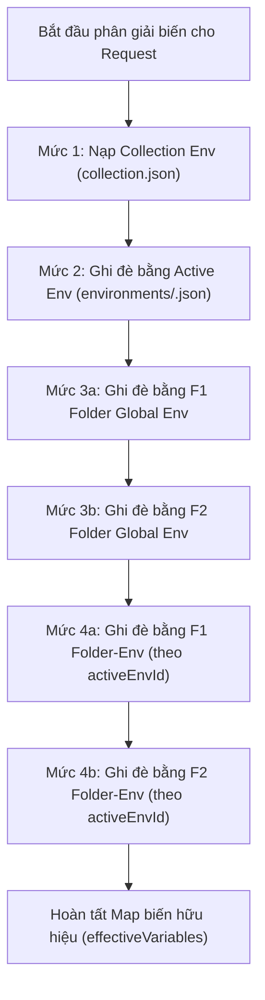

# Kiến Trúc Môi Trường & Ma Trận Phân Giải Biến

Tài liệu đồng hành (Companion) cho SPEC-folder-collection-env. Định nghĩa chi tiết cấu trúc dữ liệu lưu trữ, ma trận phân giải biến 4 cấp độ, thiết kế giao diện người dùng và quy tắc an toàn dữ liệu kiểm thử.

---

## 1. Ma Trận Phân Giải Biến 4 Cấp Độ (Variable Resolution Hierarchy)

### 1.1. Thứ tự ưu tiên ghi đè (Precedence Chain)

Khi người dùng soạn thảo request hoặc thực thi HTTP request, các biến định dạng `{{variable_name}}` trong URL, Query Params, Headers, Body và Auth được thay thế theo thứ tự ưu tiên ghi đè từ thấp đến cao:

```
[Mức 1: Thấp nhất] Collection Env
         ↓ (bị ghi đè bởi)
[Mức 2] Global Env (Active Environment được chọn)
         ↓ (bị ghi đè bởi)
[Mức 3] Folder Global Env (biến dùng chung của thư mục cha)
         ↓ (bị ghi đè bởi)
[Mức 4: Cao nhất] Folder-Env (biến riêng của thư mục ứng với Active Env ID)
```

### 1.2. Bảng ma trận ưu tiên chi tiết

| Cấp độ | Tên gọi | Phạm vi hiệu lực (Scope) | Nguồn lưu trữ | Điều kiện kích hoạt |
|---|---|---|---|---|
| **Mức 1** | **Collection Env** | Toàn bộ Collection, mọi môi trường | `<col-root>/collection.json` -> `variables` | Luôn kích hoạt cho mọi request thuộc collection |
| **Mức 2** | **Global Env** | Toàn bộ ứng dụng khi chọn Environment | `<col-root>/environments/<env-id>.json` -> `variables` | Khi có một Environment đang được chọn (`activeEnvId != null`) |
| **Mức 3** | **Folder Global Env** | Mọi request nằm trong thư mục và thư mục con | `<col-root>/.../<folder-id>/_folder.json` -> `variables` | Khi request nằm trong một hoặc nhiều cấp thư mục |
| **Mức 4** | **Folder-Env** | Request nằm trong thư mục, đúng Environment được chọn | `<col-root>/.../<folder-id>/_folder.json` -> `folder_envs[activeEnvId]` | Khi request nằm trong thư mục VÀ `activeEnvId` khớp với cấu hình `folder_envs` |

### 1.3. Quy tắc duyệt cây thư mục lồng nhau (Nested Folder Traversal)

Nếu một Request nằm sâu trong nhiều cấp thư mục (Ví dụ: `Root Collection` -> `Folder Cha (F1)` -> `Folder Con (F2)` -> `Request`):
1. **Mức 1:** Nạp toàn bộ biến `enabled = true` từ `Collection.variables`.
2. **Mức 2:** Ghi đè bằng toàn bộ biến `enabled = true` từ `ActiveEnvironment.variables`.
3. **Mức 3:** Duyệt tuần tự từ thư mục gốc đến thư mục gần nhất (`F1` rồi đến `F2`):
   - Biến `enabled = true` trong `F1.variables` ghi đè lên các mức trước.
   - Biến `enabled = true` trong `F2.variables` ghi đè lên `F1.variables`.
4. **Mức 4:** Duyệt tuần tự từ thư mục gốc đến thư mục gần nhất (`F1` rồi đến `F2`):
   - Nếu `activeEnvId` tồn tại trong `F1.folder_envs`, các biến `enabled = true` tại đây ghi đè tiếp.
   - Nếu `activeEnvId` tồn tại trong `F2.folder_envs`, các biến `enabled = true` tại đây có quyền ưu tiên cao nhất, ghi đè toàn bộ.



---

## 2. Cấu Trúc Mô Hình Dữ Liệu & Lưu Trữ Trên Đĩa

Tất cả các thực thể tiếp tục tuân thủ nghiêm ngặt kiến trúc Pure UUID v4 (không dùng slug), lưu trữ 100% dạng tệp JSON trên hệ thống tệp cục bộ.

### 2.1. Cấu trúc `collection.json` (Collection Metadata & Collection Env)

Đường dẫn: `<collections_root>/<collection_id>/collection.json` (hoặc `default/collection.json`).

```json
{
  "id": "c1a2b3c4-d5e6-4f7a-8b9c-0d1e2f3a4b5c",
  "name": "E-Commerce API",
  "description": "API thanh toán và đơn hàng",
  "is_default": false,
  "is_active": true,
  "variables": [
    {
      "key": "app_version",
      "value": "v2.1.0",
      "enabled": true
    },
    {
      "key": "api_prefix",
      "value": "/api/v2",
      "enabled": true
    }
  ],
  "created_at": "2026-10-13T10:00:00Z",
  "updated_at": "2026-10-13T10:05:00Z"
}
```

- **Tương thích ngược:** Nếu tệp `collection.json` cũ chưa có trường `"variables"`, backend Go và frontend Vue tự động coi là mảng rỗng `[]`, không gây lỗi parse hay mất dữ liệu.

### 2.2. Cấu trúc `_folder.json` (Folder Metadata, Global Env & Folder-Env)

Đường dẫn: `<folder_path>/_folder.json`.

```json
{
  "id": "f9e8d7c6-b5a4-4f3e-2d1c-0b9a8f7e6d5c",
  "name": "Auth Service",
  "variables": [
    {
      "key": "auth_timeout",
      "value": "5000",
      "enabled": true
    }
  ],
  "folder_envs": {
    "e1111111-2222-4333-8444-555555555555": [
      {
        "key": "auth_url",
        "value": "https://auth.dev.example.com",
        "enabled": true
      }
    ],
    "e9999999-8888-4777-8666-555555555555": [
      {
        "key": "auth_url",
        "value": "https://auth.prod.example.com",
        "enabled": true
      }
    ]
  },
  "headers": [],
  "auth": {
    "type": "inherit"
  },
  "created_at": "2026-10-13T10:00:00Z",
  "updated_at": "2026-10-13T10:05:00Z"
}
```

- **`variables` (Folder Global Env):** Giữ nguyên trường `variables` hiện tại để bảo toàn tính tương thích ngược tuyệt đối. Mọi biến ở đây có hiệu lực trên mọi môi trường.
- **`folder_envs` (Folder Environment per Env ID):** Là map/dictionary dạng `map[string][]KVPair` trong Go và `Record<string, KVPair[]>` trong TypeScript, với key là `environment_id`.
- **Tương thích ngược:** Nếu `_folder.json` cũ không có `"folder_envs"`, backend deserialize thành map rỗng, frontend khởi tạo object `{}` rỗng.

### 2.3. Cấu trúc `TreeNode` trong Backend & Frontend

Struct `model.TreeNode` mở rộng bổ sung `folder_envs`:
```go
type TreeNode struct {
    ID         string                 `json:"id"`
    Name       string                 `json:"name"`
    Type       string                 `json:"type"` // "folder" hoặc "request"
    Method     string                 `json:"method,omitempty"`
    Path       string                 `json:"path"`
    Children   []TreeNode             `json:"children,omitempty"`
    Variables  []KVPair               `json:"variables,omitempty"`
    FolderEnvs map[string][]KVPair    `json:"folder_envs,omitempty"`
    Headers    []KVPair               `json:"headers,omitempty"`
    Auth       *AuthConfig            `json:"auth,omitempty"`
    CreatedAt  time.Time              `json:"created_at"`
}
```

---

## 3. Thiết Kế Trải Nghiệm Giao Diện Người Dùng (UI/UX)

### 3.1. CAP-1: Click Folder hiển thị cài đặt thư mục ngay lập tức

- **Vị trí tác động:** `TreeNodeRow.vue`, `collectionStore.ts`, `ContentArea.vue`.
- **Hành vi khi click:**
  1. Khi người dùng click chuột trái vào hàng thư mục trên cây sidebar (ngoại trừ click vào icon menu ba chấm hoặc input rename):
  2. Kích hoạt song song:
     - `store.toggleFolder(props.node.id)`: Mở rộng hoặc thu gọn nhánh cây con.
     - `store.selectFolder(props.node.id)`: Đặt `activeFolderId = id`, xóa `activeRequestId = null`.
  3. Trước khi kích hoạt chuyển đổi, nếu `requestStore` hoặc `folderStore` đang ở trạng thái dirty (có thay đổi chưa lưu), tự động flush auto-save an toàn.
  4. Hiển thị trạng thái active: Thêm visual highlight cho dòng thư mục khi `store.activeFolderId === props.node.id` (tương tự như request đang active).
  5. `ContentArea.vue` render component `FolderEditor.vue` với thông tin chi tiết của thư mục vừa click.

### 3.2. CAP-2: Giao diện chỉnh sửa Collection Environment

- **Điểm truy cập (Entry Points):**
  1. Menu ba chấm của CollectionSwitcher hoặc nút "Cài đặt Collection" / icon Settings bên cạnh tên Collection trong sidebar header.
  2. Trong `SettingsModal.vue`: Tab hoặc mục quản lý biến của Collection đang hoạt động.
  3. Hỗ trợ mở `CollectionEditor.vue` trong `ContentArea.vue` khi click vào tiêu đề Collection ở đầu sidebar (hoặc mở modal cấu hình biến Collection).
- **Thành phần giao diện:**
  - Tái sử dụng component `KvpEditor.vue` (hỗ trợ Key, Value, Checkbox Enabled, thêm dòng mới, xóa dòng).
  - Tự động lưu (Auto-save) sau 800ms khi có chỉnh sửa hoặc nút Lưu rõ ràng, đồng bộ thẳng về tệp `collection.json` thông qua binding Go backend `UpdateCollection`.

### 3.3. CAP-3: Giao diện Folder Environment theo từng Env

- **Vị trí tác động:** `FolderEditor.vue` -> Tab `Variables`.
- **Thiết kế điều khiển:**
  - Phía trên bảng `KvpEditor`, bổ sung thanh chọn Scope môi trường (Environment Scope Selector):
    - Tùy chọn 1: `Folder Global Env (Dùng chung cho mọi môi trường)` — liên kết với `folder.variables`.
    - Tùy chọn 2..N: Danh sách các Environment hiện có trong ứng dụng (lấy từ `environmentStore.environments`, ví dụ: `Development`, `Staging`, `Production`).
  - Khi người dùng chọn một Environment cụ thể:
    - Bảng `KvpEditor` chuyển sang chỉnh sửa danh sách biến thuộc `folder_envs[selectedEnvId]`.
    - Cho phép bật/tắt, thêm/xóa biến riêng biệt cho môi trường đó.
    - Hiển thị badge số lượng biến cho từng môi trường để người dùng dễ theo dõi.
  - Tự động lưu theo cơ chế dirty-checking của `FolderEditor.vue` xuống tệp `_folder.json`.

### 3.4. CAP-4: Thu nhỏ kích thước Font chữ thanh URL Bar

- **Vị trí tác động:** `UrlBar.vue`, `VariableHighlighter.vue`.
- **Thông số kỹ thuật:**
  - Thay thế class Tailwind:
    - Cũ: `font-mono text-base` (16px, line-height 24px).
    - Mới: `font-mono text-sm` (14px, line-height 20px).
  - Đồng bộ kích thước font và padding giữa thẻ `<textarea>` nhập liệu và thẻ overlay `VariableHighlighter` để các biến màu cam/xanh được highlight khớp tuyệt đối pixel-by-pixel, không bị lệch vị trí ký tự.
  - Mang lại không gian hiển thị rộng rãi, chứa được nhiều ký tự URL hơn trên cùng một dòng.

---

## 4. Quy Tắc An Toàn Dữ Liệu Khi Test (Item 19)

Để đảm bảo tuyệt đối an toàn cho dữ liệu thật của người dùng trong quá trình phát triển và kiểm thử:

1. **Test-Collection độc lập:**
   - Tất cả các bài kiểm thử tương tác tới Collection (bao gồm Go backend tests, Vitest component/store tests, Playwright E2E smoke tests) chỉ được phép thao tác trên collection mang tên `Test-Collection` hoặc thư mục tạm thời được tạo riêng bằng `t.TempDir()` (backend) hoặc mock filesystem/in-memory (frontend).
   - Tuyệt đối không đọc, ghi, sửa hoặc xóa collection `default` hay các collection hiện có của người dùng trên máy.
2. **Quy tắc dọn dẹp tự động (Teardown Cleanup):**
   - Với mọi kịch bản kiểm thử luồng tạo mới Collection, sau khi assertion hoàn tất (kể cả khi test thất bại), test suite bắt buộc phải tự động gọi lệnh xóa dọn dẹp (cleanup / teardown) để xóa sạch collection tạm vừa tạo.
3. **Mã hóa trong CI và Script kiểm thử:**
   - Trong các tệp test fixture, kiểm tra biến môi trường hoặc thư mục gốc trước khi thực thi để chặn đứng bất kỳ thao tác ngoài ý muốn nào vào thư mục dữ liệu thật.
