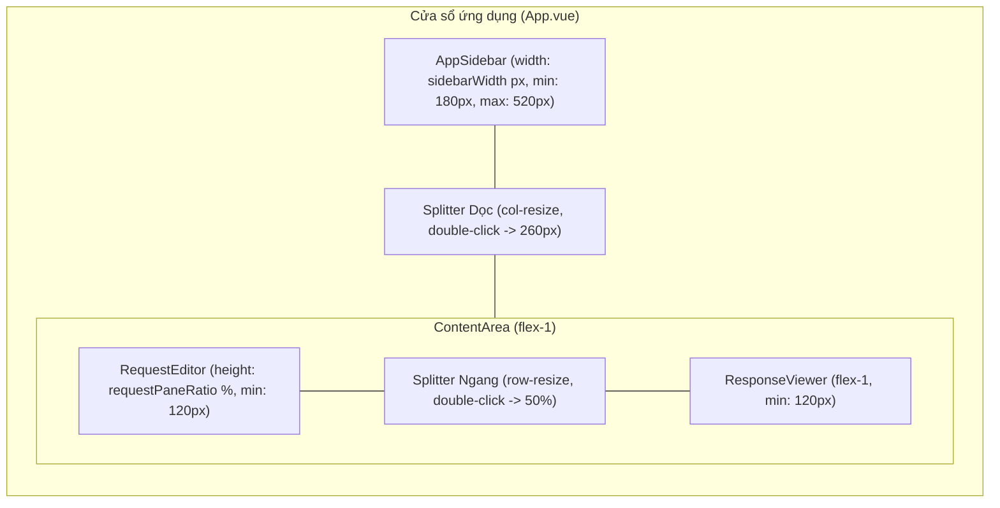
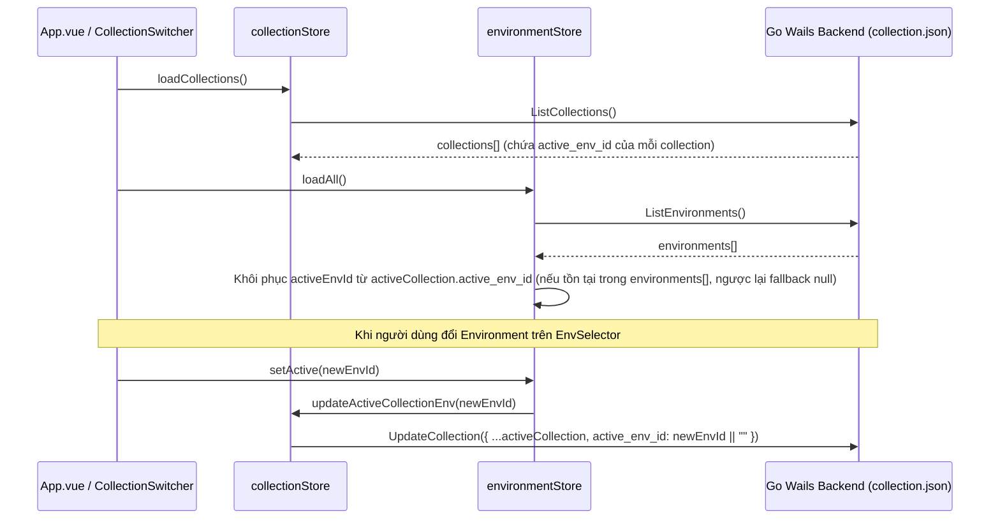

# Kiến Trúc Giao Diện Kéo Giãn & Tương Tác Biến Môi Trường

Tài liệu đồng hành (Companion) cho `SPEC-layout-and-env-ux`. Định nghĩa chi tiết kiến trúc kéo giãn khung nhìn (Resizable Panes), lưu trữ trạng thái Active Environment theo Collection, tự động nhận diện phạm vi môi trường ở Folder Editor, và cơ chế Hover Preview/Inline Edit cho biến môi trường `{{variable}}`.

---

## 1. Kéo Giãn Bố Cục Màn Hình (CAP-1 — Mục 22)

### 1.1. Cấu trúc các khung nhìn (Layout Panes)

Giao diện chính của ứng dụng được chia thành 3 vùng có thể tùy chỉnh kích thước thông qua 2 thanh kéo phân cách (Splitters):

1. **Thanh phân cách dọc (Horizontal Resize — Sidebar ↔ ContentArea):**
   - Nằm tại ranh giới phải của `AppSidebar.vue` và bên trái `ContentArea.vue`.
   - Điều chỉnh chiều rộng của `AppSidebar`:
     - Mặc định: `260px`
     - Tối thiểu (Min): `180px`
     - Tối đa (Max): `Math.min(520, window.innerWidth * 0.5)` (không vượt quá `520px` hoặc `50%` chiều rộng cửa sổ).
2. **Thanh phân cách ngang (Vertical Resize — Top Editor ↔ Bottom ResponseViewer):**
   - Nằm trong `ContentArea.vue`, ngăn cách giữa vùng soạn thảo phía trên (`RequestEditor`) và vùng hiển thị kết quả phía dưới (`ResponseViewer`, chỉ hiển thị khi `collectionStore.activeRequestId != null`).
   - Điều chỉnh tỷ lệ chiều cao (`requestPaneRatio`, tính theo phần trăm `%` chiều cao của `ContentArea`):
     - Mặc định: `50%` (`0.5`)
     - Ngưỡng giới hạn (Clamping): Đảm bảo mỗi vùng trên và dưới luôn có chiều cao tối thiểu `120px` (hoặc tỷ lệ trong khoảng `[15%, 85%]` khi chiều cao cửa sổ nhỏ).



### 1.2. Hành vi tương tác & Lưu trữ trạng thái

- **Kéo thả (Pointer Drag):**
  - Hit-area của thanh splitter rộng tối thiểu `6px` (`cursor-col-resize` cho dọc, `cursor-row-resize` cho ngang), hiển thị đường chỉ báo nổi bật (`bg-brand-primary`) khi hover hoặc đang kéo (`isDragging`).
  - Trong khi kéo, gắn `user-select: none` lên `document.body` để ngăn hiện tượng bôi đen văn bản ngoài ý muốn.
- **Double-click Reset:**
  - Double-click vào splitter dọc khôi phục `sidebarWidth = 260`.
  - Double-click vào splitter ngang khôi phục `requestPaneRatio = 50`.
- **Lưu trữ bền vững (`uiStore.ts` + `localStorage`):**
  - `hecto_sidebar_width`: số nguyên pixel (mặc định `260`).
  - `hecto_request_pane_ratio`: số thực từ `15` đến `85` (mặc định `50`).
  - Đọc và kiểm tra hợp lệ (`Number.isFinite` + clamp trong ngưỡng an toàn) ngay khi khởi tạo `uiStore`.

---

## 2. Lưu Trữ Active Environment Theo Từng Collection (CAP-2 — Mục 28)

### 2.1. Mở rộng mô hình dữ liệu `Collection` (`collection.json`)

Mỗi Collection lưu trữ danh sách biến môi trường riêng trong thư mục `<collection_root>/environments/`. Do đó, trạng thái môi trường đang được kích hoạt (`active_env_id`) được gắn trực tiếp vào metadata của từng Collection trong tệp `<collection_root>/collection.json`:

```json
{
  "id": "default",
  "name": "Default Collection",
  "description": "",
  "active_env_id": "e1111111-2222-4333-8444-555555555555",
  "variables": [],
  "created_at": "2026-10-14T08:00:00Z",
  "updated_at": "2026-10-14T09:00:00Z"
}
```

- **Backend Go (`projects/model/types.go` & `projects/service/collection.go`):**
  - Bổ sung trường `ActiveEnvID string` (`json:"active_env_id,omitempty"`) vào struct `model.Collection`.
  - Trong `CollectionService.UpdateCollection`, bảo toàn hoặc cập nhật trường `existingColl.ActiveEnvID = coll.ActiveEnvID`.
  - Trong `CollectionService.RenameCollection`, đọc toàn bộ `coll` hiện có từ đĩa nên tự động bảo toàn `ActiveEnvID`.
  - **Tương thích ngược:** Nếu tệp `collection.json` cũ không có `"active_env_id"`, Go tự động hiểu là chuỗi rỗng `""` (tương đương `null` / "Không dùng env" trên Frontend).

### 2.2. Luồng đồng bộ giữa `collectionStore` và `environmentStore`



- **Khởi động ứng dụng (`App.vue`):**
  - Đảm bảo `collectionStore.loadCollections()` và `envStore.loadAll()` phối hợp đồng bộ để sau khi cả hai hoàn tất, `envStore.activeEnvId` được gán theo `collectionStore.activeCollection?.active_env_id` (nếu ID đó có tồn tại trong `envStore.environments`, nếu không thì đặt về `null`).
- **Chuyển đổi Collection (`collectionStore.switchCollection`):**
  - Sau khi `SwitchCollection` thành công và nạp lại `loadCollections()` + `envStore.loadAll()`, `envStore.activeEnvId` tự động khôi phục đúng `active_env_id` của Collection mới chuyển sang.
- **Xóa Environment (`environmentStore.remove`):**
  - Nếu người dùng xóa đúng Environment đang là `activeEnvId`, hệ thống tự động đặt `activeEnvId = null` và cập nhật `active_env_id: ""` vào `collection.json`.

---

## 3. Tự Động Nhận Diện Environment Ở Cấp Folder (CAP-3 — Mục 29)

### 3.1. Hành vi trong `FolderEditor.vue`

- Trong `FolderEditor.vue`, biến trạng thái `selectedEnvScope` điều khiển dropdown chọn phạm vi biến ở tab `Variables`.
- **Quy tắc tự động nhận diện (Auto-detect):**
  - Hàm helper xác định scope mặc định theo `envStore.activeEnvId`:
    - Nếu `envStore.activeEnvId` khác `null` và tồn tại trong `envStore.environments`: trả về `envStore.activeEnvId`.
    - Ngược lại (`envStore.activeEnvId === null`): trả về `'__folder_global__'`.
  - Khi mở một thư mục lần đầu (`onMounted` / `loadFolderData`) hoặc khi chuyển sang một thư mục khác (`watch(() => collectionStore.activeFolderId)`): `selectedEnvScope` tự động được đặt theo hàm helper trên.
  - Khi người dùng thay đổi Environment tổng trên `EnvSelector` ở thanh Header (`watch(() => envStore.activeEnvId)`): `selectedEnvScope` cũng tự động cập nhật theo Environment tổng vừa chọn.
  - Trong khi đang ở `FolderEditor`, người dùng vẫn có thể mở dropdown `#folder-env-scope-select` để chuyển thủ công sang `Folder Global Env (Dùng chung)` hoặc một môi trường bất kỳ để xem/chỉnh sửa.

---

## 4. Hover Preview & Chỉnh Sửa Nhanh Biến Môi Trường (CAP-4 — Mục 21)

### 4.1. Ngữ cảnh phả hệ & Quy tắc hiển thị Dropdown Scope trong Popover

Khi người dùng di chuột (hover) vào một token biến `{{varName}}` trong bất kỳ ô nhập liệu nào sử dụng `VariableHighlighter.vue` (`UrlBar.vue`, `KvpEditor.vue` cho Params/Headers/Variables, `BodyEditor.vue`), một popover tương tác (`VariableHoverPopover.vue`) sẽ hiển thị.

Theo yêu cầu thiết kế:
- **Dropdown chọn tầng lưu trữ (Scope Selector) trong Popover** cho phép người dùng chọn giữa **Global/Collection Env** và **tất cả các Folder cha (`all cha folder`)** của request/folder đang mở.
- **Nguyên tắc lọc theo Active Environment:** Ở cả cấp Folder Env lẫn Global Env, **chỉ hiển thị Environment đang active** (tuyệt đối không liệt kê các environment khác không active vào dropdown).

Cụ thể, danh sách các tùy chọn (Options) trong Dropdown Scope của Popover được xây dựng động như sau:

1. **Khi ĐANG CÓ một Environment tổng được kích hoạt (`activeEnvId != null`, ví dụ đang chọn môi trường `Local`):**
   - Cấp Folder (duyệt qua tất cả các thư mục trong phả hệ từ thư mục cha gần nhất hoặc từ gốc đến lá, gồm `F_1, F_2, ...`):
     - `Folder-Env`: **`Folder: <Tên Folder> (Local)`** — tương ứng với `folder.folder_envs[activeEnvId]`.
     - `Folder Global`: **`Folder: <Tên Folder> (Dùng chung)`** — tương ứng với `folder.variables` (hiển thị để nếu biến đang được định nghĩa ở Folder Global hoặc người dùng muốn lưu vào biến chung của Folder cha thì vẫn nhìn thấy và chọn được).
   - Cấp Global / Collection:
     - `Global Env`: **`Global Env (Local)`** — tương ứng với `environments/<activeEnvId>.json`.
     - `Collection Env`: **`Collection Env (Dùng chung)`** — tương ứng với `collection.json -> variables`.

2. **Khi KHÔNG chọn Environment tổng (`activeEnvId === null` — "Không dùng env"):**
   - Cấp Folder (cho từng thư mục cha `F_1, F_2, ...` trong phả hệ):
     - `Folder Global`: **`Folder: <Tên Folder> (Dùng chung)`** — tương ứng với `folder.variables`.
   - Cấp Collection:
     - `Collection Env`: **`Collection Env (Dùng chung)`** — tương ứng với `collection.json -> variables`.

### 4.2. Xác định tầng mặc định khi mở Popover (Default Selected Scope)

Khi người dùng vừa hover vào biến `{{varName}}`:
- Hệ thống kiểm tra biến `varName` theo đúng thứ tự ưu tiên 4 cấp độ (`Collection Env -> Global Env (Active) -> Folder Global Env (Root..Leaf) -> Folder-Env (Active, Root..Leaf)`):
  - **Trường hợp 1 — Biến đã được định nghĩa (`resolved`):**
    - Dropdown Scope tự động chọn đúng **Tầng đang thắng ưu tiên (Winning Tier)** nơi giá trị hiệu lực của `{{varName}}` được lấy ra.
    - Ô input trong Popover hiển thị giá trị hiện tại của biến tại tầng đó.
    - Nếu biến cũng tồn tại ở các tầng thấp hơn (bị ghi đè), hiển thị chú thích nhỏ hoặc ký hiệu cho biết tầng nào đang có chứa biến.
  - **Trường hợp 2 — Biến chưa được định nghĩa ở bất kỳ tầng nào (`missing`):**
    - Hiển thị badge trạng thái `Chưa định nghĩa`.
    - Dropdown Scope mặc định chọn **`Global Env (<Active Env>)`** (nếu đang có Active Env), hoặc **`Collection Env (Dùng chung)`** (nếu không chọn Active Env).
    - Ô input trong Popover để trống (với placeholder `"Nhập giá trị cho {{varName}}..."`), sẵn sàng để người dùng nhập giá trị và tạo mới biến ngay tại tầng đang chọn trong dropdown.

### 4.3. Hành vi khi chuyển đổi Dropdown Scope hoặc Chỉnh sửa Giá trị trong Popover

- **Khi người dùng đổi lựa chọn trong Dropdown Scope của Popover:**
  - Ô input giá trị trong Popover lập tức cập nhật để hiển thị giá trị của biến `varName` tại tầng vừa chọn (nếu biến chưa có ở tầng đó thì ô input hiển thị rỗng kèm gợi ý tạo mới/ghi đè tại tầng đó).
- **Khi người dùng sửa giá trị và xác nhận Lưu (nhấn `Enter`, nhấn nút `Lưu`, hoặc auto-save khi blur/click nút):**
  - Nếu tầng được chọn là **Collection Env**:
    - Cập nhật (hoặc thêm mới với `enabled: true`) biến `varName` trong `collectionStore.activeCollection.variables` và gọi `collectionStore.updateCollectionVariables(...)`.
  - Nếu tầng được chọn là **Global Env (Active Env)**:
    - Cập nhật (hoặc thêm mới với `enabled: true`) biến `varName` trong `envStore.environments` (ứng với `activeEnvId`) và gọi `envStore.save(env)`.
  - Nếu tầng được chọn là **Folder-Env (Active Env)** hoặc **Folder Global Env** của một thư mục `F`:
    - Nạp dữ liệu thư mục `F` (qua `LoadFolder(F.id)`), cập nhật hoặc thêm mới biến `varName` (với `enabled: true`) vào `F.folder_envs[activeEnvId]` (hoặc `F.variables`), gọi `UpdateFolder(F)` và `collectionStore.loadTree()`.
    - Nếu người dùng hiện đang mở chính `FolderEditor` của thư mục `F`, đồng bộ luôn state cục bộ của `FolderEditor` để giao diện phản ánh tức thì.
  - Ngay sau khi lưu, `effectiveVariables` được tính toán lại tự động nhờ tính năng reactive của Vue/Pinia, làm đổi màu highlight (từ đỏ `missing` sang xanh `resolved`) và cập nhật giá trị mới ngay lập tức.

### 4.4. Cơ chế kỹ thuật bắt sự kiện Hover không chặn Input (`VariableHighlighter.vue`)

Vì lớp overlay của `VariableHighlighter.vue` đặt `pointer-events-none` để nhường toàn bộ sự kiện chuột (click đặt con trỏ, kéo bôi đen văn bản, gõ phím, IME composition) cho thẻ `<input>` / `<textarea>` bên dưới:
- Mỗi phần tử `<span data-var-name="key">` của biến trong overlay lưu tên biến và tọa độ hiển thị trên màn hình.
- Thẻ bao ngoài của `VariableHighlighter.vue` lắng nghe sự kiện `@mousemove` và `@mouseleave`:
  - Khi `@mousemove(e)`: Kiểm tra tọa độ `(e.clientX, e.clientY)` có nằm trong hình chữ nhật (`getClientRects()` / `getBoundingClientRect()`) của bất kỳ thẻ `<span data-var-name>` nào trong `overlayRef` hay không.
  - Nếu trúng một biến `{{varName}}`: Sau một khoảng trễ ngắn (hover delay ~150ms để tránh nháy khi lướt chuột nhanh), mở `VariableHoverPopover` thông qua `<Teleport to="body">` định vị ngay phía trên hoặc phía dưới token biến đó (tự động căn chỉnh để không tràn mép cửa sổ).
  - Khi chuột rời khỏi token biến (`@mouseleave`), duy trì một khoảng grace timer (~200ms); nếu người dùng di chuột vào bên trong `VariableHoverPopover`, hủy grace timer để giữ Popover mở cho phép người dùng tương tác với dropdown và ô input sửa giá trị.
  - Khi đang gõ phím trong `<input>`/`<textarea>` chính hoặc nhấn `Escape`, tự động đóng Popover để không che khuất tầm nhìn.

---

## 5. Quy Tắc An Toàn Dữ Liệu Khi Test (Mục 19)

- Mọi kịch bản kiểm thử tự động (Go unit/integration tests, Vitest store/component tests, Playwright E2E tests) bắt buộc chỉ được thao tác trên collection mang tên `Test-Collection` hoặc thư mục tạm độc lập (`t.TempDir()`).
- Tuyệt đối không tác động (đọc/ghi/sửa/xóa) vào collection `default` hay bất kỳ collection thực tế nào của người dùng.
- Tự động dọn dẹp (teardown cleanup) mọi collection tạo mới phục vụ kiểm thử ngay sau khi kịch bản kết thúc.
