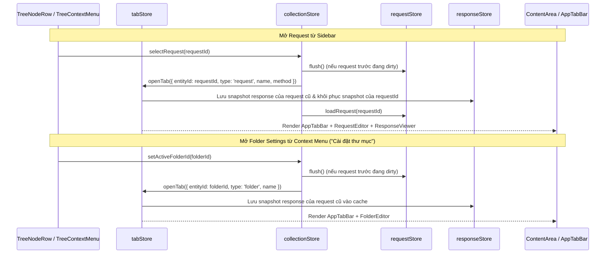
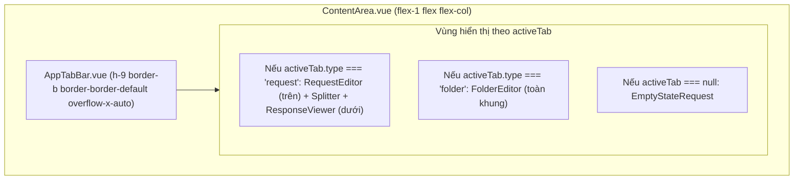

# Kiến Trúc Multisession Tabs Bar, Điều Hướng Thư Mục & Sửa Lỗi Folder Settings

Tài liệu đồng hành (Companion) cho `SPEC-multisession-tabs-and-folder-ux`. Định nghĩa chi tiết kiến trúc `tabStore`, thanh `AppTabBar.vue`, lưu trữ kết quả Response theo từng tab Request, hành vi click thư mục trên Sidebar (`TreeNodeRow.vue`), sửa lỗi ẩn chữ khi nhập `Key` trong `KvpEditor.vue`, và tích hợp phân giải/highlight biến môi trường 4 tầng trong `FolderEditor.vue` & `AuthEditor.vue`.

---

## 1. Quản Lý Đa Phiên Với `tabStore` & `AppTabBar.vue` (CAP-1 — Mục 20)

### 1.1. Mô hình trạng thái `tabStore` (`projects/frontend/src/stores/tabStore.ts`)

```ts
export type TabEntityType = 'request' | 'folder'

export interface TabItem {
  id: string              // Định danh duy nhất: `${type}:${entityId}`
  entityId: string        // UUID của Request hoặc Folder
  type: TabEntityType     // 'request' | 'folder'
  name: string            // Tên hiển thị trên tab
  method?: string         // HTTP Method (chỉ dành cho type === 'request', ví dụ 'GET', 'POST')
  isDirty: boolean        // Cờ báo hiệu có thay đổi chưa lưu (hiển thị chấm amber dot)
}

export interface CachedResponseState {
  response: ExecuteResponse | null
  error: { code: string; message: string } | null
  loading: boolean
  urlInvalid: boolean
}
```

- **Trạng thái chính trong `tabStore`:**
  - `tabs: TabItem[]`: Danh sách các tab đang mở theo thứ tự mở.
  - `activeTabId: string | null`: ID của tab đang được chọn hiển thị trong `ContentArea`.
  - `responseCache: Record<string, CachedResponseState>`: Bộ nhớ đệm lưu kết quả `responseStore` theo `entityId` của từng Request tab đang mở.
- **Getters:**
  - `activeTab`: Trả về `TabItem | null` tương ứng với `activeTabId`.

### 1.2. Luồng hoạt động & Đồng bộ giữa `tabStore`, `collectionStore`, `requestStore`, `responseStore`



- **Mở hoặc kích hoạt Tab (`openTab` & `activateTab`):**
  - Khi người dùng chọn một Request trên Sidebar (`collectionStore.selectRequest(id)`), hoặc tạo mới/nhân bản Request (`createRequest`, `duplicateRequest`), hoặc chọn `"Cài đặt thư mục"` từ Context Menu (`collectionStore.setActiveFolderId(id)`):
    - Nếu tab `${type}:${entityId}` đã tồn tại trong `tabs`: cập nhật `name`/`method` mới nhất và đặt `activeTabId = tab.id`.
    - Nếu chưa tồn tại: thêm `TabItem` mới vào cuối `tabs` và đặt `activeTabId = tab.id`.
  - Khi người dùng click vào một tab trên `AppTabBar.vue` (`tabStore.activateTab(tabId)`):
    - Nếu `tab.type === 'request'`: gọi `collectionStore.selectRequest(tab.entityId)` để nạp dữ liệu request và khôi phục `responseStore` từ `responseCache[tab.entityId]`.
    - Nếu `tab.type === 'folder'`: gọi `collectionStore.setActiveFolderId(tab.entityId)` để hiển thị `FolderEditor` cho thư mục đó.
- **Bảo toàn `responseStore` theo từng Request Tab:**
  - Trước khi chuyển rời khỏi một Request tab `oldRequestId`, `tabStore` lưu trạng thái hiện tại của `responseStore` (`{ response, error, loading, urlInvalid }`) vào `responseCache[oldRequestId]`.
  - Khi chuyển sang một Request tab `newRequestId`, nếu `responseCache[newRequestId]` có dữ liệu, khôi phục lại vào `responseStore`; nếu chưa có thì đặt `responseStore` về trạng thái rỗng ban đầu (`response = null, error = null, loading = false, urlInvalid = false`) mà không hủy kết quả của các tab khác.
  - Khi đóng một Request tab `closedRequestId`, xóa `delete responseCache[closedRequestId]`.
- **Đóng Tab (`closeTab`):**
  - Hỗ trợ 3 cách đóng tab:
    1. Click nút `✕` (`[data-test="tab-close-btn"]`) trên tab.
    2. Click chuột giữa (`e.button === 1` trên `@auxclick` / `@mousedown`) vào tab.
    3. Nhấn phím tắt `Ctrl+W` (hoặc `Cmd+W`) để đóng `activeTabId` hiện tại.
  - Nếu tab bị đóng đang là tab active và có thay đổi chưa lưu (`isDirty`), thực hiện flush/save an toàn trước khi đóng.
  - Sau khi xóa tab tại vị trí `idx` khỏi mảng `tabs`:
    - Nếu tab bị đóng là `activeTabId`:
      - Nếu mảng `tabs` vẫn còn phần tử: chọn tab kế tiếp tại `Math.min(idx, tabs.length - 1)` làm tab active mới và kích hoạt nó (`selectRequest` hoặc `setActiveFolderId`).
      - Nếu `tabs` rỗng (`tabs.length === 0`): đặt `activeTabId = null`, `collectionStore.activeRequestId = null`, `collectionStore.activeFolderId = null`, `requestStore.clearRequest()`, `responseStore.clear()`.
    - Nếu tab bị đóng không phải là `activeTabId`: giữ nguyên `activeTabId` hiện tại mà không làm gián đoạn công việc.
- **Đồng bộ vòng đời với Sidebar & Editor:**
  - **Đổi tên (`renameRequest`, `renameFolder`):** Cập nhật ngay thuộc tính `name` của tab tương ứng trong `tabStore.tabs`.
  - **Đổi HTTP Method (`requestStore.current.method`):** Khi người dùng đổi method trên `UrlBar.vue` hoặc khi `requestStore` nạp request, cập nhật ngay `method` của tab request đang mở.
  - **Trạng thái chưa lưu (`isDirty`):**
    - Với Request tab: đồng bộ `tab.isDirty = requestStore.isDirty` khi `requestStore.current?.id === tab.entityId`.
    - Với Folder tab: `FolderEditor.vue` đồng bộ trạng thái `isDirty` của thư mục đang mở vào `tabStore.setTabDirty('folder', folderId, isDirty)`.
  - **Xóa Request (`deleteRequest(id)`):** Tự động gọi `tabStore.closeTabByEntity('request', id)` để đóng tab của request vừa xóa và tự động chuyển sang tab kế bên (nếu có).
  - **Xóa Folder (`deleteFolder(id)`):** Trước khi xóa thư mục, thu thập danh sách ID của thư mục `id` và toàn bộ các thư mục con / request con bên trong nhánh cây đó; sau khi xóa thành công, đóng toàn bộ các tab thuộc tập ID vừa thu thập.
  - **Chuyển đổi / Xóa / Làm mới Collection (`switchCollection`, `deleteCollection`, `refresh`):** Gọi `tabStore.clearAllTabs()` để xóa toàn bộ danh sách tab và `responseCache` của Collection cũ.

### 1.3. Giao diện `AppTabBar.vue` & Bố cục `ContentArea.vue`



- **Thiết kế `AppTabBar.vue`:**
  - Chiều cao `36px` (`h-9`), nền `bg-surface-base`, viền dưới `border-b border-border-default`, cuộn ngang mượt (`overflow-x-auto hide-scrollbar`).
  - Mỗi phần tử tab (`[data-test="app-tab-item"]`):
    - Hiển thị viền trên hoặc viền dưới nổi bật (`border-b-2 border-brand-primary bg-surface-raised text-text-primary`) khi là tab active; nền `bg-surface-base text-text-secondary hover:bg-surface-hover` khi không active.
    - Badge Method (in đậm `text-[10px] font-mono`, tô màu theo method `GET`/`POST`/`PUT`/`PATCH`/`DELETE`) đối với Request tab; hoặc biểu tượng Folder (`svg` `w-3.5 h-3.5 text-text-muted`) đối với Folder tab.
    - Tên tab (`max-w-[160px] truncate ui-sm`).
    - Chấm tròn hổ phách (`w-2 h-2 rounded-full bg-unsaved-dot`, `data-test="tab-unsaved-dot"`) khi `tab.isDirty === true`.
    - Nút đóng `✕` (`[data-test="tab-close-btn"]`) hiển thị rõ khi hover hoặc trên tab active.

---

## 2. Hành Vi Click Thư Mục Trên Sidebar (CAP-2 — Mục 30)

### 2.1. Thay đổi trong `TreeNodeRow.vue`

- Hiện tại trong `TreeNodeRow.vue`:
  ```ts
  const toggle = () => {
    if (isEditing.value) return
    if (isFolder.value) {
      store.toggleFolder(props.node.id)
      void store.selectFolder(props.node.id) // <-- Gây lỗi tự động mở FolderEditor khi chỉ muốn đóng/mở cây
    } else {
      store.selectRequest(props.node.id)
    }
  }
  ```
- **Hành vi chuẩn mới:**
  - Khi `isFolder.value === true`, hàm `toggle()` **chỉ gọi duy nhất `store.toggleFolder(props.node.id)`**, tuyệt đối không gọi `store.selectFolder(props.node.id)`.
  - Trạng thái `isActive` của hàng thư mục trên Sidebar chỉ sáng lên khi tab đang active hiện tại thực sự là tab của thư mục đó (`store.activeFolderId === props.node.id && !store.activeRequestId`).
- **Mở cài đặt thư mục có chủ đích:**
  - Khi người dùng mở Context Menu trên thư mục (click chuột phải hoặc nhấn nút `...`) và chọn **"Cài đặt thư mục"** (`handleFolderSettings` trong `TreeContextMenu.vue`), hệ thống gọi `collectionStore.setActiveFolderId(nodeId)` — hàm này sẽ đồng thời mở/kích hoạt tab Folder trong `tabStore` và hiển thị `FolderEditor.vue`.

---

## 3. Sửa Lỗi Ẩn Key Trong `KvpEditor.vue` & Biến Môi Trường Trong `FolderEditor.vue` / `AuthEditor.vue` (CAP-3, CAP-4 — Mục 31)

### 3.1. Sửa lỗi gõ Key bị ẩn trong `KvpEditor.vue` (CAP-3)

- **Nguyên nhân:**
  - Trong `KvpEditor.vue`, ô `<input placeholder="Key">` ở cột `Key` đang được bọc bởi `<VariableHighlighter :single-line="true">` và gắn class `text-transparent`. Vì lớp phủ single-line bên trong khung `min-h-[32px]` không có chiều cao cố định hoặc khi gõ phím vào dòng phantom row của `FolderEditor`, văn bản trong `<input>` bị `text-transparent` làm ẩn đi. Hơn nữa, cột `Key` là nơi khai báo tên biến / tên header / tên param nên về mặt nghiệp vụ không cần highlight biến `{{...}}`.
- **Giải pháp kỹ thuật trong `KvpEditor.vue`:**
  - Tháo bỏ `<VariableHighlighter>` khỏi cột `Key` (và xóa mảng ref `keyHighlighterRefs` không còn dùng đến).
  - Trên thẻ `<input type="text" placeholder="Key">`:
    - Thay class `text-transparent` và `transparent-selection` bằng `text-text-primary`.
    - Giữ nguyên đầy đủ các sự kiện `@compositionstart="ensureRealRow(index)"`, `@input="e => onCellInput(index, 'key', e)"`, `@compositionend="e => onCellInput(index, 'key', e)"` và ref `keyInputs[index]`.
  - Ở cột `Value`, giữ nguyên `<VariableHighlighter>` bọc ngoài `<textarea placeholder="Value">` để tiếp tục hỗ trợ highlight và hover preview biến `{{variable}}`.
  - Trong `FolderEditor.vue`, đảm bảo getter/setter của `currentScopeVariables` luôn khởi tạo mảng thực `folder_envs.value[selectedEnvScope.value]` nếu chưa có để việc thêm dòng mới từ phantom row luôn tham chiếu trực tiếp vào state gốc.

### 3.2. Phân giải biến 4 tầng, Highlight & Preview trong `FolderEditor.vue` và `AuthEditor.vue` (CAP-4)

- **Ngữ cảnh biến trong `FolderEditor.vue`:**
  - `FolderEditor.vue` tính toán `folderHierarchyNodes` bao gồm toàn bộ các thư mục cha (`parentNodes`) từ gốc đến cha trực tiếp cộng với chính thư mục đang mở (với `variables` và `folder_envs` phản ánh trực tiếp state đang chỉnh sửa).
  - `effectiveVariables` được tính qua `resolveHierarchyVariables` theo đúng 4 tầng:
    1. `Collection Env` (`collectionStore.activeCollection?.variables`)
    2. `Active Global Env` (`envStore.variablesMap` / biến của `envStore.activeEnvId`)
    3. `Folder Global Env` (`parentNodes` -> `currentFolder`)
    4. `Folder-Env` theo `envStore.activeEnvId` (`parentNodes` -> `currentFolder`)
  - `FolderEditor.vue` cung cấp `provide('effectiveVariables', effectiveVariables)` và `provide('variableHierarchyFolders', folderHierarchyNodes)` cho toàn bộ các component con bên trong (`KvpEditor.vue` ở tab `Headers`/`Variables` và `AuthEditor.vue` ở tab `Auth`).
  - Trong tab `Headers` của `FolderEditor.vue` và `RequestEditor.vue` (`DefaultHeadersTable`), đảm bảo các giá trị header kế thừa từ thư mục cha hoặc từ Auth được phân giải biến từ `effectiveVariables` khi hiển thị preview.
- **Sửa lỗi tự động ẩn khi gõ & Tích hợp `VariableHighlighter` trong `AuthEditor.vue`:**
  - **Sửa lỗi tự động ẩn ký tự khi đang gõ:**
    - Trong `AuthEditor.vue`, xóa bỏ `watch(() => props.modelValue, () => { showBearerToken.value = false; showBasicPassword.value = false; showApiKeyValue.value = false })` (vì mỗi lần người dùng gõ 1 ký tự vào ô Token, Password hay API Key Value, `emit('update:modelValue', ...)` tạo ra object mới làm watcher chạy và lập tức chuyển ô input về lại `type="password"` gây ẩn mất nội dung đang nhập).
    - Chỉ reset các cờ `showBearerToken`, `showBasicPassword`, `showApiKeyValue` khi chuyển sang một Request hoặc Folder khác (theo dõi `collectionStore.activeRequestId` và `collectionStore.activeFolderId`).
  - **Tích hợp `VariableHighlighter` vào `AuthEditor.vue`:**
    - Trên ô `Basic Auth Username` (`#basic-username-input`): bọc trong `<VariableHighlighter :value="basicUsername" :single-line="false" :wrap="false">` (hoặc hiển thị overlay chuẩn) để luôn highlight biến `{{username}}` và hỗ trợ hover mở `VariableHoverPopover`.
    - Trên các ô có nút bật/tắt hiển thị (`#bearer-token-input`, `#basic-password-input`, `#api-key-val-input`):
      - Khi người dùng bật hiện văn bản (`showBearerToken === true`, `showBasicPassword === true`, `showApiKeyValue === true`) **HOẶC** khi giá trị chứa cú pháp biến `{{...}}` (ví dụ `{{token}}`, `{{password}}`, `{{apiKey}}`), hiển thị ở chế độ văn bản (`type="text"`) kết hợp `<VariableHighlighter>` để tô màu biến (`text-variable-valid` / `text-variable-missing`) và cho phép di chuột mở `VariableHoverPopover` xem/sửa giá trị biến từ `Collection Env / Active Global Env / Folder cha`.
      - Khi giá trị là chuỗi mật khẩu tĩnh (không chứa `{{...}}`) và người dùng đang để chế độ ẩn (`show... === false`), giữ nguyên `<input type="password">` với chữ `text-text-primary` để bảo mật.
      - Ô `API Key -> Key` (`#api-key-name-input`): giữ `<input type="text" class="... text-text-primary ...">` tương tự cột `Key` của `KvpEditor.vue` để gõ tên khóa luôn hiển thị rõ ràng.

---

## 4. Quy Tắc An Toàn Dữ Liệu Khi Test (Mục 19)

- Mọi kịch bản kiểm thử tự động (Go unit/integration tests, Vitest store/component tests, Playwright E2E tests) bắt buộc chỉ được thao tác trên collection mang tên `Test-Collection` hoặc thư mục tạm độc lập (`t.TempDir()`).
- Tuyệt đối không tác động (đọc/ghi/sửa/xóa) vào collection `default` hay bất kỳ collection thực tế nào của người dùng.
- Tự động dọn dẹp (teardown cleanup) mọi collection tạo mới phục vụ kiểm thử ngay sau khi kịch bản kết thúc.
